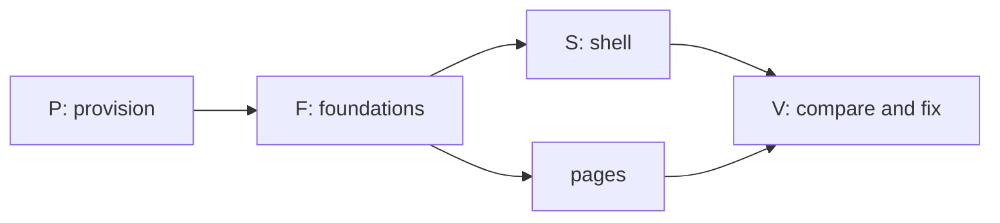

# Prompt: build the Syrius desktop redesign from the mockups

Open a session in this folder, the root of the Syrius repository, and tell
it: `Follow PROMPT-redesign-build.md`. Every path below is relative to this
folder.

This file is the instructions and the record of progress. The coordinator and
its subagents write their progress into the Progress section at the end, so a
session that starts later, or after the context was cleared, reads this file
and carries on from it.

---

## The task

Make the Syrius desktop wallet in this tree look and move the way
`mockups/redesign/` shows: every one of its 47 screens, in both themes, with
the same layout, the same effects and the same transitions. Where a screen
shows a feature the wallet cannot do yet, draw it as the mockup does but do
not let it run: put a seam in the code where the feature will be filled in
later.

You coordinate. Subagents do the microtasks below, up to four at once, each
on one small task with a fresh context. You provision, build, run, commit,
compare and dispatch.

## Assume you have never built Syrius

Nothing about this machine or this tree is taken from memory, an earlier
session, or a file that says it is done. Every tool, version, path and claim
is checked on disk before it is used.

- This file's Progress section is how the work resumes, but it is a record,
  not proof: a row marked `done` names its commit, and the commit is found in
  `git log` before anything is built on it.
- `HANDOFF.md`, when present (it is local, not in git), and its "Redesign
  build (Task 41)" table describe an earlier pass at the same work. Rows marked `done` there are claims. Reuse the code
  they point at where it exists and matches the mockup; otherwise fix it.
- The branch is `redesign`. Look at `git status` and `git log` before the
  first change, and commit nothing you did not read.

## Read first

1. `docs/design/RULES.md`: the owner's interface rules. They bind: motion
   always runs (never follow the OS reduced-motion setting), interface text
   is as short as it can be, no em dashes in it, balances with no trailing
   zeros, diagrams in docs are Mermaid.
2. `AGENTS.md`: the BLoC feature layout, generated files, the pinned and
   patched packages.
3. `mockups/redesign/README.md`: the plan. Its Motion, Shaders, Dollar values
   and "The original animations" tables are the specification for effects.
   "Not drawn" lists screens that follow a drawn pattern; build those to the
   pattern.
4. `mockups/redesign/src/*.html`: each `<section class="scr" id="…">` is one
   screen, with notes under it saying what is at rest, what is one click
   away, what moves, what was dropped. `src/00-head.html` holds the CSS: the
   colours, type, radii and gaps of both themes.
5. `mockups/redesign/shots/NN-<id>-<theme>.png`: each screen at 1280 by 780,
   dark and light. These pictures are what "done" is measured against.
6. `docs/flutter-dev-practices.md` and `docs/research/modern-flutter-stack.md`
   for how motion and shaders are built here; `harness/README.md` for driving
   the wallet; `tools/devnet/lab/README.md` for the chain it sends on.

Some files here (`docs/research/`, `HANDOFF.md`) cite paths in other
repositories or on another machine as their sources. You do not need them,
and you do not go looking for them.

## Hard rules

- **Stay in this folder.** Read and write nothing outside it, except the
  tools you install, what `tools/devnet/lab/lab.sh` fetches into its own
  `.build/`, and Docker's own state. If something seems to need a file from
  elsewhere, stop and ask.
- **Never touch the real wallet.** Real wallets live in `%AppData%\znn`. Run
  the wallet only through `harness/h start`, which moves APPDATA, LOCALAPPDATA,
  TEMP, HOME and USERPROFILE into a profile under `.harness/`, or with those
  variables redirected by hand for `flutter run`. Syrius allows one window per
  desktop: check no `syrius.exe` is running before you start one, and stop
  only what you started.
- **No new dependency.** The packages the mockup's effects need are in
  `pubspec.yaml` already (`animations`, `flutter_animate`, `flutter_shaders`,
  `lottie`). If a task cannot be done without one, it stops and says so.
- `flutter pub get` rewrites `analysis_options.yaml` and `pubspec.lock`;
  restore them before each commit unless the change was meant.
- Elevation (an installer's UAC prompt, enabling Developer Mode) is the
  owner's to grant: list what needs it and ask once, together.
- Keep the tree compiling at every commit. Commit on `redesign` only, new
  commits, never amends, never a push unless the owner asks.
- Writing, in code and docs: say what a thing is and why it is that way, name
  the failure that motivated a constraint, leave out encouragement. Comments
  explain the decision, not the syntax. Reports back are short.

## Seams: a feature that is drawn but not built

Missing means the logic behind the control does not exist in this tree: a
service, a chain call, a file format, a platform API. It does not mean "the
widget is not drawn yet"; drawing is the task.

Task F03 builds the seam kit before any page task starts. Every page task
uses it the same way:

- `lib/seams/seam.dart`: `enum Seam` with one value per missing feature, and
  `SeamGate(seam:, child:)`. The child is drawn exactly as the mockup draws
  it, then held disabled: no tap, no keyboard activation, the cursor stays
  basic, a tooltip of two words ("Not yet"). Its Go to entry and its shortcut
  refuse the same way.
- A missing service is an interface plus an `Unbuilt…` implementation that
  throws `SeamNotBuilt(Seam.x)`. Nothing calls the network or the chain for
  it, and no fake result is shown as real.
- Each seam is listed in `lib/seams/SEAMS.md`: the value, the screens it
  gates, the file to fill in, and the brief in `docs/research/` that describes
  it. A test fails when an enum value has no row there.
- Candidates from the mockup, to be confirmed against the tree by each task:
  Zap send and receive, the wallet picker at unlock, operator modes, the
  GitHub update notice, Windows Hello, WalletConnect approvals in the bell,
  the Sporks group, the Ledger flow. Anything the tree already does is wired,
  not seamed.

## End state

The work is done when all of these hold:

1. On a clean checkout, `docs/environment.md` lists every tool with its
   version and how it was installed, and following it gives a working debug
   and release build of the wallet on Windows.
2. `flutter analyze` reports no error or warning, and `flutter test` passes.
3. For each of the 47 screen ids and each theme, a harness script drives the
   wallet into that state at a 1280 by 780 client area and takes a shot.
   `mockups/redesign/compare/index.html` shows each shot beside its mockup
   shot with a diff, and every pair is marked `match` in the Screens table of
   the Progress section.
   A pair matches when the layout, components, colours, type, spacing, icons
   and animation frames shown agree. Allowed differences: the example figures,
   names and addresses, live data, and font hinting.
4. Every row of the mockup's Motion table and Shaders table plays in the
   running build as specified, checked by eye in the built wallet and, where a
   test can hold it, by a widget test on its duration and curve.
   `harness/h stalls` during a page change, a disclosure and the launch shows
   no frame over 16 ms that the old build did not also have.
5. Every seam is in `SEAMS.md`, and none of them can be set off from the
   interface.

## Order



P runs one task at a time: it installs and builds, and builds collide. F
starts when P is done; S and the page groups start when F03 (seams) and F01
(tokens) are committed, and each page group also needs the shared parts it
names. V runs as pages land, not only at the end.

## How the coordinator works

1. **Start from the Progress section.** Read it whole. A row left at `run`
   by a session that ended is checked against the disk (its files, `git
   status`) and set back to `todo` with a note of what was found.
2. Dispatch up to four `general-purpose` agents, each on one row whose
   dependencies are `done` and whose write paths no running row shares.
   Give each the brief template below, filled in. The agent marks its own
   row as it goes (see "Keeping the Progress section").
3. When a row reports: read the diff, run `flutter analyze --no-pub` on its
   files and its tests, add any strings it reported, commit it, set the row
   to `done` with the commit's short hash, and dispatch the next.
4. After every four rows: full `flutter test`, `harness/h build`, run the
   screen scripts of the screens those rows touched, rebuild the compare
   page, and look at it. Mark each pair looked at in the Screens table. Each
   mismatch becomes a new row (`X01`, `X02`, …) appended to the Rows table,
   naming the screen, the difference and the write paths.
5. Rewrite the "Now" lines of the Progress section after each of steps 3 and
   4, and before anything that can end the session (a long build, a
   restart).
6. Never build or run the harness while an agent is writing.
7. A row that fails twice is split, not retried as it was.

### Keeping the Progress section

Several agents write to this file at once, so every write is small and
exact:

- Only the Edit tool, replacing one whole line that is yours: your row in the
  Rows table, or, for the coordinator, the "Now" lines, the Screens table and
  new `X` rows. Never Write this file, never reformat it, never touch another
  agent's line. If the edit is refused because the file changed, read it
  again and redo the one edit.
- Times are UTC from `date -u +%Y-%m-%dT%H:%MZ`, never an estimate.
- A note is one short line: what is true now, not the history. No `|`, no
  em dashes.
- States: `todo`, `run` (an agent has it), `review` (the agent finished; the
  coordinator has not committed it), `done` (committed, hash in the note),
  `blocked` (the note says on what). In the Screens table: `todo`, `match`,
  or the `X` row that holds the difference.

### Brief template

```
Row <ID>: <what>.
Mockup: mockups/redesign/src/<file>.html, sections <ids>;
shots mockups/redesign/shots/<NN>-<id>-dark.png and -light.png.
Spec rows: <Motion / Shaders / Dollar values rows that apply>.
Write only: <paths>, and your row's line in PROMPT-redesign-build.md.
Read anything in this repository.

Progress: follow "Keeping the Progress section" in PROMPT-redesign-build.md.
Set your row to run when you start, update its note after each step that
lands (drawn, wired, tests passing), and set it to review with a one-line
summary as the last thing before your report. If you stop on a problem,
set it to blocked and say on what.

First check what exists at those paths and whether it already matches the
mockup; change only what does not. Draw what the mockup draws. If the logic
behind a control does not exist in the tree, gate it with SeamGate and add
its row to lib/seams/SEAMS.md; do not build the missing service.

Do not: run flutter build, flutter run, flutter pub get or harness/h; write
to git; add a dependency; kill a process you did not start; bulk-replace
with a script. Use Edit and Write for Dart and ARB files.

Follow docs/design/RULES.md. Read nothing outside this repository.
Colours, gaps and radii from AppTokens.of(context), never literals.
Directional padding. Amounts and addresses in Ltr; balances through
AmountText (no trailing zeros). Motion always runs; nothing on money moves
except ValueFlash. Interface text as short as it can be, no em dashes.
Comments say why. New strings: append to lib/l10n/app_en.arb only, then
flutter gen-l10n (re-read the file if the edit is refused; another agent may
have appended).

Write harness/screens/<id>.txt for each screen you own: the harness lines
that bring the wallet from unlocked Home to that state. Do not run it.

Done when: flutter analyze --no-pub <your files> is clean, and
flutter test --no-pub --timeout 60s <your test dir> passes.
Report in at most 25 lines: files written, tests, seams added, strings
added, what does not yet match the shot and why, what you found. Then stop.
```

## Microtasks

`Needs` names rows that must be committed first. Paths are relative to the
repository; `features/` is `lib/rearchitecture/features/`, `tabs/` is
`lib/widgets/tab_children_widgets/`, `modular/` is
`lib/widgets/modular_widgets/`, `utils/widgets/` is
`lib/rearchitecture/utils/widgets/`.

### P: provision (one at a time; the coordinator or one agent)

| Row | What | Writes | Needs |
| --- | --- | --- | --- |
| P01 | Inventory, read only: Windows version, Git with Git Bash, Visual Studio or Build Tools with the "Desktop development with C++" workload (MSVC, CMake, a Windows SDK), Flutter and Dart, Python 3 with Pillow, Node (the lab's scripts), Chrome or Edge, Docker Desktop, Developer Mode (Flutter's Windows plugins need symlinks). Record what is present, with versions, and what is missing | `docs/environment.md` | |
| P02 | Choose the Flutter version: the newest stable that satisfies `pubspec.yaml`'s Dart constraint and resolves `pubspec.lock`; note where it differs from `FLUTTER_VERSION` in `.github/workflows/` and why | `docs/environment.md` | P01 |
| P03 | Install what P01 found missing (winget where it can; Flutter as a git checkout of the chosen tag). One list of elevation prompts to the owner first | `docs/environment.md` | P02 |
| P04 | `flutter config --enable-windows-desktop`; `flutter doctor -v` clean for Windows desktop. Record any warning left and why it does not matter | `docs/environment.md` | P03 |
| P05 | Dependencies and generated code: `flutter pub get` (then restore the two files it rewrites), `dart run build_runner build --delete-conflicting-outputs` if any `*.g.dart` is stale, `flutter gen-l10n`. Check the `libznn` blobs in `lib/embedded_node/blobs/` load on Windows | generated files only | P04 |
| P06 | Baseline: `flutter analyze`, `flutter test`, `flutter build windows --release` and `--debug`. Record times, test count and every existing warning, so later rows are judged against it | `docs/environment.md` | P05 |
| P07 | Debug loop: `flutter run -d windows` with the profile variables redirected, hot reload and hot restart, DevTools attached, a breakpoint hit. Write the exact recipe | `docs/environment.md` | P06 |
| P08 | Harness: `harness/h build`, `start --fresh`, onboarding, `tour` with no error widget and no SEVERE log | `docs/environment.md` | P06 |
| P09 | Lab devnet: `tools/devnet/lab/lab.sh up` (chain 321; it fetches go-zenon at a pinned commit and builds the image), `status` says producing, the devnet mnemonic from its README imported into the harness profile, `harness/h chain 321`, index 1 selected, one send confirmed | `docs/environment.md` | P08 |
| P10 | Mockup pipeline: `python art.py` and `python build.py shots` in `mockups/redesign/` reproduce `shots/` (diff a few); proves Chrome and Python | none | P04 |

### F: foundations (four at once)

| Row | What | Writes | Needs |
| --- | --- | --- | --- |
| F01 | Tokens: every CSS variable in `src/00-head.html`, both themes (colours, type scale, radii, gaps, shadows, glass), mapped one to one into `AppTokens` and the two `ThemeData`s; a table in the file's doc comment of mockup name to token | `lib/utils/app_theme.dart`, `lib/utils/app_colors.dart`, `test/theme/` | P |
| F02 | Fonts: the families and weights the mockup inlines, bundled and declared. The coordinator edits `pubspec.yaml` from the agent's report | `assets/fonts/`, report for `pubspec.yaml` | P |
| F03 | Seam kit, as specified above, with its test | `lib/seams/`, `test/seams/` | P |
| F04 | Harness additions: `theme dark\|light`, `window` sized by client area in logical pixels at 1280 by 780, and `screens <id>\|all` that runs `harness/screens/<id>.txt` in both themes and saves `.harness/shots/<NN>-<id>-<theme>.png` | `harness/bin/`, `harness/app/`, `harness/README.md` | P08 |
| F05 | Compare page: `tool/redesign_compare.py` pairs `.harness/shots/` with `mockups/redesign/shots/`, writes `mockups/redesign/compare/index.html` (side by side, a diff image, a per-pair score, the screen's notes) | `tool/redesign_compare.py`, `mockups/redesign/compare/` | P10 |
| F06 | Seed data: `harness/seed/` scripts of harness lines that give the lab the states the shots need, done through the wallet itself (a stake, a fuse, a token owned, a swap, a project, a second funded address). Index 1 already owns pillar `dev1` and three fuses. States the lab cannot reach (a sentinel, a fuse old enough to cancel) get a fixture injected through `harness/app/` only, never linked into an ordinary build | `harness/seed/`, `harness/app/fixtures/` | P09 |
| F07 | `Segment` (one sliding thumb, 360 ms `(.65,0,.35,1)`, arrow keys) and `Disclosure` (240 ms slide 8 px, chevron 220 ms, state kept by key) | `utils/widgets/segment.dart`, `disclosure.dart`, their tests | F01 |
| F08 | `PageStrip` (headline figures, 48 px lead slot, main action) and `EmptyNote` (no-data mark at 44 px with "None yet", 16 px on one-line cards) | `utils/widgets/page/`, `test/page_strip/` | F01 |
| F09 | `RowDetail` (a row that opens its details under itself) and the list entrance (40 ms stagger, once) | `utils/widgets/row_detail.dart`, `test/row_detail/` | F01 |
| F10 | Motion kit: `RiseSwitcher` with fade through (320 ms, rise 6 px), `ValueFlash` (one 1.2 s flash; a new row rises 6 px over 320 ms), `Skeleton` sweep (1.4 s, in step across the page) | `utils/widgets/motion/`, `test/motion/` | F01 |
| F11 | Frost: blurred backdrop for dialogs, Go to, the bell panel, menus, the lock and ready cards; one `BackdropGroup` where several share it; dialogs rise 6 px | `lib/widgets/reusable_widgets/modals/`, `test/frost/` | F01 |
| F12 | Primary pill: its look per theme and the 600 ms sheen on hover and once when the action lands | `lib/widgets/reusable_widgets/buttons/`, `test/sheen/` | F01 |
| F13 | Shaders: hero field (Home, lock, Welcome), plasma glow, meter flow; each in a `RepaintBoundary`, one ticker, stopped when its page is hidden or the window loses focus | `lib/rearchitecture/utils/shaders/`, `shaders/`, `test/shaders/` | F01 |
| F14 | Lottie rules in `AppLottie`: play once when the surface appears, hold the last frame, replay on hover; the three loops; nothing below 40 px; `_small` files at 48 px | `lib/widgets/reusable_widgets/app_lottie.dart`, `test/app_lottie/` | F01 |
| F15 | `LaunchFilm`: animated WebP a frame at a time (window file and well file), start frame, hold, replay, skip; the assets from `tool/lottie_reencode.py` if absent | `lib/widgets/reusable_widgets/launch_film.dart`, `assets/images/launch*.webp`, `tool/`, `test/launch_film/` | F01 |
| F16 | Dollar values: price feed (CoinGecko `zenon-2` and `quasar`, once a minute while listened to, last answer kept), `DollarText` (dim, mono, 13 px; four decimals under a dollar; `≈` on sums), the setting key, on | `lib/services/price_feed.dart`, `utils/widgets/dollar_text.dart`, `test/price_feed/` | F01 |
| F17 | Hidden balances: one notifier, `HiddenAmount` dots, the eye on the original Lottie (frames 0 to 30, 200 to 232) | `lib/utils/notifiers/balance_visibility.dart`, `utils/widgets/eye_toggle.dart`, `test/hidden_balances/` | F14 |
| F18 | Toast: rises 300 ms, bar drains over 5 s, hover pauses, self-dismissing | `lib/utils/toast_utils.dart`, its widget, `test/toast/` | F01 |

### S: shell (`10-home.html` shows it on every screen)

| Row | What | Screens | Writes | Needs |
| --- | --- | --- | --- | --- |
| S01 | Rail: 56 px icons, tooltips with shortcuts, chevron to 200 px (200 ms spring, labels fade 150 ms after), state kept across restarts; Home, Transfer, Staking, Nodes, Plasma, Tokens, Swap, Accelerator, then bell, Settings, Lock | all | `lib/widgets/shell/rail.dart`, `test/shell/rail/` | F01, F03 |
| S02 | Status strip: sync, node, chain, peers; sync dot pulse 2.4 s, amber when behind; in-flight block chip; plasma generating with the bolt, elapsed and typical time; update line slot (seam) | all | `lib/widgets/shell/status_strip.dart`, `lib/widgets/shell/strip/`, `test/shell/strip_test.dart` | F03, F14 |
| S03 | Bell panel: dot for unseen, slides 24 px over 240 ms with frost, what needs the user first, runs folded ("Block published × 6") | `home-bell` | `lib/widgets/shell/bell_panel.dart`, `tabs/notifications_tab_child.dart` | F11 |
| S04 | Go to (Ctrl K): pages, actions, addresses, contacts; seamed actions refuse | `home-goto` | `utils/widgets/go_to_palette.dart` | F03, F11 |
| S05 | Shortcuts: Ctrl 1 to 8, Ctrl L, R, H, comma, Esc; page change by fade through | all | `lib/widgets/shell/shortcuts.dart`, `lib/widgets/shell/shell.dart` | S01, F10 |

### Home (`10-home.html`)

| Row | What | Screens | Writes | Needs |
| --- | --- | --- | --- | --- |
| H01 | Hero: balances with dollar values, the eye, Send / Receive / Zap pills, hero field behind; no refresh icons | `home-rest` | `features/home/view/` hero files | F13, F16, F17, F12 |
| H02 | Side cards: To collect on one line with Collect all, Tokens closed (opens in place), Pending only while a block is in flight | `home-rest`, `home-open` | `features/home/view/` side files, `features/pending_transactions/` | F07, F08 |
| H03 | Activity list: rows say what moved, Message on a zap row (seam if Zap is), hidden state hides amounts | `home-rest`, `home-hidden` | `features/latest_transactions/` | F09, F17 |
| H04 | "A zap arrived": 28 sparks over 900 ms, once per hash (gate on the Zap seam if receive is missing) | `home-zap` | `features/home/view/zap_sparks.dart` | F03 |

### Transfer (`20-transfer.html`)

| Row | What | Screens | Writes | Needs |
| --- | --- | --- | --- | --- |
| T01 | One 640 px card, `Segment` Send / Receive / Zap; To receive below only with rows; Receive blocked while a receive runs | all transfer | `features/transfer/`, `tabs/transfer_tab_child.dart` | F07 |
| T02 | Send: recent chips, book icon, dollar line, look-alike and first-time warning, node-behind note | `send-rest`, `send-warn` | `features/send/` | T01, F16 |
| T03 | Receive: address, Show QR, request an amount | `receive`, `receive-qr` | `features/receive/` | T01 |
| T04 | Confirm dialog in the transfer shape (`docs/design/RULES.md` section 8), the block followed to its momentum | `send-confirm` | send dialog files | F11, T02 |
| T05 | Zap tab as drawn; behind its seam if the Zap service is missing | `zap-form` | `features/zap/` | T01, F03 |

### Staking and Nodes (`30-earn.html`)

| Row | What | Screens | Writes | Needs |
| --- | --- | --- | --- | --- |
| E01 | Staking: strip (staked, to collect, week, Stake), list with unlock countdown, New stake as a disclosure, empty state, reward chart behind a button | `staking`, `staking-new`, `staking-empty` | `features/staking/`, `stakes/`, `create_stake/`, `stake_collect/`, `staking_rewards_history/`, `tabs/staking_tab_child.dart` | F07, F08, F09 |
| E02 | Nodes page: `Segment` Pillars / Sentinels, delegation strip; one rail entry replacing the two tabs | `pillars` | new `tabs/nodes_tab_child.dart`, `features/delegation/`, `delegation_stats/` | F07, F08, S01 |
| E03 | Pillars list: five columns, sort chip, search, APR, row detail | `pillars` | `features/pillars/`, `active_pillars/` | E02, F09 |
| E04 | Your pillar panel: pillar Lottie once at 132 px, then 48 px in the strip; revoke asks twice | `pillar-mine` | `features/pillars_by_owner/`, `pillar_parts/` | E02, F14 |
| E05 | Sentinels tab: list, your sentinel leading the strip at 48 px | `sentinels` | `features/sentinels/`, `sentinels_by_owner/`, `active_sentinels/` | E02, F14 |
| E06 | Steppers on a shared axis (300 ms), every step kept mounted | `spawn` | `lib/widgets/reusable_widgets/custom_material_stepper.dart`, step switcher | F01 |
| E07 | Success step: the object full size ("Pillar registered"; the same shape for sentinel and token) | `pillar-done` | stepper success widgets | E06, F14 |

### Plasma and Tokens (`40-plasma-tokens.html`)

| Row | What | Screens | Writes | Needs |
| --- | --- | --- | --- | --- |
| K01 | Plasma: glow in its well, available and fused strip, fused list with checkboxes and "Cancel 2 fuses" | `plasma` | `features/plasma_stats/`, `fused_plasma/`, `cancel_plasma/`, `tabs/plasma_tab_child.dart` | F13, F08, F09 |
| K02 | Fuse form and Other addresses as disclosures | `plasma-fuse` | `features/fuse_plasma/` | K01, F07 |
| K03 | Tokens: one list, Held / Favorites / All, search, balance column, the coin leading the strip | `tokens` | `features/tokens/`, `all_tokens/`, `token_balance/`, `token_favorite/`, `search_token/`, `tabs/tokens_tab_child.dart` | F07, F08, F14 |
| K04 | Token row detail: Mint, Burn, Transfer ownership, Flags in the row | `token-mine` | `features/mint_token/`, `burn_token/`, `transfer_token/` | K03, F09 |
| K05 | Create token stepper | `token-new` | `features/create_token_stepper/`, `create_token/` | E06 |

### Swap and Accelerator (`50-swap-az.html`)

| Row | What | Screens | Writes | Needs |
| --- | --- | --- | --- | --- |
| W01 | Swap: strip, one list (active, completed, to reclaim), row detail with deposit ID | `swap-list` | `modular/p2p_swap_widgets/` list files, `tabs/p2p_swap_tab_child.dart` | F08, F09 |
| W02 | Start and Join dialogs in the transfer shape, dollar line | `swap-start` | `modular/p2p_swap_widgets/modals/` | F11, F16 |
| W03 | Accelerator: fund strip, Voting / Active / Mine / All, vote bar in the row | `az` | `modular/accelerator_widgets/` list files, `tabs/accelerator_tab_child.dart` | F07, F08 |
| W04 | Project page by container transform (300 ms), phases, vote column | `az-project` | `lib/screens/project_details_screen.dart`, project detail files | W03 |

### Settings (`60-settings.html`)

| Row | What | Screens | Writes | Needs |
| --- | --- | --- | --- | --- |
| G01 | Frame: seven sections (Node, Security, Display, Wallet, Apps, Addresses, About), groups closed, no second rail, every Confirm gone | all settings | `tabs/settings_tab_child.dart`, `modular/settings_widgets/settings_parts.dart` | F07 |
| G02 | Node section, Sporks group closed (seam if not wired) | `set-node` | node management and peers files | G01 |
| G03 | Security: applies when chosen, wrong-password limit on at 3, Windows Hello row (seam) | `set-security` | security file | G01, F03 |
| G04 | Display: theme, dollar switch, explorer, rail labels, hide balances | `set-display` | display and general files | G01, F16 |
| G05 | Wallet: modes (seam), wallets on this computer (seam), delete cache keeps labels | `set-wallet` | wallet options and backup files | G01, F03 |
| G06 | Apps: connected sites as one list and one switch | `set-apps` | `modular/wallet_connect_widgets/`, new `apps.dart` | G01 |
| G07 | Addresses: labels and contacts | `set-addresses` | addresses file | G01 |
| G08 | About with the update line (seam), Licences group | `set-about`, `set-licences` | about card, new `licences.dart` | G01, F03 |
| G09 | The unlabelled field under the last licence; 321 raises the Originals card (six tiles that play on hover, three small, replay launch). Nothing stored | `set-originals` | `licences.dart` field, new `originals_card.dart` | G08, F14, F15 |

### Entry (`70-entry.html`)

| Row | What | Screens | Writes | Needs |
| --- | --- | --- | --- | --- |
| N01 | Launch: full window on black, click or key skips to the last frame | `launch` | `lib/screens/splash_screen.dart` | F15 |
| N02 | Lock card: the well playing `LaunchFilm`, wallet name, password, tries left; wrong password shakes the field 4 px twice over 200 ms and replays frames 14 to 56 in the well; Ctrl L replays the same | `lock-screen`, `lock-wrong` | `tabs/lock_tab_child.dart` | F15, F13, F11 |
| N03 | Launch settles into the lock card: one container transform on the stage's rect, 400 ms emphasized decelerate; the lock card under the stage from the first frame | `launch-settle` | `splash_screen.dart`, `lock_tab_child.dart` | N01, N02 |
| N04 | Wallet picker at unlock, drawn; behind its seam if listing wallets is missing | `lock-pick` | lock card picker file | N02, F03 |
| N05 | Welcome: the globe turning on the left half, three rows with the list entrance | `welcome` | `lib/screens/onboarding/access_wallet_screen.dart`, onboarding scaffold | F14, F09 |
| N06 | Import (any file accepted) and the seed quiz of three words, four choices each | `import`, `seed-quiz` | `lib/screens/onboarding/` import and confirm-seed files | N05 |
| N07 | Wallet ready: the map full window behind a frosted card | `wallet-ready` | `lib/screens/onboarding/wallet_success_screen.dart` | F11, F14 |

### V: compare and fix (the coordinator, as pages land)

| Row | What |
| --- | --- |
| V01 | Seed the lab (F06), `harness/h build`, `harness/h screens all`, `python tool/redesign_compare.py`. Mark each pair `match` or open an `X` row for it |
| V02 | Motion pass in the running build: each Motion and Shaders row seen, `harness/h stalls` across a page change, a disclosure and the launch, compared with P06's baseline |
| V03 | Seam pass: every value in `SEAMS.md` tried from its control, its shortcut and Go to; none runs |
| V04 | The minimum window (1200 by 600) and Arabic layout looked at once; defects become `X` rows, not part of the match |
| V05 | A fresh agent, given only the compare page, `mockups/redesign/README.md` (its "Settled by the owner" table above all) and `docs/design/RULES.md`, reviews every pair against the section 9 checklist and the owner's answers; its findings become `X` rows |
| V06 | End state checked item by item and written into the Progress section with the date |

## Progress

Written by the coordinator and its agents as the work goes; see "Keeping
the Progress section" for how. Local foundation preparation has begun on
macOS; Windows provision and acceptance remain pending. See
`docs/environment.md` for the source pin, tool selection and evidence limits.

### Now

- Updated: 2026-11-01T04:53Z
- Current work: Source278 focused, native, reader and full Windows controls are qualified. All eight Home images and references were viewed in a successfully closed managed review. Source279 prepares fourteen Settings defaults pending fresh hosted qualification. See [the source-bound record](docs/review/source278-goto-qualification-and-settings-catalog.md)
- Main ledger: 72 of 80 rows done, 90 percent by rows. P03, P09, F06, V01-V03 and V05-V06 remain open; original V04 viewing is complete on its recorded scope
- Source278 evidence: 777 ordinary Dart passes, 918 Python controls with three original skips, zero selected findings, reader 95, 33 producer pins and 36 PNGs. The full producer/inspector qualify 4849 passes and one original skip on Source278 only
- Visual scope: eight Home originals and eight exact references viewed; zero of 94 accepted matches, nineteen preparations and 82 missing literal outputs. Go To trailing ink/alignment X417 is corrected; X411 and Arabic fallback X414 retain their scopes
- Next gates: Source279 expects 778/780 ordinary/startup Dart, 920/455/97 Python/memory/reader, 42 producer pins, fourteen Settings and 42 total PNGs. Applied memory passes; hosted/native/reader remain pending. The 780-case selection is not executed
- Preserved scope: all original FAILURE/HOLD/UNKNOWNs remain. Native101 Send and Native103 Token confirmation/effect stay UNKNOWN; Native104 is not admitted. Attribution uses edgepillar, GitHub no-reply and UTC; the PR stays Draft

### Rows

| Row | State | Updated (UTC) | Note |
| --- | --- | --- | --- |
| P01 | done | 2026-10-26T13:08Z | At 08fdf0ab62e8, run 40325850769 attempt one job 121584678066 succeeds with all nineteen inventory fields known and source unchanged. The native query exits zero normally in 2.656s with 932 complete bytes, every phase and one valid frame. Desktop workload 18.11.12315.225, MSVC 14.51.36231, SDK 10.0.26100.0, browser versions and enabled Developer Mode are observed. Pillow and Docker Desktop are recorded absent. The environment table records versions and runner-provided or Flutter-setup origins. This completes inventory; P03 installation and full wallet acceptance remain separate |
| P02 | done | 2026-10-23T15:54Z | e13abb387577 pins workflows to Flutter 3.47.7; passes on the retained Dart 3.13.5 toolchain with unchanged application dependency versions; Windows provisioning remains separate |
| P03 | blocked | 2026-10-30T04:08Z | The original inventory records absent Pillow and Docker Desktop. A new readonly windows-11-arm job observes closed platform, feature and tool facts without installation, SDK/VM/container startup or paid settings. Actual hosted facts, nested virtualization, Docker Linux mode and the documented native Windows/Linux Docker route remain unqualified; platform metadata alone cannot complete installation |
| P04 | done | 2026-10-25T19:16Z | At unchanged application source 1d663dc58b9c, Windows run 40142185606 attempt one job 121016046890 enables desktop and passes Windows/Visual Studio doctor sections with original exit zero, complete output and no forced termination. Retained source/run/log and successful transport closure are rechecked without another build. This completes hosted Windows desktop setup; optional inventory failures, the personal machine and full wallet startup retain their separate scopes |
| P05 | done | 2026-10-25T20:43Z | At unchanged application source 1d663dc58b9c, Windows job 121016046890 verifies locked restoration, generated/localized correspondence and actual source/Debug/Release DLL loads with export lookup and identical pinned bytes. Every original stage exits zero, complete and unforced. This meets P05's dependency/generation/loading requirements. ABI invocation, full wallet startup and optional inventory remain separately unqualified; no test or build is repeated |
| P06 | done | 2026-10-26T18:22Z | At f024e78bf777, original run 40368833678 baseline job 121733764905 and read-only inspection 40376130619/job 121759565325 verify all twelve checks. Root analysis has zero errors/warnings and 1304 infos; 4377 non-chain test events pass with two skips. Debug/Release take 139.328/189.406s, with original zero complete unforced exits, unchanged generation/source and three matching DLL map/export probes. This qualifies that application source; old-build frame comparison remains V02 and full wallet runtime remains P08 |
| P07 | done | 2026-10-26T07:37Z | Source fc6515e8ffbc, tree 6157da75da60, run 40279392842 attempt one job 121429091241 passes all 24 native checks, 50 controller/ten frontend cases, six tour regressions and zero-diagnostic selected analysis. Original app/VM binding, breakpoint, reload/state preservation, restart/state reset and actual DevTools attachment pass. Browser, frontend, probe, app, tool and bootstrap exit zero normally with complete output. Exact SDK/compiler helpers have explicit forced termination receipts; the job is empty and no required actor is forced. This meets P07's debug-loop recipe; prior failed attempts remain failed |
| P08 | done | 2026-10-27T03:38Z | At da809e850607, native 40442587592/job 121986172753 and independent a56f0b6c5ec6 inspection 40444377836/job 121992021448 verify fresh build/start, original onboarding, chain-321 signing policy and all twelve tour destinations with zero error widgets/severe logs and twelve valid 1280x780 PNGs. Original app/entry exit zero normally with 1940 complete output bytes, no forced required actor, an empty owned job and unchanged source/inputs. Exact MSVC telemetry termination is labelled separately; all five lab nodes exit zero normally. Both original archives and the cross-recorded wallet digest match. This completes P08; index-1 send, fixtures, 94 visual matches and whole-runner lifecycle remain separate |
| P09 | review | 2026-10-27T17:51Z | At 103e37479ab4, 40550772652 positively qualifies the original native UI send: persisted index 1 sends exactly 1 ZNN to index 0 with original-request confirmation, all twelve tour checks and normal app/entry/five-node exits. All 218 Dart cases, 555 Python cases/three skips and clean selected analysis pass. Every source/input check passes; auxiliary telemetry termination is separate. This closes the native send portion, while the written Docker installation/lab.sh image-command route remains unqualified. Earlier UNKNOWN originals remain UNKNOWN; no checkpoint or seed state is inferred |
| P10 | done | 2026-10-22T11:00Z | e13abb387577 adds portable fresh output and isolated browser selection; 13 synthetic checks, 12 exact art scripts and 94 reference renders pass; inspected samples differ in platform text rendering; actual wallet capture remains separate |
| F01 | done | 2026-10-21T23:26Z | e13abb387577 maps both themes and all CSS variables; selected checks pass; native acceptance pending |
| F02 | done | 2026-10-22T00:32Z | e13abb387577 bundles the derived 600 face, coverage fallback and licenses; deterministic output and metadata verified; native rendering pending |
| F03 | done | 2026-10-21T23:27Z | e13abb387577 adds the seam kit and throwing boundaries; input, focus, semantics and registry tests pass; page wiring pending |
| F04 | done | 2026-10-22T06:06Z | e13abb387577 adds guarded themes, measured client sizing and complete 1x captures; adapter and input tests pass; remaining page scripts and native P08 pending |
| F05 | done | 2026-10-25T00:05Z | e13abb387577 adds comparison reports with twelve passing synthetic tests. A new private export uses the four 1d663dc58b9c native captures and existing references, with independently verified successful closure and all eleven earlier report files preserved. The 94-pair summary has four unreviewed and 90 missing captures, zero matches; browser rendering remains unverified |
| F06 | review | 2026-10-30T06:08Z | Source198 Native100 41010027086 / independent 41011829357 qualify original positive send/twelve-page tour/quiescence/normal exits and preserve producer failure. Copied Project initial Home returns targetMissing before command one/publication after Deposit plan and finish returned. Four prior final receipts/effects remain unexported; remaining modal and exact inner cause are NOT_ESTABLISHED. Prepare one confirmed original Deposit Close and pre-captured route wait. Current engine/native proof, six effects, reopen and nineteen preparations remain open |
| F07 | done | 2026-10-22T05:11Z | e13abb387577 blocks closing disclosure input and semantics; existing thumb, keyboard and reveal clocks retained; local tests pass; native acceptance pending |
| F08 | done | 2026-10-22T05:11Z | e13abb387577 aligns strip spacing and empty type while retaining exact figures and original marks; both-theme, keyboard and update tests pass; native acceptance pending |
| F09 | done | 2026-10-22T00:32Z | e13abb387577 adds keyed, once-per-view list entrances with 40 ms staggering; RowDetail retained; lifecycle and input tests pass; page wiring pending |
| F10 | done | 2026-10-22T00:32Z | e13abb387577 aligns fade-through and flash timing, preserving motion and focus barriers; 168 foundation tests pass; running-build motion pending |
| F11 | done | 2026-10-22T05:11Z | e13abb387577 adds clipped glass and independent overlapping filters with preserved dialog clocks; local tests pass; remaining callers and native acceptance pending |
| F12 | done | 2026-10-21T23:27Z | e13abb387577 adds both-theme plasma pills; disabled geometry, input and sheen tests pass; native visual acceptance pending |
| F13 | done | 2026-10-22T05:11Z | e13abb387577 stops hidden, blurred and unfocused clocks without resume jumps; single-ticker meter keeps 500 ms easing; local tests pass; generation callers and native shader acceptance pending |
| F14 | done | 2026-10-22T05:11Z | e13abb387577 adds once-and-hold playback, hover replay, three allowed loops and actual-size rules; playback and existing image tests pass; native acceptance pending |
| F15 | done | 2026-10-22T05:11Z | e13abb387577 fixes queued takeover and reused-controller skip; existing asset, decoder and master-frame tests pass; native memory and frame-time checks pending |
| F16 | done | 2026-10-22T05:11Z | e13abb387577 retains the existing exact dollar formatter, listener-bound feed and default-on key; existing feed and formatting tests pass; Display wiring pending |
| F17 | done | 2026-10-22T05:11Z | e13abb387577 retains shared visibility, hidden width and semantics, persistence and original eye ranges; existing tests pass; remaining page wiring pending |
| F18 | done | 2026-10-22T05:11Z | e13abb387577 adds 300 ms toast rise, five-second drain, remaining-time pause and owned overlay cleanup; timing, flags, replacement and teardown tests pass; notification wiring pending |
| S01 | done | 2026-10-22T06:06Z | e13abb387577 adds eight pages, original SVGs, rich shortcut hints and preserved two-stage motion; local tests pass; native acceptance pending |
| S02 | done | 2026-10-22T07:34Z | e13abb387577 adds pulse, exact scoped flight tracking, measured plasma, peers and update seam; wires session status; local checks pass; native acceptance pending |
| S03 | done | 2026-10-22T10:03Z | e13abb387577 adds scoped history and explicit connection decisions; wires the panel and toast; local checks pass; native acceptance pending |
| S04 | done | 2026-10-22T10:03Z | e13abb387577 adds grouped exact targets, IME and seam guards; wires existing flows; 27 cases and the full suite pass; native acceptance pending |
| S05 | done | 2026-10-22T12:31Z | e13abb387577 wire platform chords; binds locked replay and removes outgoing private pages immediately; local checks pass; native acceptance pending |
| H01 | done | 2026-10-22T10:03Z | e13abb387577 adds exact balances, shared dollars and privacy, responsive columns and distinct Transfer entries; 26 cases and full suite pass; native acceptance pending |
| H02 | done | 2026-10-22T11:00Z | e13abb387577 wires exact rewards, closed Tokens and published-only Pending through the retained session owner; widget and full suites pass; native acceptance pending |
| H03 | done | 2026-10-22T12:31Z | e13abb387577 adds exact scoped Activity, trusted ABI labels, hidden amounts and guarded Message previews; ownership, widget and full suites pass; actual captures pending |
| H04 | done | 2026-10-22T17:44Z | e13abb387577 adds 28 sparks over exactly 900 ms with 21 passing cases; qualified receive and durable claims remain seamed; strict and full checks pass; native acceptance pending |
| T01 | done | 2026-10-22T07:34Z | e13abb387577 adds retained 640px modes and guarded inbound rows; 14 widget cases and full suite pass; inner forms continue in T02-T05; native acceptance pending |
| T02 | done | 2026-10-22T14:33Z | e13abb387577 adds exact Send fields, recipient checks, known-lag guards and confirmation; strict and full checks pass; native acceptance pending |
| T03 | done | 2026-10-22T14:33Z | e13abb387577 retains exact optional requests and synchronously revokes stale QR exports; strict and full checks pass; native export and acceptance pending |
| T04 | done | 2026-10-22T14:33Z | e13abb387577 bind exact confirmation to captured context and the original result; deferred lifecycle and full checks pass; native acceptance pending |
| T05 | done | 2026-10-22T14:33Z | e13abb387577 adds retained Zap fields and exact byte counts behind existing service seams; strict and full checks pass; native acceptance pending |
| E01 | done | 2026-10-22T06:06Z | e13abb387577 adds stake columns, persistent entrances and guarded compact form; 14 widget cases and existing BLoC suites pass; three guarded scripts authored; native acceptance pending |
| E02 | done | 2026-10-22T07:34Z | e13abb387577 adds retained Nodes tabs and shared action holds with chart-only history; lifecycle and full suites pass; list and owner refinements continue in E03-E05 |
| E03 | done | 2026-10-22T17:44Z | e13abb387577 adds five exact columns, loaded search and sorting, pagination and reported counts; unavailable APR remains seamed; strict and full checks pass; native acceptance pending |
| E04 | done | 2026-10-22T17:44Z | e13abb387577 binds owner facts and original art to fresh authority; update, QSR and twice-confirmed revoke retain exact context and deadlines; strict and full checks pass; native acceptance pending |
| E05 | done | 2026-10-22T17:44Z | e13abb387577 adds the active list, exact-owner strip and retained inactive ownership with guarded Spawn and revoke; strict and full checks pass; native acceptance pending |
| E06 | done | 2026-10-22T12:31Z | e13abb387577 retains all bodies and listeners with 300 ms shared-axis input gates; rapid Back, completion and real keyboard traversal pass with the full suite; native acceptance pending |
| E07 | done | 2026-10-22T21:26Z | e13abb387577 binds receipt state and original art to exact positive confirmation; immutable original results, owner guards, retained steps and full checks pass; native acceptance pending |
| K01 | done | 2026-10-22T21:26Z | e13abb387577 adds complete owner reads and exact serial cancellations with shared Fuse admission, retained original outcomes and uncertainty holds; full checks pass; native acceptance pending |
| K02 | done | 2026-10-23T00:27Z | e13abb387577 adds compact Fuse and Other addresses with retained drafts, original outcome holds and confirmed Another; full local checks pass, native acceptance pending |
| K03 | done | 2026-10-22T21:26Z | e13abb387577 adds one scoped non-native token ledger, exact balances, committed favorites and shell-retained filters; full checks pass; native acceptance pending |
| K04 | done | 2026-10-23T00:27Z | e13abb387577 adds inline token actions with sender-owned journals and original terminal delivery; full local checks pass, native acceptance pending |
| K05 | done | 2026-10-23T00:27Z | e13abb387577 adds retained token creation steps, exact preflight and immutable publication; full local checks pass, native acceptance pending |
| W01 | done | 2026-10-23T15:54Z | e13abb387577 adds captured Swap catalogues, proof-gated receive and expiry facts, exact public deposit disclosure and original-Box deletion receipts; strict and full local checks pass; native comparison remains pending |
| W02 | done | 2026-10-23T15:54Z | e13abb387577 binds Start, Join, Recover and detail surfaces to captured sources and original outcomes, with explicit deposits and retained sender admission; full two-sided terms remain seamed; strict and full local checks pass; native acceptance pending |
| W03 | done | 2026-10-23T15:54Z | e13abb387577 adds captured Accelerator sources, actual fund values with independent unknown coins, wallet-wide Mine, four segments and 300 ms project transforms; quorum remains Unknown; strict and full local checks pass; native comparison pending |
| W04 | done | 2026-10-23T15:54Z | e13abb387577 adds project phases and vote aside, original-click action sources, shared sender admission, exact latest-phase budgets and original outcome rearm; strict and full local checks pass; native contract effects and comparison remain unqualified |
| G01 | done | 2026-10-22T06:06Z | e13abb387577 adds seven sections, Apps destination and protected page transitions; frame tests pass; child controls continue in G02-G09; native acceptance pending |
| G02 | done | 2026-10-23T00:27Z | e13abb387577 adds Node settings, owned transport transitions, verified rollback and gated Sporks; full local checks pass, native acceptance pending |
| G03 | done | 2026-10-23T15:54Z | e13abb387577 adds the Security stack, original policy lanes, owned sensitive routes and exact Sign field semantics; password migration remains seamed; strict and full local checks pass; native acceptance pending |
| G04 | done | 2026-10-22T07:34Z | e13abb387577 shares seven Display choices and source-chain explorer gates; settings and full suites pass; native acceptance pending |
| G05 | done | 2026-10-23T15:54Z | e13abb387577 adds full-width Wallet rows and closed Maintenance, with gated modes and catalogues, serialized original-Box preferences and captured maintenance holds; strict and full local checks pass; native cleanup and startup acceptance pending |
| G06 | done | 2026-10-23T15:54Z | e13abb387577 adds one persisted Web apps switch, combined actual connections and closed WalletConnect details, with original requester incarnations and captured client outcomes; strict and full local checks pass; native acceptance pending |
| G07 | done | 2026-10-23T15:54Z | e13abb387577 adds full-width address and contact tables, complete captured reads, original-Box edits and queued membership derivation; strict and full local checks pass, including attached actions and scaled RTL fixtures; native comparison pending |
| G08 | done | 2026-10-23T15:54Z | e13abb387577 adds full-width About, actual process metadata, original links and genuine licence groups; strict and full local checks pass; native metadata and comparison remain unqualified |
| G09 | done | 2026-10-23T15:54Z | e13abb387577 adds session-only Originals discovery, six large and three small original animations and movie-only replay; strict and full local checks pass; native comparison pending |
| N01 | done | 2026-10-22T21:26Z | e13abb387577 plays the original launch and runs existing startup once after completion or skip; finite source cases and full checks pass; native acceptance pending |
| N02 | done | 2026-10-22T12:31Z | e13abb387577 adds the owned glass card, launch well, replay and awaited attempt bookkeeping; isolated and full suites pass; SDK worker rollback, native authentication and captures remain unqualified |
| N03 | done | 2026-10-22T21:26Z | e13abb387577 reparents one genuine auth owner and original film into the measured well over 400 ms; boundary, resize and full checks pass; native acceptance pending |
| N04 | done | 2026-10-23T00:27Z | e13abb387577 draws the current wallet picker and gates the missing catalog; full local checks pass, native acceptance pending |
| N05 | done | 2026-10-23T15:54Z | e13abb387577 adds the original globe crop and three captured entry routes, preserving owned callbacks and Welcome motion; strict and full local checks pass; native comparison pending |
| N06 | done | 2026-10-23T15:54Z | e13abb387577 adds pure Import and the bounded three-word quiz with original decrypt, access release and shared-axis routes; strict and full local checks pass; native authentication and comparison remain unqualified |
| N07 | done | 2026-10-23T15:54Z | e13abb387577 adds the original map and Ready glass card, captured first address and once-only opening bound to original creation and local initialization; connection mismatch and uncertainty remain distinct from readiness; strict and full local checks pass; native acceptance pending |
| V01 | review | 2026-11-01T04:53Z | Source278 native/reader qualify 24 generic, eight literal Home and four viewport PNGs. All eight Home images and exact references were viewed with successful owned closure and actual controller exit zero. Zero of 94 matches, nineteen preparations and 82 missing literal outputs remain. Source279 prepares fourteen Settings defaults pending qualification; no generic or viewport alias is accepted |
| V02 | blocked | 2026-10-23T12:26Z | Finite widget timing coverage is separate from the running-build motion, shader and frame-time pass; native execution and its baseline remain pending |
| V03 | blocked | 2026-10-23T12:26Z | Seam registry and injected control checks are prepared; trying every control, shortcut and Go to entry in a running native wallet remains pending |
| V04 | done | 2026-10-31T23:34Z | All four independently qualified Source265 minimum-window/Arabic originals were actually viewed in both themes. The owned review closes SUCCESS with actual controller exit zero; required original native closure stays source-bound. Minimum controls fit and RTL layout mirrors. English fallback/missing Arabic copy is retained as X414; exact saved locale preference and Arabic glyph quality remain separate unqualified observations |
| V05 | blocked | 2026-10-28T12:48Z | The four source133 images and their exact references are now opened, with corrected Import family/counter placement and residual selector, Welcome frame/drop and draft-decoration differences. Font hinting and the selected brand colors remain allowed exceptions. No input buffer receives a decorative continuation mark. Complete independent review of all 94 pairs and the browser-rendered compare page remains pending; zero matches are accepted |
| V06 | review | 2026-11-01T04:53Z | Main progress remains 72/80. Source278 has five terminal successful runs, 777 selected passes, 36 PNGs and an independently qualified 4849-pass/one-skip full Windows baseline. Source279 adds Settings capture only with unchanged application UI; fresh 778-case/native/reader controls remain pending. Zero of 94 matches and original acceptance gates remain |
| X01 | done | 2026-10-21T23:26Z | e13abb387577 restores loading-list sweep ink in lib/rearchitecture/utils/widgets/motion/skeleton.dart; all 19 existing Skeleton tests pass unchanged |
| X02 | done | 2026-10-21T23:57Z | e13abb387577 keeps the status-strip dot visible at narrow widths and fixes asynchronous visibility tests |
| X03 | done | 2026-10-21T23:57Z | e13abb387577 parses the bridge test's HTTP head before binary frames; compression refusal assertions retained |
| X04 | done | 2026-10-21T23:57Z | e13abb387577 aligns the Fuse Plasma integration step with its shared bloc API; no live-chain run |
| X05 | done | 2026-10-21T23:57Z | e13abb387577 restores locked vendored test tools and aligns workflow pins; local analysis has no errors or warnings; hosted CI not run |
| X06 | done | 2026-10-22T07:34Z | e13abb387577 resolves the split Transfer diagnostics; strict changed-file analysis, 14 targeted tests and full suite pass |
| X07 | done | 2026-10-22T10:03Z | e13abb387577 preserves original publication ownership, exact results and late history; session and failure cases pass with no real signing or chain run |
| X08 | done | 2026-10-22T11:00Z | e13abb387577 scopes publication and four consumers to opaque PoW ownership and explicit idle; revokes shell contexts; lifecycle and full suites pass |
| X09 | done | 2026-10-22T10:03Z | e13abb387577 keeps Bell test ownership inside widget time; blocked seen writes and stream closure are awaited; eight panel cases pass |
| X10 | done | 2026-10-22T10:03Z | e13abb387577 checks rendered spans and tooltip metadata with owned semantics cleanup; all 27 palette cases pass |
| X11 | done | 2026-10-22T10:03Z | e13abb387577 releases semantics and checks actual seam tooltip metadata; all 26 Home hero cases pass |
| X12 | done | 2026-10-22T10:03Z | e13abb387577 consumes locked Escape and exposes only the replay chord; keyboard variants pass; the N02 well remains pending |
| X13 | done | 2026-10-22T10:03Z | e13abb387577 attaches acquisition errors after observers and preserves exact failure identities; publication lifecycle cases pass |
| X14 | done | 2026-10-22T10:03Z | e13abb387577 declares explicit route semantics children and checks the first visible panel frame; isolated and full suites pass |
| X15 | done | 2026-10-22T10:03Z | e13abb387577 bridges real cancellation and fake widget queues outside motion samples; cleanup and restored-focus cases pass |
| X16 | done | 2026-10-22T10:03Z | e13abb387577 positions toasts at the shared top and end and beside an open panel; local checks pass; native acceptance pending |
| X17 | done | 2026-10-22T10:03Z | e13abb387577 refuses retained files before RPC when locked or uninitialized and rechecks lock before dispatch; lifecycle cases pass |
| X18 | done | 2026-10-22T10:03Z | e13abb387577 aligns devnet notification override parameters; strict and full analysis pass; original full unit inputs are unchanged; native chain integration unrun |
| X19 | done | 2026-10-22T11:00Z | e13abb387577 serializes shared admission and retains exact outcomes through close; keeps partial and uncertain collection attempts; 21 sender cases and full suite pass |
| X20 | done | 2026-10-22T11:00Z | e13abb387577 binds collection rearm to the exact post-confirmation snapshot and coalesces Home reads; equal fresh snapshots reach the view; lifecycle and full suites pass |
| X21 | done | 2026-10-22T11:00Z | e13abb387577 resolves final Home diagnostics and preserves the token precision fixture; strict analysis and full suite pass |
| X22 | done | 2026-10-22T11:00Z | e13abb387577 checks asynchronous display removal separately from the exact completed duration; lifecycle and full suites pass |
| X23 | done | 2026-10-22T12:31Z | e13abb387577 binds reads and caches to exact address, node and chain; stale completion, overlapping pagination, empty cache and close cases pass |
| X24 | done | 2026-10-22T12:31Z | e13abb387577 owns the already-broadcast SDK controller directly; replacement, repeated reconnect, independent readers and close all detach without a socket |
| X25 | done | 2026-10-22T12:31Z | Failed bounded focus retries and the diagnostic trace are preserved; e13abb387577 resolves handoff through the X27 source fix; all focused and full tests pass |
| X26 | done | 2026-10-22T12:31Z | e13abb387577 wraps the lock comment; strict changed-file analysis has no diagnostics and the full suite passes |
| X27 | done | 2026-10-22T12:31Z | e13abb387577 removes the inherited traversal latch and keeps one revoked handoff; 35 focused cases including Tab and Shift-Tab pass with the full suite |
| X28 | done | 2026-10-22T14:33Z | e13abb387577 removes the inherited traversal latch from Transfer and RiseSwitcher; returning form and hidden-arrival regressions pass with the full suite |
| X29 | done | 2026-10-22T14:33Z | e13abb387577 opens contacts and records only original accepted transfer recipients; storage and observer failures preserve outcomes; full checks pass |
| X30 | done | 2026-10-22T14:33Z | e13abb387577 preserve immutable confirmation fields and late original results; exact unchanged drafts alone clear; full checks pass |
| X31 | done | 2026-10-22T14:33Z | e13abb387577 repairs address-book ink, retained amount fields and exact acknowledgement checks after the split; strict and full checks pass |
| X32 | done | 2026-10-22T14:33Z | e13abb387577 revokes pending QR exports before rebuild and checks the complete 240 ms reveal; strict and full checks pass |
| X33 | done | 2026-10-22T14:33Z | e13abb387577 checks the effective seam cursor and retains the disabled pointer, key, focus, semantics and callback boundaries; full checks pass |
| X34 | done | 2026-10-22T14:33Z | e13abb387577 retains segment focus and targets pending-row privacy; resolves deferred confirmation through X36 and X37; full checks pass |
| X35 | done | 2026-10-22T14:33Z | e13abb387577 refuses revoked queued work and reentrant closing predicates; publication preparation rejects context round trips; focused and full checks pass |
| X36 | done | 2026-10-22T14:33Z | e13abb387577 constructs deferred replies on the widget clock and awaits actual dispatch and original-result boundaries; focused and full checks pass |
| X37 | done | 2026-10-22T14:33Z | e13abb387577 refuses callbacks from popping or disposed confirmations before Navigator access; repeated and post-disposal regressions pass with the full suite |
| X38 | done | 2026-10-22T17:44Z | e13abb387577 binds address-owned reads to exact current transport, node, chain and revision; unbound caches cannot authorize owned or empty states; full checks pass |
| X39 | done | 2026-10-22T17:44Z | e13abb387577 binds immutable owner actions to fresh proofs, original wallet context and shared admission through preparation; original outcomes survive disposal; full checks pass |
| X40 | done | 2026-10-22T17:44Z | e13abb387577 retains immutable rewards, original collection outcomes and uncertain holds; exact-hash confirmation and a fresh read alone rearm; full checks pass |
| X41 | done | 2026-10-22T17:44Z | e13abb387577 retains inactive Sentinel ownership and original art; Spawn and twice-confirmed revoke use exact reads and shared publication; full checks pass |
| X42 | done | 2026-10-22T17:44Z | e13abb387577 uses independent reported counts with genuine zero, unknown and stale-context handling; mono Segment and full checks pass |
| X43 | done | 2026-10-22T17:44Z | e13abb387577 repairs owned diagnostics without changing analyzer rules; strict changed-file and complete checks pass |
| X44 | done | 2026-10-22T17:44Z | e13abb387577 retains the source covered by the complete serial suite with 3960 successes and one existing skip; interrupted and incomplete executions retain UNKNOWN evidence |
| X45 | done | 2026-10-22T17:44Z | e13abb387577 releases owned semantics, records callbacks before assertions and removes only owned routes; focused and full checks pass |
| X46 | done | 2026-10-22T17:44Z | e13abb387577 supplies explicit synthetic SDK epoch facts while retaining original owner assertions; focused and full checks pass |
| X47 | done | 2026-10-22T17:44Z | e13abb387577 uses finite observed Sentinel futures, real route clocks and owned close queues while retaining exact outcomes; focused and full checks pass |
| X48 | done | 2026-10-22T17:44Z | e13abb387577 registers the missing Pillar APR service and disables its sort through SeamGate; strict, seam and full checks pass |
| X49 | done | 2026-10-22T17:44Z | e13abb387577 adds measured heading underlines, CSS count insets and scaled Panel alignment with pill defaults retained; 12 heading cases and full checks pass |
| X50 | done | 2026-10-22T17:44Z | e13abb387577 settles owned QSR fixture routes beyond the pinned interpolation endpoint without changing production guards; full checks pass |
| X51 | done | 2026-10-22T17:44Z | e13abb387577 completes covering-route teardown before removing the owner and preserves unrelated dialogs; focused and full checks pass |
| X52 | done | 2026-10-22T17:44Z | e13abb387577 drains asynchronous Sentinel fixture storage turns with finite widget clocks; exact-result and full checks pass |
| X53 | done | 2026-10-22T17:44Z | e13abb387577 releases counted Segment semantics before framework verification and retains actual-zero and unknown assertions; full checks pass |
| X54 | done | 2026-10-22T17:44Z | e13abb387577 finds the entering Spawn route before its measured transition and requires the visible original stepper afterwards; full checks pass |
| X55 | done | 2026-10-22T17:44Z | e13abb387577 qualification preserves both SCRATCH_SCAN_UNSTABLE failures; later full tests and full analysis complete under unchanged storage policy; no manager repair is claimed |
| X56 | done | 2026-10-22T17:44Z | e13abb387577 retains the Pillar revocation deadline through preparation; four exact-expiry refusals and original accepted-result retention pass with the full suite |
| X57 | done | 2026-10-22T17:44Z | e13abb387577 checks observed Spawn refusal outcomes after guarded widget pumping; exact error and absent-result assertions pass with the full suite |
| X58 | done | 2026-10-22T17:44Z | e13abb387577 removes new style diagnostics and completes the Home paint boundary at exactly 900 ms; strict and full checks pass |
| X59 | done | 2026-10-22T17:44Z | e13abb387577 waits for the measured theme transition before exact palette assertions and retains all 28-circle checks; all 21 effect cases and the full suite pass |
| X60 | done | 2026-10-22T17:44Z | e13abb387577 retains the source checked by full tests before root analysis; 3960 pass with one existing skip, no failures, no analysis errors or warnings and 1322 infos |
| X61 | done | 2026-10-22T17:44Z | e13abb387577 supplies exact owner and positive unit getters in both legacy reward fixtures; six focused cases and the full suite pass with original assertions intact |
| X62 | done | 2026-10-22T21:26Z | e13abb387577 retains persistent boxes during ordinary cache maintenance and preserves explicit reset; policy and full tests pass; X81 pairing retention remains a separate follow-up |
| X63 | done | 2026-10-22T21:26Z | e13abb387577 synchronously revokes Tokens, Plasma and registration paint on context revision; stale display and callback cases pass with the full suite |
| X64 | done | 2026-10-22T21:26Z | e13abb387577 freezes exact Fuse-link decimal units and owner before questions, shares sender admission and retains original results through owned closure; full checks pass |
| X65 | done | 2026-10-22T21:26Z | e13abb387577 repairs registry fixture cascades without changing exact-hash outcomes; strict changed-file analysis and all focused and full tests pass |
| X66 | done | 2026-10-22T21:26Z | e13abb387577 preserves the full-stage crop and adds the generated English skip instruction; finite inset, crop and completion cases pass with the full suite |
| X67 | done | 2026-10-22T21:26Z | e13abb387577 observes original Plasma cancellation and close outcomes within finite positive widget ticks; original errors and assertions pass with the full suite |
| X68 | done | 2026-10-22T21:26Z | e13abb387577 constructs registration blocs inside guarded builds, preserves identical original errors and closes owned instances; focused and full tests pass |
| X69 | done | 2026-10-22T21:26Z | e13abb387577 bounds logical Tokens reads and closes within their widget clocks; physical art loads and original paint assertions pass with the full suite |
| X70 | done | 2026-10-22T21:26Z | e13abb387577 keeps registration observations, stream closure and traversal assertions on their original widget clocks; focused and full tests pass |
| X71 | done | 2026-10-22T21:26Z | e13abb387577 fixes token actions at 32 px with local shrink targets; all 24 extent, containment, callback and semantics cases pass with the full suite |
| X72 | done | 2026-10-22T21:26Z | e13abb387577 owns Plasma fixtures and operations in finite real async guards; body and teardown failures remain independent and original assertions pass with the full suite |
| X73 | done | 2026-10-22T21:26Z | e13abb387577 captures original Plasma question visibility before preparation; leaving and returning cannot revive it; deferred and full tests pass |
| X74 | done | 2026-10-22T21:26Z | e13abb387577 uses one concrete Disposable in the Tokens fixture and verifies exactly one disposal; original selection, node, revision and callback assertions pass |
| X75 | done | 2026-10-22T21:26Z | The original bounded Tokens read-paint failure is resolved by e13abb387577 through X77; current catalog, exact account and original paint assertions pass with the full suite |
| X76 | done | 2026-10-23T00:27Z | e13abb387577 preserves internal text-field traversal and closed-detail input refusal; full local checks pass, native acceptance pending |
| X77 | done | 2026-10-22T21:26Z | e13abb387577 explicitly awaits both synthetic delayed replies before JSON decoding; original error observation, exact account facts and stale-callback assertions pass |
| X78 | done | 2026-10-23T15:54Z | e13abb387577 binds receive origins, exact shared-sender admission, non-secret original journals and scoped rows; strict and full local checks pass; native receive and durability remain unqualified |
| X79 | done | 2026-10-22T21:26Z | The parallel eye timing failure remains preserved; the unchanged isolated case passes at 35 ms and e13abb387577 passes a terminal full serial suite under the original 50 ms bound |
| X80 | done | 2026-10-22T21:26Z | e13abb387577 disposes owned capture images and uses fresh managed temporary output; all original timing bounds and sampled frames pass in the focused and full serial suites |
| X81 | done | 2026-10-23T00:27Z | e13abb387577 retains pairings during ordinary cache maintenance; no cleanup was executed; full local checks pass, native acceptance pending |
| X82 | done | 2026-10-23T00:27Z | e13abb387577 captures Tokens Send owner and asset and explicitly opens Send; full local checks pass, native acceptance pending |
| X83 | done | 2026-10-23T00:27Z | e13abb387577 retains registration requests across replacement with exact-confirmed rearm; full local checks pass, native acceptance pending |
| X84 | done | 2026-10-23T00:27Z | e13abb387577 retains owner, chain and token holds across reopened action views; full local checks pass, native acceptance pending |
| X85 | done | 2026-10-23T00:27Z | e13abb387577 retains Fuse drafts and sender-owned uncertainty across reopening; full local checks pass, native acceptance pending |
| X86 | done | 2026-10-23T00:27Z | e13abb387577 repairs the missing localization import and changed-source diagnostics; full local checks pass, native acceptance pending |
| X87 | done | 2026-10-23T00:27Z | e13abb387577 adds per-segment availability, keyboard skipping and Security policy boundaries; full local checks pass, native acceptance pending |
| X88 | done | 2026-10-23T00:27Z | e13abb387577 bounds same-handle wallet envelope probing and awaits the original file write; full local checks pass, native acceptance pending |
| X89 | done | 2026-10-23T00:27Z | e13abb387577 quarantines publication during exact-owned transport transitions; full local checks pass, native acceptance pending |
| X90 | blocked | 2026-10-23T00:27Z | Canceled embedded startup needs exact owned startup and positively verified shutdown; native lifecycle ownership is unavailable and the source conservatively retains quarantine |
| X91 | done | 2026-10-23T00:27Z | e13abb387577 repairs Node direction imports and diagnostics while preserving failed evidence; full local checks pass, native acceptance pending |
| X92 | done | 2026-10-23T00:27Z | e13abb387577 fences stale Fuse effects while releasing original busy state; full local checks pass, native acceptance pending |
| X93 | done | 2026-10-23T00:27Z | e13abb387577 requires the positively captured original chain for rollback; full local checks pass, native acceptance pending |
| X94 | done | 2026-10-23T00:27Z | e13abb387577 observes actual async queues, painted controls and engine submission; full local checks pass, native acceptance pending |
| X95 | done | 2026-10-23T00:27Z | e13abb387577 uses valid synthetic token names and captured block chains; full local checks pass, native acceptance pending |
| X96 | done | 2026-10-23T00:27Z | e13abb387577 checks attached semantics while retaining pointer, focus and clock assertions; full local checks pass, native acceptance pending |
| X97 | done | 2026-10-23T00:27Z | e13abb387577 sets the twelve-pixel Settings gap and bounds scaled Fuse actions; full local checks pass, native acceptance pending |
| X98 | done | 2026-10-23T00:27Z | e13abb387577 isolates terminal observer failures from original publication results; full local checks pass, native acceptance pending |
| X99 | done | 2026-10-23T00:27Z | e13abb387577 observes rendered receipt removal and rebuilt supply actions; full local checks pass, native acceptance pending |
| X100 | done | 2026-10-23T00:27Z | e13abb387577 observes actual Fuse reversal and attached merged semantics; full local checks pass, native acceptance pending |
| X101 | done | 2026-10-23T00:27Z | e13abb387577 retains the same preparation error in the Future and journal; full local checks pass, native acceptance pending |
| X102 | done | 2026-10-23T00:27Z | e13abb387577 separates four terminal deliveries from publication catches; twelve regressions pass; full local checks pass, native acceptance pending |
| X103 | done | 2026-10-23T00:27Z | e13abb387577 awaits the original popup completion within finite frames; full local checks pass, native acceptance pending |
| X104 | done | 2026-10-23T00:27Z | e13abb387577 releases semantics handles before framework verification; full local checks pass, native acceptance pending |
| X105 | done | 2026-10-23T15:54Z | e13abb387577 preserves the revision already invalidated by NodeChange.announce while clearing owned collections; committed transition receipts are retained; strict and full local checks pass |
| X106 | done | 2026-10-23T15:54Z | e13abb387577 captures maintenance and lock-attempt ownership, original Futures and errors, exact disposal and film boundaries, writer drains and uncertainty holds; strict and full local checks pass; fresh startup transfer and native cleanup remain refusing or unqualified |
| X107 | done | 2026-10-23T15:54Z | e13abb387577 captures connection feeds, same-origin scans and rendered-row receive guards, with no fallback node-chain reads or inactive probes; strict and full local checks pass |
| X108 | done | 2026-10-23T15:54Z | e13abb387577 captures original notification stores and operation Futures, serializes same-Box retention and exposes terminal pause and drain receipts; strict and full local checks pass; native persistence remains unqualified |
| X109 | done | 2026-10-23T15:54Z | The unchanged-source qualification for e13abb387577 completed in the existing approved store with retained original outputs and no historical adoption, cleanup, duplicate packages or new downloads |
| X110 | done | 2026-10-23T15:54Z | e13abb387577 adds original HTLC Box lanes, encrypted durable action holds, exact contiguous cursors and terminal handler drains, with private metadata omitted from captured history; strict and full local checks pass; fresh native owner and cancellation proof remain unavailable |
| X111 | done | 2026-10-23T15:54Z | e13abb387577 captures direct SDK senders, notification Boxes, original hashes and publication drains, binding creation and initialization to original files and connection receipts; strict and full local checks pass; fresh terminal-owner restart and native cancellation remain unqualified |
| X112 | done | 2026-10-23T15:54Z | e13abb387577 resolves observed diagnostics, pre-queue address capture, original-settlement WalletConnect input release, receive reentrancy and exact publication lanes; strict analysis and the complete local suite pass |
| X113 | done | 2026-10-23T15:54Z | e13abb387577 retains the once-only committed original service lifetime while startup and each wallet cycle keep strict authority; ordinary lock, exact owner loss, failed handoff and nested refusal regressions pass with the full local suite |
| X114 | done | 2026-10-23T15:54Z | e13abb387577 fixes Settings and Accelerator overflow, sensitive-route removal and the original copy symbol; bounded fixture cleanup preserves actual Futures, original assertions and timer limits; strict and full local checks pass |
| X115 | done | 2026-10-23T15:54Z | e13abb387577 permits only the once-only synchronous original question over reserved Splash; original route completion, positive disposal, film and arbitrary-cover guards remain; strict and full local checks pass |
| X116 | done | 2026-10-23T15:54Z | e13abb387577 retains nested observed revocation after original callbacks across initialization, settings, receive, Swap, Accelerator, store and maintenance guards; exact error identity and refused-effect regressions pass with the full local suite |
| X117 | done | 2026-10-23T15:54Z | e13abb387577 preserves worker-owned notifier disposal and stable script assertions; all 47 scripts retain final positive assertions; strict and full local checks pass; native preparation and actual captures remain pending |
| X118 | done | 2026-10-23T15:54Z | e13abb387577 isolates the actual Sign input semantics from the File disclosure, retaining exact spoken label, field role, attached-node and closed-state checks; strict and full local checks pass |
| X119 | done | 2026-10-23T15:54Z | e13abb387577 repairs consent-incarnation, approval-replacement, contact settlement, source-whitespace and exact creation-date cases without relaxing behavior; recent-recipient setup stays outside widget time under 60 seconds, and devnet overrides compile; strict and full local checks pass |
| X120 | done | 2026-10-23T15:54Z | e13abb387577 aligns four Settings headers with production preflight and qualifies actual-script and pending-entry refusals; bounded capture contracts retain original Futures, observed frame identity and positive restoration requirements; strict and full local checks pass; the native adapter remains unavailable |
| X121 | blocked | 2026-10-23T13:56Z | Production entry and full-shell covering capture lack positively owned preparation, renderer frame pins and restoration or fresh startup receipts. Push and pop, synthetic Ready state, visible Home and equal theme values cannot prove restoration; pending script guards remain |
| X122 | done | 2026-10-23T15:54Z | e13abb387577 adds six labelled inert standalone components before wallet startup, explicit isolated mode and process acknowledgement, attached-theme checks and denied wallet or shot commands; strict and full local checks pass; native execution and actual capture remain unqualified |
| X123 | done | 2026-10-23T15:54Z | e13abb387577 pins the original Element, preserves Welcome clocks behind pointer and keyboard barriers, checks only owned visible content and retains one delayed original close outcome; unseen remount, both themes, coverage, keyboard cleanup, retirement and late-error regressions pass |
| X124 | done | 2026-10-23T17:19Z | e13abb387577 targets dev in all three PR workflow filters; local YAML parsing and exact semantic comparison pass; push, tag and release conditions are preserved; hosted CI remains unrun |
| X125 | done | 2026-10-23T19:48Z | ddf740e14206 adds the manual desktop matrix and same-commit devnet reuse; local semantic checks preserve existing behavior; hosted e67d0fab4c54 passes all six desktop builds, while the devnet job fails its first setup scenario and retains its original failure |
| X126 | done | 2026-10-23T19:30Z | ddf740e14206 retains the original frame Future and late outcomes; deadline or failure holds readback and theme changes; thirteen frame regressions pass within the 160-case harness suite; native renderer and owner restoration proof remain separate |
| X127 | done | 2026-10-23T19:30Z | ddf740e14206 retains original route completion, State disposal and every asynchronous close; thirteen cleanup regressions pass, including actual Navigator teardown with a pending original close; native wallet restoration remains unqualified |
| X128 | done | 2026-10-23T19:30Z | ddf740e14206 retains typed success handlers and original error tearoffs; the full suite passes 3997 tests with one existing skip before one redundant import is removed; final strict analysis has zero diagnostics and root analysis has zero errors, zero warnings and 1322 infos after locked offline vendored tool restoration; failed receipts remain preserved |
| X129 | done | 2026-10-23T19:30Z | ddf740e14206 refuses seed begin, preparation and publication while original fixture cleanup is held; original callbacks, guards, attempts, check and exact finish hashes remain; eleven inert policy regressions pass within the 160-case harness suite |
| X130 | done | 2026-10-23T19:48Z | ddf740e14206 adds the CI-only Windows presentation controller and 32 passing finite cases; hosted e67d0fab4c54 passes Windows Debug/Release, controller tests, the separate harness build and presentation steps; full-wallet ownership, restoration and actual captures remain unqualified |
| X131 | done | 2026-10-23T22:19Z | 8ea04bc8caea binds the owned memory-wallet path, original socket URL and verified chain 69, restores prior identity and refuses foreign owners; eighteen new cases and 87 publication regressions pass; hosted d225317cce49 passes that identity boundary before the separate missing-provider failure addressed by X137 |
| X132 | done | 2026-10-24T19:39Z | The bcc26fee2ca5 hosted Windows baseline passes all twelve controller checks and every job step, including locked restoration, analyses, generation correspondence, Debug/Release builds and three DLL map/export probes. Complete original output and closed retention are verified. These finite checks do not establish node startup or ABI compatibility; P05/P06 remain blocked |
| X133 | done | 2026-10-23T22:19Z | 5f9faeb37c82 adds harness-only early entry observation with no production owner retention, permanent late-opt-in refusal and original initialization, startup, Import and restoration receipts; all seven original-entry and startup lifecycle cases pass within the 350-case focus and 4051-pass full suite |
| X134 | review | 2026-10-25T00:05Z | The 1d663dc58b9c ordinary entry/caption contract verifies original process/window ownership, four actual captures and positive finite restoration, including maximize, caption restore, minimize and native restore. All eighteen original and four caption checks pass with independently verified retention closure. Full wallet/lab lifecycle ownership and restoration acceptance remain pending |
| X135 | done | 2026-10-24T19:39Z | At efeca119cf2f, four genuine 1280x780 Welcome/empty-Import PNGs, original renderer retention, startup/window/restoration receipts, original zero exit and complete output pass the eighteen-check native entry contract. Original log/archive transport and successful retention closure are independently verified; full-wallet restoration and visual matching remain separate |
| X136 | done | 2026-10-24T19:39Z | The default-off ordinary Windows entry lane passes all thirteen job steps at efeca119cf2f, with four bounded PNG captures, exact original source/process bindings, positive restoration, zero exit, complete output and no overflow/forced kill. All eighteen original and four caption checks plus archive/retention closure are independently verified. Visual comparison remains pending under V01/V05 |
| X137 | done | 2026-10-23T22:53Z | 5f9faeb37c82 gives all three isolated registration steppers one owning sender provider and borrowed original balances; both offline ancestry, retention and exact-disposal cases pass; production admission and token ownership remain; 8b019e3eb6d7 hosted devnet built Linux and then failed the pillar stepper scenario, whose retained failure is under diagnosis |
| X138 | done | 2026-10-23T22:19Z | 5f9faeb37c82 corrects strict analyzer findings without changing analyzer policy; formatting and strict analysis of 23 Dart files pass with zero diagnostics; root analysis has zero errors, zero warnings and 1314 infos |
| X139 | done | 2026-10-23T22:19Z | 5f9faeb37c82 observes original route ownership, navigation, disposal and provider close Futures through finite real-queue turns; the final six-case gate, 350-case focus and 4051-pass full suite succeed; earlier failed commands and their closed FAILURE outcomes remain preserved |
| X140 | done | 2026-10-23T22:19Z | 5f9faeb37c82 observes exactly one actual push from the original Welcome in both onboarding tests, then stages the first frame and awaits that same route before visible lookup; all six entry/provider cases pass with late-opt-in refusal and original cleanup assertions intact |
| X141 | review | 2026-10-24T01:30Z | be6a7612aa36 requires positive explicit-chain preflight, strict actionable-key cardinality, one genuine mismatch admission and one original Ready opening; all 34 recipe cases pass, with committed SDK and stored signing policy observed separately; actual native import, readiness and policy acceptance remain pending |
| X142 | review | 2026-10-24T01:30Z | be6a7612aa36 adds the injected bounded chain-321 supervisor with original fresh resource capabilities, trusted build/storage witnesses and independent HTTP/WS production observations; all 41 policy cases pass; saved reports cannot authorize ownership or seed, and actual managed adapters, wallet and checkpoint admission remain pending |
| X143 | review | 2026-10-24T01:30Z | be6a7612aa36 applies owner-selected docs/design/RULES.md colours, green #00D557 and blue #0061EB; original mockups and separately defined readable inks remain; the separate 12-input task closed SUCCESS with 37 passing theme cases, zero strict diagnostics and complete rehashed output; actual visual parity remains unqualified |
| X144 | done | 2026-10-24T19:39Z | The earlier SOURCE_CHANGED/SOURCE_REFUSED outcomes remain preserved with zero captures. Strict source guards now pass the complete bcc26fee2ca5 baseline and efeca119cf2f ordinary entry/caption contracts. LF checkout preparation remains in place. Later positive execution resolves current source admission without establishing the exact earlier hosted cause |
| X145 | done | 2026-10-24T01:23Z | be6a7612aa36 carries the successful 30-input local qualification: format11, strict zero diagnostics, Python183, Dart65 with no skips, root zero errors/warnings with 1314 infos, and diff; actual exit0 and complete rehashed output, genuine SUCCESS closure and positive owned cleanup; earlier failures and UNKNOWN attempts remain unchanged; no full-suite or native acceptance is inferred |
| X146 | done | 2026-10-24T19:39Z | At efeca119cf2f, all four native entry captures have the required 1280x780 dimensions and the eighteen-check entry plus four-check caption contracts pass. Complete original output, bounded PNG parsing and successful archive/retention closure are independently verified. Earlier 1184x749 diagnostics and failures remain preserved; no historical causality or visual parity is inferred |
| X147 | done | 2026-10-24T02:19Z | be6a7612aa36 passes all 30 baseline-controller cases; retained 423e9e02299f output verifies all 12 actual hosted baseline checks, Windows doctor, Debug/Release, analyses, 4115 tests with two skips, generated correspondence and source/Debug/Release DLL map/export checks; retention closed SUCCESS with owned cleanup; the later pub-cache post-step job failure is separate X156, and wallet/node startup remains unqualified |
| X148 | done | 2026-10-24T19:39Z | The original-deposit Sentinel BDD scenario passes at 193f3ad437eb and again within all six passing feature files at 27938b9bc546. Exact transaction confirmation, full contract amount, original information bloc and one read-only refresh remain intact. Complete original logs, terminal steps and successful retention closure are independently verified. Earlier timeouts remain preserved; owned chain-321 lab and real-wallet acceptance remain separate |
| X149 | review | 2026-10-24T01:30Z | be6a7612aa36 passes all 42 HTTP/WS socket-adapter cases, including three local AF_UNIX mechanics cases with no skips; original socket retention, finite operations and exact close are covered; live storage, source-build, Docker, wallet and checkpoint authorities remain absent and seed admission stays false |
| X150 | done | 2026-10-24T01:34Z | e2a2dd648e17 adds one finite Python controller and lab-policy step to PR Fast Validation; the real Ruby check confirms all five workflow documents, only this added step and preserved dev filter and Flutter/codegen semantics; actual exit0, complete rehashed output, genuine SUCCESS closure and owned cleanup; no new dependency or hosted execution is inferred |
| X151 | done | 2026-10-24T01:23Z | be6a7612aa36 corrects the ten infos and the test constructor super-parameter name without suppressions; all 11 Dart files now have zero strict diagnostics, all 31 confirmation cases pass, and original error identity, permanent refusal, authority checks and deadlines remain |
| X152 | done | 2026-10-24T01:23Z | be6a7612aa36 gives duplicate welcome_import controls distinct keyed parents, retaining global ambiguity without an invalid Flutter sibling tree; production selectors and original assertions remain unchanged; all 34 recipe cases pass without skips |
| X153 | done | 2026-10-24T03:26Z | e39e8ed4d99d captures original Sentinel authority before mounting and bounds account-info and deposited-QSR reads, retaining the same owner and original Futures; formatting, zero-diagnostic strict analysis, all 47 confirmation cases, root analysis with zero errors or warnings and 1314 infos, and diff pass; original exit 0, complete output, genuine SUCCESS and owned cleanup are verified; the first UNKNOWN attempt remains preserved and native acceptance remains pending |
| X154 | done | 2026-10-24T03:26Z | 40466630ead4 configures finite tracking before ordinary Windows harness startup while preserving early native ownership, exact measured client matching and restoration; all 11 cases and two hidden loading checks, zero-diagnostic strict analysis, root analysis with zero errors or warnings and 1314 infos, formatting and diff pass with complete output, genuine SUCCESS and owned cleanup; the first fixture failure remains preserved and native cause/capture acceptance remain pending |
| X155 | done | 2026-10-24T03:10Z | Local 584428b0e15a captures authority before Register, retains the original accepted sender and journals, freezes its exact hash and requires positive confirmation within one finite budget; all 38 cases and three hidden checks pass, four-file strict analysis has zero diagnostics, and root analysis has zero errors or warnings; complete rehashed output, genuine SUCCESS and owned cleanup are verified; both earlier FAILURE outcomes remain preserved, and hosted behavior remains pending |
| X156 | done | 2026-10-24T04:20Z | 8861f95eb1f3 retains SDK caching and separately keys pub dependencies from the two exact committed lockfiles; the real five-document semantic check passes with all 22 source pins intact, original exit0, complete output, genuine SUCCESS and owned cleanup; the first refused admission remains UNKNOWN with no task or command; at 87228af16567 hosted baseline job120767290096 passes all checks and both cache post-steps with complete retained output and verified SUCCESS closure; the earlier directory-walk cause remains unproven |
| X157 | done | 2026-10-24T03:10Z | Local 584428b0e15a fixes the BDD ignore explanation in integration_test/steps/the_blockchain_should_contain_pillar_testpillar_with_the_submitted_stepper_data.dart and the fixture cascade in test/integration_support/devnet_pillar_observation_test.dart; the scoped formatter preserves the other ten inputs, strict analysis has zero diagnostics, all 38 regressions pass, and root analysis has zero errors or warnings with 1313 infos; original exit 0, complete output, genuine SUCCESS and owned cleanup are verified |
| X158 | done | 2026-10-24T05:18Z | Published edecd9b3465f passes all 189 Python cases; ordinary Windows CI 40062851700 attempt 1 passes all 18 checks, four genuine captures, both restorations and original exit 0. Complete log, archive and images are independently rehashed with genuine SUCCESS and owned cleanup; visual findings are X163-X165, and the earlier rejected PNG's exact cause remains unproven |
| X159 | done | 2026-10-24T05:28Z | Local anonymous 8f22be145676 retains the original wallet, account and immutable message across signing and close, retaining settled results and original failures privately. All 34 offline regressions and one loading check pass, strict analysis has zero diagnostics, and root analysis has zero errors or warnings with 1301 infos. All five gates exit 0 with complete rehashed 259669-byte output; eleven raw inputs, genuine CLOSED/SUCCESS, free lease and absent original process group are independently verified. Analyzer state remains under storage HOLD without cleanup; the first test-only compilation failure is preserved, and live signing remains unqualified |
| X160 | done | 2026-10-24T04:52Z | Local anonymous f5b503afd264 prevents late original reads from restarting polling after disposal; all ten offline regressions and one loading check pass, strict analysis has zero diagnostics, root analysis has zero errors or warnings with 1309 infos, and format/diff pass. Original exit 0 and complete 250523-byte output are rehashed, all ten inputs match the raw commit, and genuine CLOSED/SUCCESS, free lease and absent original process group are independently verified. Isolated analyzer state remains under storage HOLD without cleanup; the first strict-analysis failure and UNKNOWN closure remain preserved |
| X161 | done | 2026-10-24T05:55Z | Local anonymous 71143c49b3e4 owns the missing selection provider, borrows the original balances and selects the actual Segment duration. All three offline ownership/render regressions and one loading check pass; strict analysis has zero diagnostics, and root analysis has zero errors or warnings with 1297 infos. All five gates exit 0 with complete rehashed 245134-byte output, eleven raw pins, genuine CLOSED/SUCCESS, free lease and absent original process group independently verified. Analyzer state remains under storage HOLD without cleanup; the first strict failure is preserved, original transaction assertions remain unchanged, and hosted devnet behavior remains unqualified |
| X162 | done | 2026-10-24T06:21Z | Local anonymous 555ed3d0ca46 routes approved WalletConnect text through the shared UTF-8 and exact-32-byte refusal policy, preserving original confirmation and signing. All 13 offline regressions and three loading checks pass; test analysis has zero diagnostics, the production file retains its exact 44 inherited infos, and root analysis has zero errors or warnings with 1297 infos. All six gates exit 0 with complete rehashed 259903-byte output, ten raw pins, genuine CLOSED/SUCCESS, free lease and absent original process group independently verified. The new 1GiB task preserves shared policy and the first UNKNOWN admission with no task or tests. Analyzer state remains under storage HOLD without cleanup; live signing and hosted behavior remain unqualified |
| X163 | done | 2026-10-24T09:56Z | Anonymous 579ce016618a qualifies EntryField and entry density within all 150 other UI cases plus sixteen hidden checks. Seven gates pass with zero strict diagnostics, complete rehashed output and a genuine CLOSED/SUCCESS outcome. All 55 raw inputs match the commit; analyzer scratch remains HOLD and native matching remains pending |
| X164 | done | 2026-10-24T09:56Z | 579ce016618a passes all 32 window cases and two loaders. The sibling caption Overlay retains original View, body Overlay bounds, input delivery, actions and Futures; the fixture verifies actual original focus, Tab/Shift+Tab and Enter/Space activation with timely semantics disposal. Native behavior remains unqualified |
| X165 | done | 2026-10-24T09:56Z | 579ce016618a qualifies ImportSurface within the passing 150-case UI gate, retaining callbacks, drop handling, private input ownership, drop stroke and selector insets. Strict analysis has zero diagnostics; complete output and closed source correspondence are verified, while screenshot matching remains pending |
| X166 | done | 2026-10-24T09:56Z | 579ce016618a qualifies shared PrimaryPill, Receive and Home density within the passing 150-case UI gate. Explicit overrides and tight Lock/Send constraints remain. Strict analysis has zero diagnostics and original completion is independently verified; native matching remains pending |
| X167 | done | 2026-10-24T09:56Z | 579ce016618a passes both scaled stake Cancel cases, including original provider identity, actual cell bounds and declined confirmation at scale. All seven gates pass with zero strict diagnostics and root zero errors or warnings. Earlier failures remain preserved and X168 now awaits separate qualification |
| X168 | done | 2026-10-24T10:30Z | Anonymous b2af047763a0 qualifies all 21 style paths and 41 raw inputs. All five original gates pass with 117 visible cases plus eleven hidden checks, zero strict diagnostics and root zero errors or warnings with 1296 infos. Original exit zero, complete rehashed 320340-byte output, genuine CLOSED/SUCCESS, free lease and absent original process group are independently verified. Analyzer scratch remains HOLD; the 512 MiB task cap is not a measured peak. Shared policy remains unchanged, the earlier 1 GiB UNKNOWN admission is preserved, and native matching remains pending |
| X169 | done | 2026-10-24T17:24Z | At efeca119cf2f, ordinary Windows entry job 120927304304 passes all thirteen steps, eighteen original checks and four caption checks: maximize, caption restore, minimize and native restore. Four PNGs, original exit zero, complete output, no overflow/forced kill, original transport and genuine CLOSED/SUCCESS/CLEANED retention are independently verified. The 560308-byte archive is pinned in docs/environment.md. Full-wallet and visual acceptance remain separate |
| X170 | done | 2026-10-24T10:57Z | Anonymous bff78c818167 qualifies all three fixture paths and 31 raw inputs, preserving original issuance slices and returning the untapped Issue control after finite four-step navigation. All five gates exit zero, including five regressions plus one loader, zero strict diagnostics and root zero errors or warnings with 1296 infos. Complete rehashed 249361-byte stdout, genuine CLOSED/SUCCESS, free lease and absent original process group are independently verified. Scratch remains HOLD; the earlier pre-application refusal is preserved, and hosted devnet execution remains unqualified |
| X171 | done | 2026-10-24T19:39Z | At 27938b9bc546, Fast 40122053184 passes all thirteen steps, 205 Python methods, root zero errors/warnings with 1295 infos, generation correspondence and 4355 terminal-reported tests with one existing skip; 4325 individual success lines are recorded separately. Devnet 40122141453 passes all six feature files. These and both earlier queued Fast logs have complete original output, exact source/job bindings and CLOSED/SUCCESS/CLEANED retention. Target approval and full acceptance remain separate |
| X172 | done | 2026-10-24T09:56Z | 579ce016618a retains every original keyboard assertion and disposes SemanticsHandle in a test-body finally. The isolated case and the fresh complete 32-case window gate both pass with zero errors or skips and verified CLOSED/SUCCESS outcomes. The original isolated FAILURE and five full negative attempts remain preserved |
| X173 | done | 2026-10-24T16:35Z | At 4c7213663d53, the actual Plasma fusion BDD scenario passes in devnet job 120913607514, retaining original sender, beneficiary, amount, subscription and on-chain assertions. All five preceding feature files pass separately before the later Send failure; the complete 367640-byte job log and CLOSED/SUCCESS/CLEANED retention are independently verified. The fusion fixture is unchanged in ee3c9f2cb469. This is chain-69 devnet evidence, not owned chain-321 lab or real-wallet acceptance |
| X174 | done | 2026-10-24T19:39Z | Anonymous b2b25f1bd9cc selects Transfer through the original verified binding while retaining production admission, sender, one submit/accept tap, subscription, completion and on-chain assertions. All 84 local Dart cases plus seven hidden successes, 205 Python methods and zero strict diagnostics pass with CLOSED/SUCCESS/HOLD against 60 raw pins. The actual Send BDD scenario now passes at 27938b9bc546 within all six feature files; complete original log, eighteen terminal job outcomes and successful retention closure are independently verified |
| X175 | done | 2026-10-24T18:40Z | The original QSR information refresh in 514586d4bda3 passes the Sentinel BDD scenario at 193f3ad437eb. All five preceding feature files report success before the later Send failure. Complete 346783-byte log, eighteen terminal step outcomes, original source/run/job binding and CLOSED/SUCCESS/CLEANED retention are independently verified. Original transaction/hash confirmation remains intact. This is chain-69 devnet evidence, separate from owned chain-321 lab acceptance |
| X176 | review | 2026-10-24T17:24Z | Limited inspection of the four efeca119cf2f native entry pairs finds close main layout with no apparent earlier caption displacement. Globe timing and Import input/focus states differ from references; some helper wording and typography extents also differ. The 1.5 px drop stroke matches both sources and is retained. No image or wallet input is changed. This is not the full fresh-agent review, and all 94 visual matches remain pending |
| X177 | done | 2026-10-24T21:26Z | At d8dd4a3e20f4, the existing comparison generator uses 94 references in place and four retained efeca119cf2f captures. Four pairs are unreviewed, ninety missing and none matched. Image generation exits zero; the original metadata-mode refusal remains CLOSED/FAILURE/CLEANED and read-only reconciliation verifies eleven exported files, 1466021 export bytes and 3490206 accounted logical bytes. No capture, download or reference copy is repeated. Local-file browser policy blocks render preview; the generated comparison stays private |
| X178 | done | 2026-10-24T21:26Z | Anonymous f1b533811cef reserves the Import border's CSS layout space and keeps its centerline inside the box while retaining the 1.5 px stroke and outer radius. All five gates pass against 69 raw inputs, including thirteen existing presentation cases plus one loader and zero strict diagnostics. Complete original 251397-byte output, CLOSED/SUCCESS, free lease and absent original group are independently verified. Scratch remains HOLD; fresh native geometry qualification is X179 |
| X179 | done | 2026-10-24T23:10Z | At 85a7a1a141f1, complete original Fast and Windows baseline logs now have independently verified source-bound outcomes and CLOSED/SUCCESS/CLEANED retention. All 13 Fast steps and 12 baseline controller checks pass. The optional inventory timeout and failed prelaunch entry contract remain preserved. The old summary cannot distinguish timeout from helper failure; X181 separately verifies the later correction |
| X180 | done | 2026-10-24T22:16Z | Anonymous a60f4b1fc031 gives PowerShell process preflight a finite fifteen-second bound and adds timeout/output refusal codes without printing helper output. Git retains five seconds; original-handle cleanup and existing-process refusal remain. All 211 Python methods, including three AF_UNIX mechanics cases and seven explicit preflight regressions, pass against 26 raw inputs. Original complete 24934-byte test output, CLOSED/SUCCESS/CLEANED, free lease and absent original group are independently verified; native execution remains X181 |
| X181 | done | 2026-10-24T23:10Z | At ad52f6b99fdd, Fast 40138136852 passes 211 Python methods and 4355 terminal-reported tests with one existing skip. Ordinary Windows entry 40138167426 passes 61 controller methods, four captures and all eighteen original plus four caption checks, original exit zero and complete unforced output. Both complete logs and the 557696-byte native artifact have source-bound, independently verified CLOSED/SUCCESS/CLEANED retention. Earlier failure and full-wallet acceptance remain separate |
| X182 | done | 2026-10-24T23:10Z | Both ad52f6b99fdd Import/reference pixel scans show 6/4 native versus 3/2 reference median dash/gap runs. Anonymous 1a540b182e07 changes that single theme token while retaining the 1.5 px stroke. All five local gates, thirteen existing presentation cases plus one loader, zero strict diagnostics and root zero errors/warnings pass against 69 raw inputs. Original complete 251303-byte stdout, CLOSED/SUCCESS/HOLD, free lease and absent original group are independently verified; all visual matches remain pending |
| X183 | done | 2026-10-25T00:05Z | At 1d663dc58b9c, Fast 40142173583 and Windows 40142185606 independently qualify all three selected jobs: 211 Python methods, 4355 terminal-reported tests with one existing skip, twelve baseline checks, Debug/Release builds, 61 entry-controller methods, four captures and all 18+4 native checks. All three complete logs and the 562301-byte native artifact have exact source bindings and independently verified CLOSED/SUCCESS/CLEANED retention. Optional inventory negatives and original failed attempts remain preserved; full-wallet acceptance is separate |
| X184 | done | 2026-10-25T00:05Z | Read-only scans of both final 1d663dc58b9c Import captures and both references, at row 312 across columns 400..879, independently verify matching median dash/gap runs of 3/2 pixels. The stroke remains 1.5 px. No image is modified and no completed native execution or transport is repeated. This finite measurement establishes no complete pair match |
| X185 | done | 2026-10-25T00:05Z | The new private comparison consumes four verified final captures and 94 existing references with no new download or reference copy. All eleven exported files, explicit package accounting, source pins, original zero exit, complete output and CLOSED/SUCCESS/CLEANED are independently verified. The earlier eleven report files retain exact identities and hashes. Export is 1473703 bytes; combined logical accounting is 3507563 bytes, not a measured physical peak. All 94 matches remain pending: four pairs are unreviewed and 90 lack actual captures; browser rendering remains unverified |
| X186 | blocked | 2026-10-25T08:34Z | At bc8c95fcda6a, run 40174967274 attempt one passes both Python-suite steps: Linux has 231 successes with no skips; Windows has 228 successes and three platform skips. Both original Go 1.23.12 builds exit one before assets, node startup or wallet work. The 92798-byte Windows and 88473-byte Linux original logs and successful retention closure are independently verified. Failed lab results remain negative and establish no production, seed admission or visual acceptance; X187 supplies the compiler follow-up |
| X187 | blocked | 2026-10-25T09:19Z | Anonymous a9f7936dbb7b aligns Go 1.24.1 and buildvcs=false with the pinned node release workflow and adds three passing diagnostic cases. Run 40177753051 attempt one passes both Python-suite steps but both bounded lab steps fail. The exact stage remains in finite source-bound manifests; X188 inspects them without repeating compilation. No original failure is relabelled and no production, wallet or seed admission is claimed |
| X188 | blocked | 2026-10-25T09:41Z | Add a default-off read-only hosted inspector for an exact completed lab run and source SHA. Eight in-memory cases pass for credential separation, redirect origins, archive hash/size/CRC, member refusal, source binding and omission of private data. Only finite stages, compiler codes and public symbols reach job annotations. It starts no node, extracts no file and repeats no build; Hosted run 40181142128 fails at unittest module import because the runner resolves another test package; no manifest is read and no node is started. The original 16322-byte log and successful retention closure are verified; X189 supplies portable discovery |

`X` rows from the batch checks are appended here, each naming its screen,
the difference and its write paths in the note.

### Screens

| # | Screen | Dark | Light |
| --- | --- | --- | --- |
| 01 | `home-rest` | todo | todo |
| 02 | `home-open` | todo | todo |
| 03 | `home-hidden` | todo | todo |
| 04 | `home-bell` | todo | todo |
| 05 | `home-goto` | todo | todo |
| 06 | `home-zap` | todo | todo |
| 07 | `send-rest` | todo | todo |
| 08 | `send-warn` | todo | todo |
| 09 | `receive` | todo | todo |
| 10 | `receive-qr` | todo | todo |
| 11 | `zap-form` | todo | todo |
| 12 | `send-confirm` | todo | todo |
| 13 | `staking` | todo | todo |
| 14 | `staking-new` | todo | todo |
| 15 | `staking-empty` | todo | todo |
| 16 | `pillars` | todo | todo |
| 17 | `pillar-mine` | todo | todo |
| 18 | `sentinels` | todo | todo |
| 19 | `spawn` | todo | todo |
| 20 | `pillar-done` | todo | todo |
| 21 | `plasma` | todo | todo |
| 22 | `plasma-fuse` | todo | todo |
| 23 | `tokens` | todo | todo |
| 24 | `token-mine` | todo | todo |
| 25 | `token-new` | todo | todo |
| 26 | `swap-list` | todo | todo |
| 27 | `swap-start` | todo | todo |
| 28 | `az` | todo | todo |
| 29 | `az-project` | todo | todo |
| 30 | `set-node` | todo | todo |
| 31 | `set-security` | todo | todo |
| 32 | `set-display` | todo | todo |
| 33 | `set-wallet` | todo | todo |
| 34 | `set-apps` | todo | todo |
| 35 | `set-addresses` | todo | todo |
| 36 | `set-about` | todo | todo |
| 37 | `set-licences` | todo | todo |
| 38 | `set-originals` | todo | todo |
| 39 | `launch` | todo | todo |
| 40 | `launch-settle` | todo | todo |
| 41 | `lock-screen` | todo | todo |
| 42 | `lock-wrong` | todo | todo |
| 43 | `lock-pick` | todo | todo |
| 44 | `welcome` | X371 | X371 |
| 45 | `import` | X372 | X372 |
| 46 | `seed-quiz` | todo | todo |
| 47 | `wallet-ready` | todo | todo |
| X189 | done | 2026-10-25T09:46Z | Use unittest discovery with the explicit test_inspect_chain321.py pattern so a runner test package cannot shadow this repository. The eight in-memory checks pass with the exact new command locally. The follow-up inspects the two original a9f7936dbb7b manifests only; it repeats no Go build or lab runtime. Hosted run 40181786928 at 5b3a08d17830 passes the eight cases and original artifact inspection. Both source-bound reports fail at build with undefined secp256k1 recovery/compression functions. Archive and manifest digests are verified inside Actions; only finite annotations are read locally, and no lab runtime is repeated |
| X190 | blocked | 2026-10-25T10:12Z | Correct the actual Cgo-disabled build failure without changing the pinned node or module versions. Enable Cgo with the hosted GCC target/version checked, request external static linkage and netgo/osusergo, and refuse Linux ELF interpreters or dynamic sections before the scratch image. Four new in-memory image checks plus three diagnostic cases pass locally. At a667b3ab1055, both original node builds, asset creation and port preflights pass in 40182361862. Native launch reaches wire observation; Docker reaches resource health. Both lab steps and shutdown qualification fail. Inspection 40182680405 source-binds the original manifests; X192 preserves finer runtime diagnostics |
| X191 | review | 2026-10-25T10:12Z | Preserve executable permissions in the independent owned Docker build-context copy. Require mode 0555 and byte-for-byte digest equality with the verified static source binary before image construction. This corrects a source-reviewed copyfile permission loss; no earlier run reached image construction. At a667b3ab1055, Linux completes node compilation and reaches its container resource-health gate, which fails. This is a finite image-path result; healthy node production and shutdown remain unqualified |
| X192 | blocked | 2026-10-25T10:43Z | Preserve exact finite wire-policy error codes instead of collapsing them to INTERNAL_ERROR, and retain the first wire failure if close also fails. Record bounded runtime phases, original terminal exit/signal facts, verified Docker resource states and allowlisted node failure categories without log text. Inspector projection rejects arbitrary strings and retains no runtime authority. Six new cases and 21 distinct selected in-memory cases pass locally; Hosted 40184395839 passes both controller-suite steps but both lab steps fail. Inspection 40185145365 verifies exact original wire, terminal and Docker-state diagnostics without another native execution. Windows refuses at WS handshake and RPC reports port conflict; three Docker producers exit one. X193/X194 supply narrow source corrections; production and shutdown remain unqualified |
| X193 | done | 2026-10-26T13:08Z | The WSAEINVAL portability correction and its injected refusal cases are followed by actual Windows wire admission at 64b269f8cfdf, run 40226727980 attempt one job 121269562394. Retained inspection verifies advancing matching HTTP/WS chain-321 hashes and five complete unforced zero exits. The exact transport bytes remain unchanged at 08fdf0ab62e8. This closes wire admission; the individual error branch has no separate runtime trace and original failed attempts remain negative |
| X194 | blocked | 2026-10-25T11:02Z | Match the pinned node startup semantics: non-RPC roles receive empty HTTP/WS listen hosts because EnableHTTP/EnableWS alone do not control listeners. Rewrite only each public keystore fixture embedded Path from its exact committed deployment to the actual node wallet path; retain every encrypted/address/version/timestamp field, record before/after hashes and recheck deployed bytes before shutdown. Three new fixture cases and eight configuration cases pass in memory. Run 40186222018 at 0b69e6994c88 passes both node builds, then refuses asset preparation with CONFIG_REFUSED before any node starts. Inspection 40186644293 verifies both manifests. The added filename/baseAddress equality assumption rejects two exact committed fixtures; X195 corrects that assumption without changing encrypted data |
| X195 | blocked | 2026-10-25T11:22Z | Verify the exact pinned pillar2/pillar3 source blobs: every prior relocation condition passes except filename/baseAddress equality, which the node does not require. Preserve the original valid address metadata independently of the filename, while retaining exact source Path, field-set, version and crypto checks. One new compatibility case and twelve selected fixture/configuration cases pass locally. Original source and deployed hashes remain recorded; Run 40187539825 at 6dbe9a94994e passes both controller suites. The complete Windows manifest proves asset/start gates and five zero, complete, unforced exits, but WS admission refuses. Docker complete prefix fields show start and stop gates but no production; its long annotation is truncated and the full local observation remains incomplete. X196/X197 address the remaining observation issues |
| X196 | done | 2026-10-26T13:08Z | The native-status precedence guard and 43 injected transport cases are followed by actual Windows wire admission at 64b269f8cfdf, run 40226727980. Its complete source-bound native result and independent archive inspection pass; the transport SHA-256 48b869148eb38f6fb29b30ba9e1a184adad051bb5a808a1ae18ee35e3757ea3d remains unchanged. This closes the pending wire-admission requirement without claiming a separate runtime trace of the conflicting-status branch |
| X197 | done | 2026-10-25T11:58Z | Preserve the complete Windows observation and the original 4096-character truncated Docker annotation separately. Validate all retained Docker events, then emit latest state per role, phase counts and the first unhealthy event instead of repeating every sample. Enforce a 3800-byte notice bound before emission. Eleven in-memory inspector cases pass, including 186 synthetic state events; Inspection 40189022267 at 5495beae3a03 succeeds with both complete bounded notices and verifies the same original archives without any node build. Docker reports RPC_UNAVAILABLE during readiness, 95 healthy events, no unhealthy event and five zero exits; its original production failure remains negative |
| X198 | done | 2026-10-25T12:33Z | Keep the Docker network internal and remove reliance on published host ports. Probe both exact RPC-member ports directly from the host, recheck original resource identities, then bind fresh relays on 127.0.0.1:45997/45998 only. Destinations are fixed, buffers/session bytes/connections are bounded, and shutdown joins original threads and closes original sockets before node stop. Eight injected relay cases and twelve inspector cases pass locally. At f594478bbd39, Linux job 121163711694 in 40191648994 passes every gate: five original resources, direct readiness, actual matching RPC hashes, advancing momentum, unchanged inputs and five zero exits. Both relays close, all twelve accepted sessions finish and no worker remains. Inspection 40192456767 verifies the original archive; this establishes no wallet or seed admission |
| X199 | blocked | 2026-10-25T12:57Z | Coordinated original-handle requests at 9bbc04b9b3b1 retain the same RPC WAIT_TIMEOUT in native run 40194165893; the other four exit zero. Chain progression and unchanged inputs pass. Inspection 40194826026 verifies the original archive. The thirty-second wait and strict exit/output/unforced gates remain; X201 isolates the actual node shutdown phase before another correction |
| X200 | done | 2026-10-25T12:57Z | At 9bbc04b9b3b1, native-only run 40194165893 schedules exactly one lab backend and inspection 40194826026 reads exactly its native archive. Both remains the default with fixed runner/backend JSON literals. Positive momentum fields retain height one to two and real matching HTTP/WS hashes without creating runtime ownership. Linux qualification stays bound to f594478bbd39 and is not repeated |
| X201 | done | 2026-10-25T13:16Z | At 9b899609d900, native run 40195739913 and read-only inspection 40196078603 verify READ status for all five original private log projections. Four nodes release their data locks and exit zero; RPC records shutdown and P2P stop request without HTTP-stop or lock-release completion, then times out. Raw logs and paths are not uploaded. Thirty-one local injected cases and the hosted full controller-suite step pass; the failed overall shutdown remains negative |
| X202 | done | 2026-10-25T14:45Z | At c85a45be3dbe, native run 40202470014 captures exactly one shutdown goroutine after real RPC timeout; inspection 40202967814 verifies fixed WAIT_GROUP_SEMAPHORE, WAIT_GROUP, PROTOCOL_STOP, ZENON_STOP and NODE_STOP frames from 20403 bytes. No raw stack is uploaded. All functional gates pass; RPC remains forced and a producer records panic/exit two, so the overall result remains failed. The profiler defaults off and full controller-suite step passes |
| X203 | blocked | 2026-10-25T15:21Z | At 63e0a1282c1f, profiler-disabled native run 40203975794 passes its full controller-suite step and all functional gates. The attempted order is pillar, pillar2, pillar3, observer, RPC. RPC, pillar2 and observer exit zero; pillar and pillar3 time out and are forced. Inspection 40204414977 verifies the exact archive. Ordering alone does not resolve original-node shutdown; strict gates and failed outcomes remain intact |
| X204 | done | 2026-10-25T16:31Z | At 44e98f69ade5, native run 40210898201 uses exact node 2d1b929cc3fa5269cf133757d4a6963821137984/tree 4467fff960ea6a5409908d7c85497a68482e0edb. All seven actual Go shutdown parents and package pass without skips; all functional lab gates pass. Inspection 40211411457 verifies the exact archive and alternate-source binding. Sequential closure still forces pillar and pillar2, so overall native qualification remains failed. Original source/default and earlier Linux result remain intact |
| X205 | blocked | 2026-10-25T17:06Z | At c080b170f592, native run 40212552921 and inspection 40214066086 verify coordinated requests to all five originals on exact upstream node 2d1b929cc3fa. Every functional gate and all seven actual Go regressions pass. All five exits have complete output and no forced termination; pillar2 panics and exits two while the other four exit zero. Overall qualification remains failed; no timeout or exit requirement is relaxed |
| X206 | done | 2026-10-25T17:24Z | At cef655cca3ec, native run 40215188497 and inspection 40215620218 verify one actual NIL_POINTER panic from 3270 bytes, with the public source-path digest resolving to pillar/manager.go at lines 120 and 85 of exact node 2d1b929cc3fa. The raw message, addresses and local paths are not uploaded. The full hosted controller-suite step and all seven actual upstream Go regressions pass. The original exit two and overall failed shutdown remain unchanged; the other four originals exit zero, complete and unforced |
| X207 | done | 2026-10-25T18:38Z | At 4749f3ae920f, native run 40220180835 reproduces the actual named closed-worker nil-task panic with original exit one, then passes the same test and package with exit zero after the four-line correction. Both outputs are complete and unforced; compiled tree a9262cce1819 is verified and its CLI build passes. Inspection 40220758306 verifies the exact original archive. The subsequent seven-test upstream command fails before assets or lab startup; overall native qualification remains failed. Pristine choices, wallet dependencies and earlier failures remain intact |
| X208 | done | 2026-10-25T18:48Z | At 4e6a8d2a2ccf, native run 40222359939 and inspection 40222588929 verify six upstream tests passing and TestSameIdentityReconnectDuringGatedCleanup failing at shutdown_test.go line 381. The original exit one is complete and unforced; none skip and no node starts. The focused producer correction again passes actual red/green phases and CLI build. The assertion rejects an unexpected second-connection error, whose exact category is not retained yet. Overall qualification remains failed |
| X209 | blocked | 2026-10-25T19:05Z | At 07d8045939fc, native run 40223243672 passes all seven upstream tests, so no actual reconnect-error category is exercised. The earlier line-381 assertion remains negative and its cause unproven. Three new local checks pass without publishing socket details or changing the Go assertion. This attempt reaches advancing chain-321 production with unchanged inputs and no nil-task panic, but pillar2 times out during shutdown; inspection 40223625714 verifies the exact archive |
| X210 | done | 2026-10-25T19:16Z | At a0e0b2a7375b, native run 40224595496 and inspection 40225084926 capture one original pillar shutdown from 18798 bytes: WAIT_GROUP_SEMAPHORE, WAIT_GROUP, PROTOCOL_STOP, ZENON_STOP and NODE_STOP. All seven Go tests and functional lab gates pass; pillar is forced after timeout and four other originals exit zero. Every exit and its role remain source-bound. The failed overall qualification, unchanged Go assertions, default-off diagnostic and strict waits are preserved |
| X211 | done | 2026-10-25T19:16Z | Reconcile P04 against retained source 1d663dc58b9c and Windows job 121016046890. Desktop enablement and doctor exit zero with complete unforced output; Windows and Visual Studio sections pass. Existing successful log-retention closure and unchanged application/baseline sources are verified read-only. No native execution, test, build or artifact transport is repeated. Main ledger becomes 66 of 80; this admits no wallet, checkpoint, seed or visual match |
| X212 | blocked | 2026-10-26T14:06Z | Read-only job 121608240087 in run 40332088622 at cee4dcb5e2be verifies the original 70ad939d3130 archive and one pillar2 SYNCER site: protocol/downloader/downloader.go line 414. Cached commit-bound blob dd30f482860e3a52a44860309884940e5a719f03 maps it to Downloader.Terminate's wait group. The inner processing goroutine and root cause remain unobserved. The original forced exit one and STOP_UNKNOWN stay negative; no runtime is repeated and no wait or shutdown guard is relaxed |
| X213 | done | 2026-10-25T19:59Z | At 64b269f8cfdf, native run 40226727980 and inspection 40227385030 verify exact compiled node a9262cce1819, actual producer red/green regression, all seven upstream tests without skips and every functional lab gate. Chain-321 advances one to two across eleven samples; inputs remain unchanged and all five originals exit zero with complete unforced output. This qualifies the explicit per-role diagnostic configuration only; earlier intermittent failures, full wallet and visual acceptance remain open |
| X214 | done | 2026-10-25T20:19Z | At 15f324953f2b, Docker run 40229022991 and inspection 40229841780 verify the single stop command exits zero with complete unforced output, every original container exits zero without OOM, and all lab gates plus seven Go tests pass. The twenty-second daemon grace and thirty-second parent bound remain. Both relays close, all fifteen sessions complete and no worker remains. The original 137 failure at 64b269f8cfdf is preserved; no wallet or seed is admitted |
| X215 | done | 2026-10-25T20:19Z | At 15f324953f2b, inspector run 40229841780 passes checkout, its in-memory controller-suite step and exact original Docker archive inspection with only tool/ci, test/ci and tools/devnet/lab selected. Credentials remain disabled and runtime jobs are unchanged. This verifies the sparse path executes; actual byte or disk savings remain unmeasured |
| X216 | done | 2026-10-25T20:19Z | Native 40226727980 at 64b269f8cfdf and Docker 40229022991 at 15f324953f2b both qualify compiled node a9262cce1819 with actual producer red/green reproduction, seven upstream tests without skips, advancing chain-321 hashes, unchanged inputs and five clean original exits. Their separate original archives are verified inside Actions. Windows uses its explicit diagnostic configuration; earlier intermittent failures, full wallet startup, checkpoints, guarded seed recipes and all visual acceptance remain open |
| X217 | done | 2026-10-25T20:43Z | Reconcile P05/P06 against retained Windows job 121016046890 at 1d663dc58b9c and its successful log-retention closure. Verify unchanged application, harness, assets, dependencies, analysis options and baseline/probe sources. Dependency/generation and three actual DLL loads pass; current baseline has zero errors/warnings, 4354 passing test events, two skips and recorded command timings. No native process, build, test or transport repeats. Main ledger becomes 68 of 80; ABI, full wallet and old-frame evidence are not inferred |
| X218 | blocked | 2026-10-26T20:27Z | Read-only SDK verification proves the original harness early return violated the keyboard dispatch contract, and the correction retains single delivery and key release. All 69 selected cases now pass at 639be8318e1b. Native 40392833465 records key-confirmed but remains startup-before-initialization until terminal retirement. Actual startup acceptance and the cause of this intermittent handoff remain open; the handled-key receipt is not initialization proof. No unchanged native retry, timeout increase or owner-guard relaxation is admitted |
| X219 | done | 2026-10-26T18:22Z | At inspector source 443d0e9c6577, run 40376130619 job 121759565325 succeeds and verifies original f024e78bf777 run 40368833678. Baseline has twelve positive checks, 4377 passing tests/two skips and zero errors/warnings; entry has 18+4 positive checks and four valid PNGs. Original command exits, source/producer bindings and API artifact digest are retained. Reader runtime executions, local artifact downloads and visual matches are zero. Earlier failed native and actor outcomes are unchanged |
| X220 | done | 2026-10-26T21:45Z | At f8e1480f3895, run 40405798867 job 121863106192 verifies exact source-bound counts of 1295/1304/1295, zero errors/warnings, normal complete exits for all six original commands, equal inputs and unchanged source. Current delta groups exactly cancel the historical eight document_ignores and one cascade finding; all sixteen additional findings relative to 64899a0e31e8 are removed. The same twelve ignore directives, assertions, callback/cleanup order and timing bounds remain. No new suppressions or application changes are added; 1295 legacy infos stay explicit |
| X221 | blocked | 2026-10-26T20:27Z | The rail-key correction passes real narrow/wide/locked ShellRail cases within the 69-case gate. The fresh 88fcdb9b8773 full baseline and ordinary entry receipts are independently inspected with all checks positive. Latest native 40392833465 stalls before initialization rather than reaching Settings, so actual Settings acceptance remains open |
| X222 | blocked | 2026-10-26T20:27Z | Native 40385521617 refused a moving welcome_import control. The harness requires its original ListEntranceItem animation to complete without changing human input or exact element/center guards. All 69 selected cases now pass, including three real Welcome readiness/input cases. Native 40392833465 does not reach Welcome, so actual entrance acceptance remains unqualified |
| X223 | done | 2026-10-26T20:27Z | Inspector 639be8318e1b run 40392833465 job 121818023469 verifies original 88fcdb9b8773 run 40386781145 without another runtime job: twelve baseline checks, 4386 passing tests/two skips, normal complete selected command exits, 18+4 entry checks and four valid 1280x780 PNGs. The initial private reader omitted the inspector job name; the retained jobs query and one annotations query reconcile it. Source bindings and all 94 unreviewed visual matches remain unchanged |
| X224 | done | 2026-10-26T21:27Z | At 64899a0e31e8, run 40402639381 job 121852234999 passes all ten controls and all six original full-source analyzer commands with normal complete zero exits. Flutter and machine counts match at all three pinned sources; five tracked declaration and locked dependency digests are equal, source is unchanged, and both finite delta groups are complete. All remaining sixteen additional infos are attributed to test files. No build or wallet/node runtime is executed. Earlier refused attempts remain negative and preserved |
| X225 | run | 2026-10-26T23:50Z | Focused 40417348466 qualifies the bounded Node command, four unchanged byte controls, 499 Python cases with three skips, all 70 Dart cases, clean selected analysis and unchanged inputs/source. Native 40419297725 job 121909420634 reaches Settings, then refuses node_settings_chain_toggle with original-control-changed. Five lab nodes exit zero normally and all seven unchanged upstream tests pass with original source restored. Entry exits one with 885 complete bytes; one VCTIP actor retains required forced cleanup and overall acceptance fails. Earlier startup/direct-step failures remain retained; X218/P08 and the new X226 readiness reproduction stay open |
| X226 | run | 2026-10-27T00:34Z | At 1aa412a86ef7, focused 40423527377 passes 70 old cases and fails only two real SettingsFrame/Disclosure readiness assertions. At 5939d844c46f, focused 40424505447 passes the identical 72 cases with normal complete zero exit and clean selected analysis. The original RiseSwitcher clocks now gate readiness without changing ordinary input. Native 40425151229 still refuses the chain toggle with the combined original-control-changed reason; the reproduced readiness gap was not the sole native cause. X227 adds fixed change labels; native Settings acceptance remains open |
| X227 | done | 2026-10-27T01:10Z | At 90a24802ad25, focused 40427748319 passes all 78 Dart cases, 500 Python cases with three skips, clean selected analysis and original asset controls. Native 40428495388 job 121940136889 records original-control-moved for the chain toggle: original Element and visible extent persist while its center changes. No coordinates or private reply fields are exported and the exact guard remains. This completes refusal classification; native acceptance still fails and the causal layout/scroll source moves to X228 |
| X228 | done | 2026-10-27T02:33Z | Original updater red 40431472926 and failed combined 40434369969 retain their negative bindings. At repaired 2c56e24bdda7, focused 40436338792/job 121965782421 passes 86 Dart cases, 500 Python cases with three skips and zero selected analyzer findings. Fresh native 40436918378/job 121967690171 also passes those gates, completes actual onboarding and chain-321 signing-policy checks, then reaches nine tour destinations. This qualifies original Settings readiness while preserving updater bodies, exact Element/center and input/owner guards. The later stage-tour failure, zero accepted captures and VCTIP cleanup remain open in X230; P08/P09/F06 and full acceptance remain unqualified |
| X229 | done | 2026-10-27T02:12Z | At 2c56e24bdda7, bounded read-only GitHub inspection verifies all 142 contribution commits link both author and committer to edgepillar, use 179010287+edgepillar@users.noreply.github.com and retain UTC timestamps. The original 128-commit correction preserves every tree, message and timestamp instant; its original branch, old-to-new SHA map and verification evidence remain. The following fourteen commits already use the same identity. No upstream authors, original evidence or runtime results are rewritten; the PR remains Draft |
| X230 | done | 2026-10-27T03:38Z | Original partial-tour 40436918378 and red 40440502091 retain their negative bindings and unprojected red locations. The same 89 bodies pass at da809e850607 in green 40441827960. Native 40442587592/job 121986172753 now completes all twelve destinations and PNG checks with zero page errors/severe logs and normal app/entry zero exits. Independent a56f0b6c5ec6 inspection 40444377836/job 121992021448 verifies both original archives, matching wallet digest, full page coverage and five normal node exits after all 51 reader cases pass. Original UI Bell input, retained page, ordinary close, context, signing and lifecycle guards remain. No native runtime repeats for inspection; P09/F06 and all visual matches remain open |
| X231 | done | 2026-10-27T06:29Z | At 6cc35d208f5b, focused 40457171318/job 122033079001 passes 113 Dart bodies, 524 Python cases with three existing platform skips and zero selected analyzer findings, including both real Windows API/helper cases. Documentation-only successor 163a82f67060 keeps all program/test blobs equal. Native 40457786491/job 122035053494 then passes original preflight, actual persisted index-1 selection, all seventeen wallet checks and the twelve-destination tour with normal original app/entry exits and five normal lab-node exits. The original PowerShell timeout cause remains unknown and its failed execution is retained without retry. Whole-runner lifecycle and original UI send remain separate |
| X232 | done | 2026-10-27T07:49Z | At dec83f5bff4d, focused 40466775108/job 122063976712 passes all 153 Dart bodies, 524 Python cases/three existing platform skips, original startup/refusal/asset controls and zero selected errors/warnings/infos. Original Dart exit is zero in 45.859s with 72159 complete bytes and no forced kill/overflow. The same pointer-failure object and all assertions remain; earlier forty-info and one-info gates retain their source-bound negative qualification |
| X233 | review | 2026-10-27T09:05Z | At b0af1a76be5f, focused 40472408208/job 122082415057 passes all 167 Dart bodies, 531 Python cases/three skips and clean selected analysis. Native 40473790264 repeats those positive gates and index-1 preparation but fails in lab_send without a projected subreason, send receipt or tour. Five nodes exit normally; a remaining VCTIP image is forced on the failure path and required actor closure is not qualified. Original source/input postchecks are not reached, without implying mutation. New diagnostic qualification and native original-send acceptance remain open |
| X234 | done | 2026-10-27T09:49Z | At 646951387196, focused 40479685330 and native 40480418594 pass all 173 Dart cases, 535 Python cases/three skips and zero selected findings. The actual native failure now projects only the closed sender/original-lab-sender-choice-required pair, with no private UI/SDK data. Seventeen memory-only diagnostic/receipt/privacy cases pass. This qualifies the original closed projection, not a confirmed send or failed actor closure; native 40473790264 retains its earlier unknown outcome |
| X235 | review | 2026-10-27T11:45Z | At 07660199e587, focused 40494682494 and native 40495287178 pass all 181 Dart cases, 536 Python cases/three skips and clean selected analysis. The six isolated typed-menu regressions remain positive. Native45 reaches the real sender path after index-1 preparation, but reports original-lab-sender-choice-missing before original-send admission. Actual production-header coverage and finite distinctions between form absence, missing menu and missing menu owner are added without changing input or timing guards; their 184/536 gate remains pending |
| X236 | done | 2026-10-27T10:51Z | Source b5d585273d01/run 40484376744 retains 179 passing Dart cases and its original single test-line-length info. At 52eb2efab1ab, focused 40485885651 and native 40486771500 pass all 179 Dart cases, 535 Python cases/three skips and zero selected findings. Only the exact declaration line break and evidence text changed; every functional source/controller blob, test label, assertion and timing bound remains. This completes the style correction, not the later native startup or original send |
| X237 | review | 2026-10-27T11:45Z | At 07660199e587, focused 40494682494 and native 40495287178 pass all 181 Dart cases, 536 Python cases/three skips and clean selected analysis. Both new real-stage tests pass after the shared in-memory saved-signing-policy prerequisite is supplied. Native45 completes actual onboarding and index-1 preparation before its separate sender-choice refusal. Original film clocks, Space pair, effect acknowledgement and signing/owner guards remain. The failed 40492771630 fixture result and earlier native44 startup failure keep their original source bindings |
| X238 | review | 2026-10-27T11:45Z | Native45 at 07660199e587 reaches sender selection but cannot find the original typed owner entry. Three new cases use the actual TransferPage/header, wallet draft, balance bloc and ordinary pointer path in both themes, including proof that an open menu retains its original choice widgets after a balance update. At the existing missing-choice refusal only, three closed read-only reasons distinguish an absent owner in the current original form, no rendered current menu, and other rendered choices without that owner. No ordinary application source, original menu input, waits or publication guards change. Eighteen memory-only protocol/privacy cases pass; the 184-Dart/536-Python hosted gate is pending |
| X239 | review | 2026-10-27T12:15Z | At 8187f948e1bc, focused 40498982472 retains its original three real-header failures. At 781ec36925b4, focused 40500792826 passes both actual typed-owner selection cases after the fixture yields real event-loop time alongside its same eighty forty-millisecond fake frames. All original 181 cases, all 536 Python cases/three skips and clean selected analysis remain positive. The open-menu case alone still fails its final outside-click detach assertion. Product/harness clocks and behavior remain unchanged; the stricter original-barrier probe is tracked in X240 |
| X240 | review | 2026-10-27T12:36Z | At 6bf9f09a6c54, focused 40502878415 passes 183/184 Dart cases. The new probe positively qualifies the original dismissible barrier hit and original reverse-animation start; only final detach at the exact 300 ms boundary fails. One ordinary post-boundary microsecond tick and observation of the original route-completed Future now precede the retained final assertions. The unnecessary rendering import and untyped hit-test callback are corrected. No product or harness input behavior changes; full current qualification remains pending |
| X241 | review | 2026-10-27T12:36Z | Original selected analysis accepts info-only output and a nonzero original exit with no parsed findings. Four memory-only cases exercise the actual analyzer controller with mocked original processes: two expected failures reproduce those gaps after preserving an earlier mock-accessor fixture error. The strict condition now requires complete original output, exact integer exit zero and zero errors/warnings/infos; all 22 selected protocol/controller cases pass. The unchanged combined Windows lane has one Flutter setup and success-dependent controller, analysis and 184-Dart gates before node checkout/compiler/build. Its next dispatch includes all 540 Python cases. No native execution, wallet send, checkpoint or visual acceptance is claimed by these source/memory checks |
| X242 | review | 2026-10-27T13:03Z | Native46 at cf842f360367 proves the selected derived owner is absent from the actual original SendPopulated balance map. All 184 Dart cases, all 540 Python cases/three original skips and complete zero-finding selected analysis pass before native work. Transfer entry now requests current wallet members only when a successful cache omits a member. Two added cases exercise a real SDK-mocked MultipleBalanceBloc with a delayed new-member reply and the unchanged complete-cache path. The existing 184 Dart bodies and all controller/signing/input/publication guards are retained. Current 186/540 hosted qualification is pending; no send, checkpoint or visual acceptance is inferred |
| X243 | review | 2026-10-27T13:11Z | Original 40508995676 at 2f127fe9499c refuses five LINES_LONGER_THAN_80_CHARS infos despite complete analyzer exit zero, demonstrating that strict admission holds before Dart tests, node checkout and native build. All 540 Python cases pass with three original skips. Five new fixture lines and the new Transfer helper declaration are wrapped; executable tokens, test names, inputs and assertions are retained apart from optional trailing commas. A local source-only line-length check prevents repeating these findings without allocating an SDK. Current 186-Dart/540-Python hosted qualification remains pending |
| X244 | review | 2026-10-27T13:28Z | At 379eed606b47, actual 40510380416 qualifies strict zero-finding selected analysis and 540 Python cases/three skips, but its new real-balance fixture fails during initial pumpWidget, with two generic framework assertion events at test line 386 and 185 other Dart passes. Neither node checkout nor native build runs. An optional failure-only field now projects an exact allowlisted Flutter/provider/BLoC package to a closed source label plus bounded line/column; raw errors, expressions and paths remain private. Two adversarial privacy/context cases are added; all 24 selected memory cases pass. The actual failed fixture and all application, input, signing and publication behavior are unchanged; the new 186/542 hosted result is pending |
| X245 | review | 2026-10-27T13:39Z | Combined 40512803394 at ccef1e2fedcd passes strict zero-finding analysis and 542 Python cases/three skips, while the same new first-frame fixture has 185 other Dart passes and two error events. The optional assertion-header field remains absent, which does not identify the cause. The bounded failure projection additionally accepts the first exact allowlisted package frame from the same error stack or its own print context, marked STACK_FRAME to distinguish context from an assertion origin. A privacy/context/bounds regression is added; all 25 selected memory cases pass. Application, all 186 Dart bodies and all existing 542 controller bodies remain unchanged. Current 186/543 hosted qualification remains pending |
| X246 | review | 2026-10-27T13:56Z | Original 40514451326 at be921a3cedb4 retains clean strict analysis, all 543 Python cases/three skips and 185/186 Dart passes, with two first-frame errors at test line 386 and no projected context. Pinned SDK source confirms the test reporter dumps error details then registers an empty stack. A test-only observer reads original unfiltered FlutterErrorDetails, emits one exact allowlisted numeric package position, and always forwards the identical error to its original handler in finally; cleanup restores only its own handler. Two added Dart cases check identity forwarding, unknown sources and diagnostic failure. Existing assertion/input/timing bytes remain; the unchanged 25-case memory proof is reused after rehashing all inputs. Actual new 188/543 qualification remains pending |
| X247 | review | 2026-10-27T14:12Z | At bf10f4d9445f, original 40517414532 ends in failure after 543 passing Python cases/three original skips and complete selected analyzer exit zero with one NO_ADJACENT_STRINGS_IN_LIST info at fixture line 421. Dart tests, node checkout/compiler and native work are skipped. The same two-part expected marker is assigned to a const String outside the list, preserving its exact joined bytes and every observer, assertion, input and timing. Source-only literal equivalence, eighty-column and privacy checks pass; the unchanged 25-case memory proof is reused. New 188/543 hosted qualification remains pending |
| X248 | review | 2026-10-27T14:30Z | Actual 40519420655 at e1fe255a10dd passes clean strict analysis, 543 Python cases/three skips and 187/188 Dart cases; both original FlutterError forwarding tests pass, while the new actual-balance fixture still fails at its first pumpWidget line 524. No framework position is projected and native work is skipped. The pinned SDK exposes a separate reportTestException path. A passive test-only observer now forwards the identical details and description to that original reporter in finally, retaining owned-hook restoration and existing assertion/input/timing bytes. Four test-framework package labels and a closed seven-value error-type marker provide bounded context. Two new Dart cases await execution; the added Python privacy/context case passes within all 26 memory controls. New 190/544 qualification remains pending |
| X249 | done | 2026-10-27T15:44Z | The original 40522712598 callback guard failure is preserved. At 283ba90edc0d, 40530271055 passes the complete 191-case gate, including actual real-bloc and partial-cache Transfer cases. Its native path then completes original form/sender selection and captures the exact index-1 review before UI Accept admission, qualifying the missing-member readiness correction. Original matcher values, complete-cache behaviour and publication guards remain. Its later unknown confirmation is separate in X252 and does not establish P09 |
| X250 | done | 2026-10-27T15:18Z | Original 40526001014 at 4730e53b4b44 retains its reporter-restoration invariant failure. At 81df376fc45e, 40528089317 passes all 191 Dart cases with complete normal exit zero, including the actual balance fixture and all four identical-error forwarding cases, plus clean strict analysis and 544 Python cases/three skips. Both passive observers restore in the actual body finally before the SDK invariant; all body statements, matcher values, pumps and assertions remain. The separate stale wrapper count still refuses before native work and is tracked in X251 |
| X251 | done | 2026-10-27T15:44Z | Original 40528089317 at 81df376fc45e retains the obsolete 184-count refusal despite 191 actual passing cases. At 283ba90edc0d, 40530271055 positively qualifies the corrected wrapper: all 191 Dart cases, original complete unforced exit zero, terminal success and zero skips/failures/errors, plus 549 Python cases/three original skips and clean strict analysis. All five mocked-controller cases pass, including stale/short/extra counts, failed/incomplete processes and changed-source refusal. Native allocation starts only after these gates; original-send acceptance remains separate |
| X252 | review | 2026-10-27T16:20Z | At b264deeb41a7, 40534816604 positively qualifies all 196 Dart cases and 552 Python cases/three skips with clean strict analysis, including all five passive original-state cases and three finite-context cases. The actual native run stops before initialization with skip-next-pending, so its original-send diagnostic is unexercised. Native56 remains UNKNOWN. The seven latched original labels, exact guard-witness binding and all original publication controls retain identical bytes in the new decoder-observation update. Runtime original-send qualification remains open |
| X253 | review | 2026-10-27T16:20Z | Native 40534816604 at b264deeb41a7 stops before initialization with key-confirmed/skip-next-pending after its complete 196/552 gates pass. The original film now latches its previous-run, asset, codec, frame, resize or display Future and final cleanup stage. A synchronous observer returns each identical original Future without wrapping it and ignores stale-run metadata writes. Removing that metadata restores identical original decoder/display/skip/end/cleanup tokens. Seven fixed wait labels refine only the existing pending observation. Two new original-codec lifecycle cases cover held asset/skip completion and successor ownership; eighteen unchanged film clock and cleanup cases join the gate. All 34 memory controls pass; 216/552 hosted qualification is pending. No asset, renderer, key, timing, signing or publication changes |
| X254 | done | 2026-10-27T17:04Z | Combined 40543262824 at d7573a01168a qualifies the explicit ui.Codec correction: all 216 Dart cases, including both new original-codec lifecycle cases and eighteen unchanged film cases, pass with complete original unforced exit zero, alongside 552 Python cases/three skips and zero-finding selected analysis. Original 40540779242 retains its two nullable-codec errors. The single type argument changes no other film byte, Future identity, cast, assertion, clock or runtime operation. Native send acceptance remains separate |
| X255 | done | 2026-10-27T17:51Z | At 103e37479ab4, 40550772652 passes all 218 Dart cases and 555 Python cases/three skips with clean analysis, then confirms the original native UI send and twelve-destination tour with normal required-actor closure. The delayed real-dialog case now qualifies original RiseIn readiness, exact current review binding and ordinary input after its original fade completes. All six review conditions retain their order and exact center; five closed labels and the legacy reason remain. The precise condition behind native59 is not retrospectively established, and earlier UNKNOWN originals are not resolved |
| X256 | done | 2026-10-27T17:51Z | Current 103e37479ab4/40550772652 qualifies all 218 cases with zero skips/failures/errors, original complete unforced exit zero, clean analysis and 555 Python cases/three skips. The late-review test observes its original fade and requires actual completion before capture; all existing assertions remain. Both finite caller-context privacy cases pass within the hosted Python suite and the 37-case memory control. Native60 retains its one unhandled helper refusal and unexported caller; its exact failing test is not inferred. No production/harness, animation, pointer or signing guard was changed by this correction |
| X257 | done | 2026-10-27T19:23Z | At 31b4210ce5ba/40563512632, the positive unlock fast-return guard and all three synthetic transport/output cases pass within all 221 Dart cases, 555 Python cases/three original skips and clean strict analysis. False/null/coerced unlocked states refuse before password input, a confirmed unlocked state uses no input, and the ordinary locked field/button/state sequence remains. Actual restored native unlock and checkpoint qualification remain separate |
| X258 | done | 2026-10-27T19:23Z | At 31b4210ce5ba/40563512632, complete 221/555 qualification and zero-finding selected analysis pass. The loop retains its original four tab values, order and assertions after wrapping. Original e9c40404d0ac/40555727151 retains its one long-line info and skipped Dart step; no lint or test was suppressed |
| X259 | done | 2026-10-27T19:23Z | At 31b4210ce5ba/40563512632, all 221 Dart cases pass with complete valid JSON events, terminal success, original unforced exit zero and no skips/failures/errors. The real CLI's ordinary stdout is captured only in the fixture's IOOverrides zone and the exact success/empty-output assertions pass. Original 74f16bb68d29/40559071947 keeps TEST_EVENTS_INVALID and unknown counts; its precise unexported offending line is not retrospectively claimed. The parser and ordinary CLI output remain unchanged |
| X260 | done | 2026-10-27T19:23Z | At 31b4210ce5ba/40563512632, the existing flutter_test Fake export qualifies with clean selected analysis and all 221/555 gates. Only the redundant mocktail import was removed; all fixture statements and assertions remain. Original f62e45e0eebe/40562280234 preserves its UNNECESSARY_IMPORT refusal and skipped Dart step |
| X261 | done | 2026-10-27T20:33Z | At a474458f3f64/40569503418, all 221 Dart cases, 588 Python cases/three original skips and clean analysis pass. All thirty-three added controller cases, including ten real filesystem fixtures, qualify the bounded closed-data copy/restore components. Original/current-process checks, single attempts, deduplicated objects, independent copies, preserved sources and held partial output remain. This is controller and synthetic-data filesystem qualification; no actual native checkpoint, restored wallet or F06 effect is inferred |
| X262 | done | 2026-10-27T21:26Z | At 2585d79241be/40582231419, all 228 Dart cases, 609 Python cases/three original skips and clean analysis qualify canonical homes, node path binding and copied Hive key zero, including eighteen Python and four real Hive filesystem fixtures. Original 66bf0f5211fe/40580786634 preserves its 227 passes and one mixed Windows path expectation failure; only the expected path was normalized. Original files, cipher bytes, backend ownership and single claims remain. This does not establish actual coordinator reopen or F06 effects |
| X263 | done | 2026-10-28T01:29Z | At a9363524a0bb, original 40611372882 and independent 40614436890 verify schema-two quiescence: file/SDK/receive admission closed, four file operations, two SDK publications, two receive reads and one positive receive, with original send confirmation retained. App, entry and all five nodes exit zero normally; separate telemetry termination is labelled. All 279 Dart and 692 Python cases/three skips and clean analysis pass. The overall lab fails before copying on CLI/import class identity; checkpoint/reopen/seed effects are not inferred |
| X264 | review | 2026-10-28T00:20Z | Source connects the six existing UI recipes to the owned reopened session. One original address extension, stable persisted index one, six distinct exact results and eighteen unchanged journal records are required. The public dev2 fixture owner is selected from pinned chain-321 genesis for the deposit; no key or peer publication is introduced. All 153 memory controls pass; current 279 Dart/692 Python and actual native effects remain pending. Earlier failures and UNKNOWN originals stay preserved |
| X265 | done | 2026-10-28T02:01Z | At 18a8010779f2/40616426810, all 696 Python and 279 Dart cases and clean selected analysis pass. The original controller crosses both strict transport reads and the unchanged-input gate; independent 40618093199 verifies its retained source/run results. Canonical CLI binding and original ownership guards are qualified. The later checkpoint refusal is separate in X266; copied reopen and six seed effects remain unqualified |
| X266 | review | 2026-10-28T02:01Z | The actual workspace sampler returns an integer and writes per-role facts into an explicit receipt. Two closed-wallet callers indexed that integer; memory controls reproduce both TypeErrors without filesystem scratch. The candidate consumes the total directly and supplies a receipt for only the copied wallet role. Existing closure, profile identity, alias, cap and floor guards remain. Corrected mock contracts and two actual-sampler cases pass with all 159 memory controls. Current 698 Python/279 Dart and native checkpoint/reopen/seed qualification remain pending |
| X267 | review | 2026-10-28T02:26Z | Actual configuration generation used mixed Windows separators for GenesisFile and WalletPath, while the independent-copy binder requires the canonical native path strings. A lexical Windows control reproduces that rejection without filesystem access. The candidate uses native joins for both fields; Docker paths remain POSIX. New producer/binder round trips cover all five roles and a Windows-checkout Docker case; all 169 memory controls pass. Current 700 Python/279 Dart and native binding/reopen/seed qualification remain pending; no original failure is healed |
| X268 | done | 2026-10-28T03:56Z | At fd7ff353ae6c, original 40627415772 passes all 708 Python/281 Dart gates with clean selected analysis. Independent reader 40628977472 verifies both original finite archives and retains the overall checkpoint refusal. The diagnostic records pointer close with no child error or output; it supplies no positive binding/reopen summary. Raw errors remain private. The actual close-return contract mismatch is reproduced separately and tracked in X270 |
| X269 | review | 2026-10-28T03:21Z | Four retained native entry pairs are reviewed by their unchanged image digests. Welcome needs original globe/hero frame alignment; Import needs an actual reversible synthetic incomplete draft rather than the captured empty form. Copy differences require settled-copy review before edits. No visual match is accepted. Nineteen catalog scripts retain literal preparation refusals; full 94-pair source-bound capture and fresh independent review remain open |
| X270 | done | 2026-10-28T04:37Z | At 396f8b1cd556, native 40629899975 passes 714 Python/281 Dart gates with clean selected analysis; independent 40631641773 preserves original finite manifests and overall failure. The shared close method returns its retained forced-cleanup flag, with all six direct-method cases passing. Source control flow reaches reopen after the pointer call returns. Positive checkpoint/path/pointer receipts are still unavailable in the conservative failed summary. Native zero-return handling and the unclassified reopen failure remain X271 and X272 |
| X271 | done | 2026-10-28T05:18Z | At 7c26b1f4c98f, all 726 Python cases/three original skips, 281 Dart passes and clean selected analysis pass. Independent 40635674241 preserves normal required original actors and the later initial-chain failure. Both actual CloseHandle result guards and the three direct-method refusal cases remain. A zero return cannot supply a positive close receipt; the normal boolean return and retained forced state remain. Actual copied reopen and six effects stay open |
| X272 | done | 2026-10-28T05:18Z | Native 40633782478 exports finite active reopen phase initial_chain, fixed OTHER_ERROR and no code or raw output. Independent 40635674241 retains that original diagnostic and the failed producer. All eight diagnostic and one inspection cases pass within the 726 Python gate. No positive checkpoint/path/pointer/reopen summary is inferred. A separate actual-caller control reproduces a retained-height RPC admission mismatch; its controlled RPC_REFUSED is not a retroactive native error code. The correction is X273 |
| X273 | review | 2026-10-28T05:46Z | At 2f6e94bd17da, 733 Python/281 Dart and clean selected analysis pass. Independent 40639144206 preserves an earlier original onboarding refusal, so the corrected retained-height continuity path is not reached natively. Actual-caller/admission memory controls, exact one-height HTTP scope and original canonical equality remain. No previous failure or UNKNOWN is healed; actual copied reopen/six effects remain open |
| X274 | review | 2026-10-28T05:46Z | Native 40637530459 fails original onboarding after startup key confirmation. Its finite diagnostic locates original codec frame pending before initialization, with no Welcome control. Independent 40639144206 retains both original manifests, ENTRY_FAILED, required-actor forced cleanup and no send/quiescence/reopen receipt. The original decoder Future is not replaced or declared complete, and that session is not retried. Source gates pass at their exact head; native startup/integration still needs qualification |
| X275 | done | 2026-10-28T07:25Z | At d17b474b1362, native 40644753061 passes all genuine entry widget scenarios within 286 Dart and 735 Python cases with clean selected analysis. Producer 40645871645 and independent 40649202887 qualify actual both-theme prepared Import and Welcome images, exact original route/controller disposal, same Welcome restoration and normal process exit. Preparation uses only the public incomplete eight-word sample and no Continue/import/publication. Original empty receipts stay invalid. Visual parity, original animation phase, catalog preparation and copied reopen/six effects remain separate |
| X276 | done | 2026-10-28T06:12Z | At e5910159e1fb, run 40641069870 passes 734 Python cases/three original skips and strict selected analysis with zero errors/warnings/infos. The thirteen line-length and three cascade corrections are source-bound and qualified. The unchanged 286-case Dart gate separately records 285 passes and one unhandled NULL_CHECK; no native actor allocation occurs and no entry/capture acceptance is inferred |
| X277 | done | 2026-10-28T07:14Z | At d17b474b1362, run 40644753061 passes all 735 Python/286 Dart cases and clean selected analysis. The exact test-startup Welcome route and all genuine entry preparation scenarios pass; finite entry locations remain privacy-safe. This source-bound test qualification does not reattribute the earlier unlocalized NULL_CHECK or establish native entry/capture acceptance |
| X278 | done | 2026-10-28T07:25Z | At d17b474b1362, run 40644753061 passes all 286 Dart/735 Python cases and clean selected analysis. Capturing the original active generation at reservation preserves every positive and negative preparation scenario. Producer 40645871645 and inspector 40649202887 additionally qualify actual prepared Debug entry captures/restoration. The separate original Release skip failure, real reopen/six effects and all visual matches remain open |
| X279 | review | 2026-10-28T08:40Z | At 8bbc93b0c0a8, 40650905349 passes all 736 Python/287 Dart and clean analysis, then completes original onboarding, UI/send, tour and quiescence; independent 40653076744 qualifies that original wallet. No failing-frame class is observed. Passive scalar observation and original decoder/Futures/call count remain unchanged. Earlier startup failures retain unknown underlying causes. Separate copied startup failure is X280; all acceptance gaps remain open |
| X280 | done | 2026-10-28T09:12Z | At bb211cfb2243, native 40658883876 and independent 40661131808 qualify the silent one-request target-client acknowledgement and fixed typed child failure observation. All 740 Python/290 Dart cases and clean analysis pass. Actual copied startup reaches launch_skip_hint intent and refuses with RECIPE_REFUSED/original-owner-changed; all four retained copied components preserve the failed parent and cannot grant reopen/seed authority. Original deadlines, actions, decoder and cleanup remain. The underlying native guard condition is not inferred; its controlled policy boundary is X281 |
| X281 | done | 2026-10-28T10:44Z | At 3daccdd2fc0d, producer 40667432677 passes all 740 Python/290 Dart and clean selected analysis. Independent 40672842001 qualifies original onboarding, persisted one-ZNN UI send, all twelve tour/capture checks, quiescence and normal required-actor exits. The copied startup procedure returns and reaches unlock; its key-versus-natural path is not recorded. A separate generic unlock refusal remains X283. Known preferences, financial equality and original key/codec/deadline/cleanup requirements remain. The qualified source129 before-fix control is separate; Native75 individual guard condition is not retrospectively assigned |
| X282 | review | 2026-10-28T12:48Z | Source133 images qualify corrected sans seed prose and bottom counter placement after clean selected/full non-chain gates. Both native counter glyph regions start at y508 versus reference y507, with font hinting allowed. Selector extents are now 179/180 versus 176 pixels; a controlled tabular/proportional font-feature comparison is needed before assigning cause or changing padding. Original clocks, images, tabular figures and role tracking remain. Welcome phase/drop and draft-decoration differences remain open; no match is accepted |
| X283 | review | 2026-10-28T12:48Z | Source130 native 40667432677 and independent 40672842001 preserve copied unlock HARNESS_REFUSED with no operation code and four incomplete components. Source133 passes all 290 Dart cases, including the six original command-refusal vectors, plus all 740 Python cases/three skips and clean selected analysis. The observer preserves original commands, one password/button attempt, waits, failure-tree read and cleanup without replies/passwords/error text. Current native 40678579258 fails earlier at original startup, so no operation-specific copied unlock, reopen or seed authority is inferred |
| X284 | done | 2026-10-28T11:07Z | At b1dc75d37842, run 40676239168 passes all 740 Python/three original skips and selected analysis with zero errors, warnings or infos. The label rename and line wraps retain every original route, assertion, command, attempt, case count and failure gate. The separate new render-query TYPE_ERROR is X285; all native steps remain skipped, so no native or visual acceptance is inferred |
| X285 | done | 2026-10-28T12:48Z | At 56681c8df917, native 40678579258 passes all 290 Dart cases with zero failures/errors/skips, all 740 Python cases/three skips and clean selected analysis. Full 40679712623 and independent 40684642736 also qualify 4569 non-chain passes/two skips, builds and genuine entry captures. Reading the original EditableTextState.renderEditable fixes the new query while retaining every style/geometry and route/controller assertion. The source132 original TYPE_ERROR remains preserved; no product decoder, expectation or deadline is changed |
| X286 | done | 2026-10-28T14:12Z | At 415b992ba5da, 40693805385 passes all 752 Python cases/three skips, 290 Dart cases and zero selected findings, including genuine-State repeated-read, completion and disposed-owner checks. Its original native report records 71 passive samples with indices 2 through 42 of 56 over the unchanged deadline. The same registered Element/State/controller getters request no frame or replacement Future. This run is advancing slowly and still fails startup; earlier Native79 exact index/cause remains unknown. No retrospective cause, decoder completion or full-lab acceptance is inferred |
| X287 | done | 2026-10-28T14:12Z | At 415b992ba5da, the default-off lane executes exactly one owned ordinary Release app without a node cluster or import. Original 40693805385 retains one confirmed recipe key, the failed twenty-second startup boundary, normal original exit zero, complete unoverflowed output, window restoration and unchanged payload/source. All 752 Python/290 Dart and selected analysis gates pass. The full original text report is retained after the 4096-byte annotation truncation; its compact-summary correction is X288. Startup, copied reopen/six effects and all acceptance remain open |
| X288 | done | 2026-10-28T14:42Z | At 5e23b2bf1caf, 40704899983 emits the complete bounded summary. Its first/last samples, all 67 original samples and canonical digest match the full 67463-byte original log exactly. All 752 Python/292 Dart and clean selected analysis pass. Source134's truncated annotation, original log, failed startup and CLI presentation refusal remain preserved. No runtime or artifact transfer repeats for inspection |
| X289 | done | 2026-10-28T14:42Z | The independent-frame experiment at 5e23b2bf1caf passes both original engine fidelity cases within 292 Dart passes but still fails startup in 40704899983. Its original index advances 3 through 21 of 56 over the unchanged twenty-second boundary, with one confirmed key, normal exit zero and complete output. This establishes no speed fix or comparative engine cause. The candidate restores the exact earlier 1130796-byte film; the larger candidate and its original failure stay in history |
| X290 | done | 2026-10-28T16:26Z | At 7e851d350ac7, 40715154449 passes all 752 Python cases/three skips, 297 Dart cases including five new decoder regressions and both original asset cases, clean selected analysis and Release build. Exact engine final-still equality and all original tolerances pass. One original confirmed Skip reaches Welcome at 4250 ms under the unchanged deadline, with thirteen positive checks and normal complete unforced original exit. Natural playback/motion/frame-time acceptance, copied reopen and F06 remain open |
| X291 | done | 2026-10-28T15:14Z | At de47eb36c003, 40712460421 passes selected analysis with zero errors, warnings and infos, plus all 752 Python cases/three skips. This qualifies the final non-null original-codec alias while preserving original await/dispose order, frames, assets and guards. Source136's two nullable errors remain preserved. The later Dart gate has 295 passes, two failures and three error events, held separately in X292; build and native startup are skipped |
| X292 | done | 2026-10-28T16:26Z | At 7e851d350ac7, 40715154449 passes the full 297-case startup gate and actual original Release startup. Only the final-still asset name in two tiny-film bundles maps to the matching one-frame ending; the original pending movie Future, every assertion and product runtime bytes are retained. Source137 original two-failure/three-error result and skipped build/native steps remain preserved |
| X293 | done | 2026-10-28T16:26Z | At source138, Native80 40717245830 and independent 40722889316 qualify original one-ZNN UI send, twelve tour checks, complete quiescence and normal required app/entry/five-node exits. Auxiliary force remains separately recorded. The producer fails at the original copied password-field input request, UNLOCK_TYPE_REFUSED with HARNESS_REFUSED. This is an operation label, not an observed Dart TypeError or wrong-password result. Exact reply condition and partial input effect are unknown. All four copied components and six effects remain incomplete; the original profile/password is not retried and reader success does not heal producer failure |
| X294 | done | 2026-10-28T17:39Z | At 37665e96f9d9, Native82 40732953625 passes all 297 ordinary Dart cases with zero failures/errors/skips and clean selected analysis, including both genuine LockCard/agent readiness regressions. Source140 original early-input and presence-only assertion failures remain separately retained. Missing, disabled and covered fields wait without input; reachable input uses the original one write and submit. The controlled UI behavior is qualified without claiming copied authentication or F06 completion |
| X295 | done | 2026-10-28T16:48Z | At d1208b5f8e85, 40728093871 passes selected analysis with zero errors, warnings and infos, plus all 752 Python cases/three skips. Removing the unused builder name and wrapping the same command-list assertion fixes both source139 infos. All test expectations and original runtime bytes remain. The original two-info refusal and skipped Dart are preserved; the subsequent actual readiness failures are separately retained in X294 |
| X296 | done | 2026-10-28T17:39Z | At 37665e96f9d9, 40732953625 passes the genuine readiness controls and all 297 ordinary cases. Actual copied input and submit requests are acknowledged before UNLOCK_WAIT_REFUSED; this does not establish authentication, timeout or wrong-password results. The five-second read-only readiness wait, original mutation guards and twenty-second post-submit wait remain. All six older failure labels and the new readiness label remain closed and privacy-tested. Source140 and Native80 failures remain preserved; copied reopen/six effects remain open |
| X297 | done | 2026-10-28T17:39Z | At 37665e96f9d9, 40732953625 passes all 297 Dart cases and clean selected analysis after the helper advances real ten-millisecond waits beside its existing forty-millisecond frame pumps. Every genuine widget, input, assertion, original Future and product runtime byte remains. Source141 original two observer-pending assertions, lack of positive synthetic completion and skipped native steps are preserved. This qualifies the test observer and both readiness cases; independent native acceptance remains separate |
| X298 | done | 2026-10-28T18:59Z | At 2a17b080fcfa, 40742982705 passes all 298 ordinary Dart cases, all 752 Python cases/three skips and clean selected analysis. The genuine Welcome drop/Import route case passes accepted/refused/multiple files, stale callbacks, hidden paths, bounded probe closure, original navigation/controller cleanup and Welcome restoration. Independent 40749261114 also qualifies four prepared Debug entry captures. Actual operating-system dragging, import/decryption, full-root/build correction and all visual matches remain separate |
| X299 | done | 2026-10-28T17:39Z | At 37665e96f9d9, Native82 40732953625 and reader 40737067681 qualify both retained finite archives and all four component frames. Original one-ZNN UI send, twelve tour checks, quiescence and required app/entry/five-node normal exits pass; auxiliary force stays separate. Copied original input/submit requests are acknowledged before UNLOCK_WAIT_REFUSED. Authentication, exact wait condition, timeout and wrong-password result are unobserved. All four copied components and six effects remain incomplete. Reader success preserves producer failure and the original profile/password is not retried |
| X300 | done | 2026-10-28T18:59Z | At 2a17b080fcfa, 40742982705 passes all 298 ordinary Dart cases, 752 Python cases/three skips and selected analysis with zero findings. The complete read-only memory File path/open contract and original genuine route/privacy assertions pass. Source143 one-info refusal and skipped Dart remain preserved; its fixture gap was source-observed rather than an executed route failure. The separate full-root single failure remains unlocalized |
| X301 | done | 2026-10-28T20:32Z | Source148 40757196779 and Native83 pass 323 Dart/757 Python gates and clean selected analysis, including genuine-owner and closed-schema/driver cases. Producer 40759392257 and reader 40761639128 qualify the same original post-refusal owner and finite view. Replacement retires observation; reads start no input, callback, wallet I/O or frame. Copied wait remains failed. New callback progress is X308 |
| X302 | done | 2026-10-28T21:48Z | Source148 full producer 40760650691 and source149 reader 40765466618 qualify 4582 root passes, two existing skips, zero failures/errors, zero root errors/warnings with 1295 existing infos, clean vendored analysis, regeneration and Debug/Release. Entry was deliberately skipped with zero steps and no repeated transport. Source144 failure and its unobserved original test name remain preserved; the separate corrected Welcome cases pass source149. This does not qualify current-source full builds |
| X303 | review | 2026-10-28T20:32Z | Original font tables retain the 3.003-pixel unshaped tnum advance increase. Source148 40757196779 qualifies the genuine bundled-font Segment measurement in both themes within all 323 Dart cases. Production tabular figures, roles, padding and references remain. Exact Windows raster causation, visual parity and all 94 matches remain open |
| X304 | done | 2026-10-28T20:32Z | Source148 40757196779 and Native83 pass all 323 Dart/757 Python gates and zero selected findings. Brace/cascade/null-aware-map/type corrections and original assertions are qualified. Source145 eleven infos and skipped Dart remain preserved. No original input, decryption, attempt, signing, lifecycle or wallet deadline changed |
| X305 | done | 2026-10-28T19:28Z | At e96b84ca494b, 40753149071 passes all 756 Python cases/three skips, including both new real root-caller/reader controls and the existing bounded reader transport case. The closed at-most-three source location projection and exact producer-parser equality checks qualify for their controller scope. Raw errors and private test text stay outside public output. The separate tool-version timeout skips SDK/analysis/Dart, and the source144 failed test name remains unobserved; actual full-root success is not inferred |
| X306 | done | 2026-10-28T19:40Z | At bafb17c0a99d, 40755209257 passes 757 Python cases/three skips and both actual original asset commands. Its single Node version observation exits normally at 0.657 seconds; asset controls complete normally at 2.109 seconds, with complete unforced output and source equality. The fifteen-second window, single attempt, caps, strict version reply, workflow minute and every wallet deadline remain. The earlier source146 five-second forced timeout is retained and its latency cause is not inferred. The separate nullable fixture info skips Dart; no wallet/seed acceptance is claimed |
| X307 | done | 2026-10-28T20:32Z | Source148 40757196779 and Native83 pass all 323 ordinary Dart cases, 757 Python cases/three skips and zero selected findings. The same guarded final mock field supplies the same Map through sound local promotion. Source147 nullable-cast info and skipped Dart remain preserved. No original assertion was removed |

| X308 | done | 2026-10-28T22:50Z | Source151 focused 40776507918 and Native85 pass all 765 Python/328 Dart gates and zero selected findings. Independent 40781229783 qualifies the same original copied owner with unlock_requests=1 and unlock_phase=entered after UNLOCK_WAIT_REFUSED. This establishes callback entry only; exact preparation, decryption and authentication remain unobserved. Original behavior and every earlier failure are preserved |
| X309 | done | 2026-10-28T21:48Z | Source149 focused 40764717662 passes four baseline-only reader controls. Independent source149 reader 40765466618 qualifies the original source148 full baseline 40760650691 with an exact completed skipped entry job and zero steps, without repeating entry artifact transport. Actual baseline outcome and earlier failures remain preserved; no entry capture or current-source full qualification is inferred |

| X310 | done | 2026-10-28T22:50Z | Source151 40776507918 qualifies three finite frontier Dart cases and enhanced original guard-exhaustion coverage within all 765 Python/328 Dart cases and clean selected analysis. No new frontier read or changed delay/timeout/rollback/admission is introduced. Native85 original send is independently positive, but Native84 failed frontier sample values remain unobserved and its failure is not healed |

| X311 | done | 2026-10-28T22:50Z | Source151 40776507918 passes 765 Python cases/three existing skips, all 328 ordinary Dart cases and zero selected analysis findings. Only the multiline guard braces and two test line breaks change after source150 analysis refusal; every condition and expectation remains. Source150 40775270148 retains its three infos and skipped Dart |

| X312 | review | 2026-10-28T22:50Z | Original globe and entry painter now support scoped renderer-only reference positions: integer globe frame 720 of 1800 and field seconds 6. Original clocks/Futures keep running; owner/configuration loss retires the lease. A request is not restored until the original frame builds the live binding. Import restores before popping its original route. Four genuine-owner Dart cases and actual captures require hosted qualification; CSS elapsed time and visual parity are not inferred |
| X313 | review | 2026-10-28T22:50Z | Original reference caption uses em dash, square and multiplication glyphs, while production used Material icon outlines. The same original IconButtons now draw reference characters, inherit their state color and exclude decorative child semantics. Restore keeps its original overlapping-window icon. Geometry, focus, labels and native callbacks remain; the existing accessibility test follows the real glyph. Hosted/full Windows and actual pixel comparison remain pending |
| X314 | review | 2026-10-28T22:50Z | Native85 independently records one original callback entry but no later decrypt marker. Fixed labels now observe the same synchronous preferences/context/SDK/notification/resource/initialization/reset/binding capture, plus original predecrypt setup. Removing only diagnostic writes and the optional observer reconstructs both complete original files. No guard, read, catch, signing operation or deadline changes. Exact runtime cause remains open |

| X315 | review | 2026-10-28T23:16Z | Source152 40784306480 passes 767 Python cases/three existing skips and both asset commands, then analysis refuses three State/interface promotion errors and six infos. Dart is not run. Explicit Object references preserve the same genuine State and artwork interface while keeping every owner/generation check. Import order, nonnullable original owner and direct callback field formals fix the infos. All 265 memory controls pass; hosted analysis and 332 ordinary Dart cases remain pending |

| X316 | review | 2026-10-28T23:42Z | Source153 40786934163 passes 767 Python cases/three existing skips, both asset commands and analysis with zero findings. Its original 240-second Dart command times out and is forcibly closed; complete counts and the active case are unobserved. The test helper now passively observes the same original Future while bounded widget frames advance, and primes the original forward ticker before measurement. All four cases and production code remain; 265 memory controls pass. Hosted Dart validation and all acceptance gates remain open |

| X317 | review | 2026-10-29T00:26Z | Native86 independently pins copied unlock to capture_reset. Hive 2.19.3 requires the original box value type, while the reset list includes nodes opened as String and previously looked them up as dynamic. The original opened node registry is now read as String at capture and identity recheck; other backends and every reset/cache action remain. Three genuine memory-backed Hive cases cover the old lookup refusal, production capture, replacement retirement and ordinary-cache exclusion. Admission fixtures require all 335 ordinary/337 startup cases; 265 memory controls pass. Hosted new-case validation remains pending; source154 failures and all prior evidence remain preserved |

| X318 | review | 2026-10-29T01:17Z | Native87 independently reaches copied seed admission after original unlock and observation, then refuses disabled settings_add_address; no control is forced and its exact disabling predicate remains unobserved. Entry capture diagnostics now project only existing original effect receipts, fixed labels and elapsed durations through already scheduled state/verify replies, plus the actual HTTP exception family without its text. Original capture requests, reads, guards, renderer operations, futures and deadlines reconstruct unchanged. Six Python and three Dart regression cases are selected; all 271 memory controls pass. Hosted 773 Python/338 ordinary Dart validation remains pending; diagnostics cannot admit images or heal prior failures |

| X319 | review | 2026-10-29T01:26Z | Source156 focused CI retains one exact-key privacy-fixture failure before any SDK allocation. The original case reproduces locally; the fixture now explicitly requires transport_failure with phase readiness_ping and kind OTHER, preserves HTTP_FAILED, requires capture_progress to stay absent and retains every private-input exclusion. No runtime/controller behavior changes. All 308 memory controls pass, including the complete 37-case entry controller class. Hosted 773 Python/338 ordinary Dart validation remains pending; the original failure and skipped stages are preserved |

| X320 | review | 2026-10-29T01:38Z | Source157 focused CI passes 773 Python/338 ordinary Dart cases with zero selected findings. Native87 retains a disabled copied seed control with its exact predicate unknown. The original widget, entrance, layout and hit-test predicates now project only their first blocking label, preserving original order, short circuit, command count, deadlines and action refusal. Unknown labels retain the generic refusal. Genuine widget cases distinguish disabled callbacks, occluded centers, Welcome entrances and updater layout; a disabled seed driver never taps or revives. All 309 memory controls pass; hosted 774 Python/340 ordinary Dart validation remains pending |

| X321 | done | 2026-10-29T11:00Z | At 3fa7a584c208, 40856002309 passes all 780 Python cases with three existing skips, 345 ordinary Dart cases, zero selected findings and both asset commands. Cached original Addresses guards and all five genuine widget/metric cases pass. Native89 independently identifies the original outer-focus refusal. Source165 entry captures qualify; visual review and all matches remain V01. Original numeric features, action ownership and clocks remain |

| X322 | done | 2026-10-29T11:00Z | At 3fa7a584c208, 40856002309 qualifies the inputCurrent collision repair and exact new enum/style fixes with zero selected findings and all 345 ordinary Dart cases. Source159 original eight errors, one warning and 28 infos remain preserved. No original captured action callback, deadline or input predicate is replaced |

| X323 | done | 2026-10-29T11:00Z | At 3fa7a584c208, 40856002309 qualifies the measured bundled-font width, line-height and CSS half-leading model within 345 ordinary Dart passes. Nonempty metrics and an independent proportional-ratio reference make the control discriminating. Source160 baseline-direction failure and later unsupported API-contrast failures remain separately retained; renderer API equality is not attributed |

| X324 | done | 2026-10-29T11:00Z | At 3fa7a584c208, 40856002309 qualifies all eight genuine bundled-font size/height samples, including the taller test-only fixture, with 345 Dart passes and zero selected findings. The final control uses measured independent references rather than requiring distinct API outputs. Source161 and source162 original contrast failures remain preserved; production line height and animation clocks stay unchanged |

| X325 | done | 2026-10-29T11:00Z | At 3fa7a584c208, 40856002309 passes all 780 Python/345 Dart cases and zero selected findings. Eight bounded original numeric font samples bind to the test command/source/run. Unknown labels, private text, booleans, unbounded/nonfinite values, duplicates, reordering and incomplete output remain refused. Observation cannot heal a failed test; every earlier failed command is preserved |

| X326 | done | 2026-10-29T11:00Z | At 3fa7a584c208, 40856002309 qualifies zero-valued dimensions and both valid leading-mode enum states within all 780 Python/345 Dart passes. The same five projection/privacy cases pass. Original observations grant no font validity or test authority; source163 was not dispatched by this controller and source164 original failed contrast remains preserved |

| X327 | done | 2026-10-29T11:00Z | At 3fa7a584c208, 40856002309 passes all 345 Dart cases, 780 Python cases with three existing skips, zero selected findings and original asset commands. The bundled-font test retains exact width/height and CSS-baseline checks, requires positive real measurements and separates its independent proportional reference by more than two accepted tolerances. Original equal API samples and their unobserved renderer cause remain unchanged |

| X328 | done | 2026-10-29T12:31Z | Source169 7573797efeb2 / 40868505991 qualifies all 785 Python cases with three skips, all 347 Dart cases, zero selected findings and final source revalidation. Both genuine Addresses focus cases pass. Full Windows independent 40873129504 now binds both root assertions to import_surface_test.dart:185 without private test text. Original callback, epoch and focus guards remain; actual copied reopen and six effects remain unqualified |

| X329 | done | 2026-10-29T11:23Z | At cac2bd9e1713, 40863766812 qualifies the adjacent import-order repair with zero selected findings and all 785 Python cases with three existing skips. Its separate later cached-paint widget assertion remains preserved in X330. Product behavior, source labels, command counts and deadlines remain unchanged |

| X330 | done | 2026-10-29T11:45Z | At 67e3eb488c7b, 40865584965 records all 347 original Dart events passing, zero failures/errors/skips and a complete unforced original zero command exit. The queued-paint and immediate callback-refusal assertions pass, as do 785 Python cases with three existing skips and zero selected findings. The separate controller still expects 345 and refuses before end-source revalidation; that failure remains explicit in X331. Product owners, clocks and all original assertions stay unchanged |

| X331 | done | 2026-10-29T12:31Z | Source169 7573797efeb2 / 40868505991 qualifies the exact ordinary/startup 347/349 count contract with all 785 Python/347 ordinary Dart passes, zero selected findings, original command zero exit and final source revalidation. Stale, missing, extra, skipped and incomplete counts remain refused. Source168 original stale-count failure remains preserved |

| X332 | done | 2026-10-29T14:01Z | Source171 db12c9c9406d / 40876119769 qualifies all thirteen existing Import surface cases within 363 Dart passes, 790 Python cases with three skips and zero selected findings. Full Windows 40877124897 and independent 40882081431 qualify 4609 passes with two skips and no failures, regeneration, Debug/Release and library map/exports. The exact 13.25-pixel padding and 0.01 tolerance remain; source169 original failures are preserved |

| X333 | done | 2026-10-29T14:01Z | Source171 db12c9c9406d / 40876119769 qualifies three genuine tour refusal/continuity cases and five Python privacy/authority cases within all 363 Dart/790 Python passes. Native91 40877354798 and independent 40880417373 qualify the original twelve-page tour, send, quiescence and required normal exits. Native90 original partial-tour cause remains unobserved; copied first seed refusal and six effects remain separate F06 work |

| X334 | done | 2026-10-29T14:01Z | Source171 db12c9c9406d / 40876119769 qualifies the original wrapped test declaration with zero selected findings, all 363 Dart passes, 790 Python cases with three skips and final source revalidation. Full Windows 40877124897 independently qualifies 4609 passes with two skips and Debug/Release. Source170 original line-limit refusal and skipped Dart stage remain preserved |

| X335 | done | 2026-10-29T14:50Z | Source173 ad0fcd275f18 / 40889631354 qualifies five genuine seed operation cases and six projection/privacy cases within all 796 Python cases with three skips, 368 Dart passes and zero selected findings. Immutable finite metadata and publication-call control-flow limits pass. Native92 stops earlier at original send confirmation; this adds no runtime seed observation and does not reinterpret Native91 original seed refusal or effect |

| X336 | done | 2026-10-29T14:50Z | Source173 ad0fcd275f18 / 40889631354 qualifies the five exact cascade-style repairs with all 796 Python cases with three skips, 368 Dart passes, zero selected findings and final source revalidation. Original test labels, call order, snapshots and assertions remain. Source172 original five-info strict analysis refusal and skipped Dart stage are preserved |

| X337 | done | 2026-10-29T16:14Z | Source175 bf55118f3f05 / 40900984533 qualifies the real pinned Welcome renderer and five projection/privacy cases within all 801 Python cases with three skips, 369 Dart passes and zero selected findings. Original and two-channel variant mask-summary counts agree at thresholds 96 and 160 in both themes. Equal summaries do not establish pixelwise equality, the trim cause, normal playback or a visual match. Production assets and clocks remain unchanged; all 94 matches stay open |

| X338 | done | 2026-10-29T16:14Z | Source175 bf55118f3f05 / 40900984533 qualifies the declared synchronous cryptography SHA-256/hex calls and identical forEach visits with all 801 Python cases with three skips, 369 Dart passes, zero selected findings and final source revalidation. Expected digests, dependency versions, locks, assets, cases and 801/369/371 contracts remain. Source174 original three-info strict analysis refusal and its skipped Dart stage are retained |

| X339 | done | 2026-10-29T17:10Z | Source176 7e422e65eea5 / 40910217447 qualifies four original confirmation-guard cases, three Dart projection cases and three Python projection/privacy cases within 804 Python cases with three skips, 376 Dart passes and zero selected findings. Existing reads, waits, timeouts, original identity and held-operation rules remain. Legacy diagnostics and Native92 UNKNOWN are not reconstructed. Native93 original send is positive, so it provides no exhausted native confirmation sample |

| X340 | review | 2026-10-29T18:13Z | Source178 698b6aa6e146 / 40923449810 passes 804 Python cases with three existing skips, all 389 ordinary Dart cases, both original asset commands and zero selected findings. Four stake-row widget cases and nine newly selected existing staking/form cases qualify the original hash copy, exact-row matching, permanent owner revocation and six-read bound. Duplicate hashes cannot reset the allowance; exhaustion keeps unresolved hashes held. A throwing optional observer preserves the original form callback, reset and refreshes. Source177 retains its original 385-pass/three-failure result. Source178 Native94 40924934871 and independent 40928315041 retain the original producer conclusion failure. Original UI send: qualified; twelve-page tour: qualified; copied reopen: unqualified; six seed effects: unqualified. No old profile, password, send or seed operation is retried. Earlier failures and UNKNOWN outcomes remain source-bound. The copied child advances past the earlier stake wait to fuse command seven, publish reply, then refuses with exact-confirmation-or-effect-pending. Completed confirmation versus effect subresults are not distinguished. Command progress is not an exported final stake receipt, fuse confirmation or six-effect qualification. The earlier exact stake wait cause remains unobserved; the read-refresh race is a source hypothesis rather than a reconstructed native cause |

| X341 | done | 2026-10-29T18:13Z | Source178 698b6aa6e146 / 40923449810 passes 804 Python cases with three existing skips, all 389 ordinary Dart cases, both original asset commands and zero selected findings. Four stake-row widget cases and nine newly selected existing staking/form cases qualify the original hash copy, exact-row matching, permanent owner revocation and six-read bound. Duplicate hashes cannot reset the allowance; exhaustion keeps unresolved hashes held. A throwing optional observer preserves the original form callback, reset and refreshes. Source177 retains its original 385-pass/three-failure result. Exact current source178 contracts are 804 Python and 389/391 Dart. Native seed outcomes remain independently qualified |

| X342 | done | 2026-10-29T18:42Z | Source180 40930522634 qualifies the original render and four test-only path variants within 809 Python cases/three skips, 390 Dart passes and zero selected findings. All four-channel swaps alone change zero RGBA pixels. Flattened/swapped nested trims improve every theme/threshold sample: overlapping extra-plus-missing sum 19409 to 5313, with 6519 changed RGBA pixels at frame 720. All original assets/clocks and previous artwork cases remain. These measurements grant no production visual match or normal-motion acceptance |

| X343 | done | 2026-10-29T18:42Z | Source180 5d6a8d35541e / 40930522634 qualifies the three explicit JSON-map casts and braced conditional with zero selected findings, all 390 Dart cases, 809 Python cases/three skips and both original asset commands. Source179 original four-info refusal and skipped renderer stage remain preserved; no failed command is relabelled |

| X344 | done | 2026-10-29T21:46Z | Source181 focused 40933703960 and full Windows 40935310661/independent 40940311752 qualify the original Welcome production parse/cache/Future/clock, 4628 root passes/two skips, Debug/Release and four entry captures. All four exact pairs have now been transferred once and reviewed; the owned task is CLOSED SUCCESS with its verified object retained. Zero complete matches are accepted. Caption gradient, text/input presentation, natural motion, frame time and all 94 matches remain open |

| X345 | done | 2026-10-29T21:46Z | Source182 40944375246 qualifies 812 Python cases/three existing skips, 400 Dart passes, both original asset commands and zero selected findings, including strict optional original publish/reply counts, immutable copies, late positive and incomplete-read controls. Native95 40945925400/independent 40949760834 qualifies original send/tour/exits but retains copied deposit/Home failure before command one. Its native exhaustion path was not exercised. Native94 pending and all older outcomes remain unresolved; no old operation was retried |

| X346 | done | 2026-10-29T23:28Z | Source185 f971c7d097bd / 40964245611 qualifies all eight original Project completion cases, including two genuine original submitted-state and completed-route cases, within 408 ordinary Dart passes. Exact original callback, source/draft/epoch/hash, one guarded Projects pointer and same receipt controls qualify only at test scope. Native96 repeats the Home refusal; Project native exit/effects remain separately unqualified. Source183 one-info failure and skipped Dart stage remain preserved |

| X347 | done | 2026-10-29T23:28Z | Source185 focused 40964245611 explicitly analyzes all five Project owners/tests with zero errors, warnings or infos and qualifies 408 ordinary Dart cases. Finite source-label privacy and every earlier path/zero-findings gate remain. Source184 fourteen-info failure and skipped Dart stage retain their outcome; current full root and native Project exit are separate |

| X348 | done | 2026-10-29T23:28Z | Source185 f971c7d097bd / 40964245611 qualifies the eleven equivalent initializing formals, unchanged public arguments/immutable hashes, named test boolean and Future constructor tear-offs. All 812 Python cases/three skips and 408 ordinary Dart pass with clean explicit analysis. All old cases remain; original source183/source184 analysis failures and their skipped Dart stages are preserved. This does not establish the Native96 Home cause or native Project exit |

| X349 | done | 2026-10-30T00:31Z | Source187 92b16dd2a54c / 40975080233 qualifies all passive Home scope/reset, immutable projection, alias/eight-or-ten-call, original transport/validation and independent Python controls within 815 Python/three skips and 413 ordinary Dart passes. Native97 independently observes gotoTap targeting dashboard with the preceding gotoTarget flags. This narrows the original call boundary; it establishes no exact reply, delivery, inner cause, complete Home or seed effects. Source186 six-info failure/skipped Dart and all earlier outcomes remain |

| X350 | done | 2026-10-30T00:31Z | Source187 92b16dd2a54c / 40975080233 qualifies four equivalent null-aware finite map entries and two equivalent test cascades with zero analysis findings, 815 Python/three skips and 413 ordinary Dart passes. Omitted-null legacy shape, immutable copies, known-recipe scope/reset and original calls/timeouts remain. Source186 six-info failure and skipped Dart stage retain their outcomes; native root cause and full-root acceptance remain separate |

| X351 | done | 2026-10-30T02:22Z | Source190 7f91db75afe7 / 40983608829 passes all four original caption renderer cases with exact caption/body digests, RGB seam limits, actual clock, owner and restoration checks retained. All 449 ordinary Dart cases, 815 Python/three skips, both assets and zero selected findings pass. Source189 two digest failures and source188 six-warning refusal/skipped Dart remain preserved; no earlier root cause is reconstructed |

| X352 | done | 2026-10-30T02:22Z | Source190 40983608829 qualifies the two original private signal subclasses and unchanged three notification sites with zero analysis errors/warnings/infos and all 449 ordinary Dart cases passing. Source188 warnings and skipped Dart remain at their original source. Current native/visual and broader acceptance remain separate |

| X353 | done | 2026-10-30T02:22Z | Source190 40983608829 qualifies both theme fixtures after their original successful native mode query, enabled maximize control and existing style transition settle before fixed sampling. Exact digests, body/seam/live-clock/owner/restore checks and all production sources remain unchanged. 815 Python/three skips and all 449 ordinary Dart cases pass; source189 failures remain preserved |

| X354 | done | 2026-10-30T04:08Z | Source193 374b7f5dd875 / 40994477779 passes all thirteen Token completion cases, including seven genuine views inside production StepperScreen. Original Done completes its captured route and restores the actual Home target; wrong hash, owner/preflight/confirmation/State replacement and Another reusing the old hash remain held. All 462 ordinary Dart cases, 817 Python/three skips, both assets and zero selected findings pass. Native99 advances past Deposit/Home to command four; it does not independently export prior Token receipt/effect or reconstruct Native98 cause |

| X355 | done | 2026-10-30T04:08Z | Source193 40994477779 qualifies the original _find API, restored qualified PointerDeviceKind import and unchanged fixture Navigator.push with zero analysis findings and all 462 ordinary Dart cases passing. Source191 two-error/one-info refusal/skipped Dart and source192 earlier forced asset timeout/skipped SDK-analysis-Dart retain their original outcomes |

| X356 | done | 2026-10-30T04:08Z | Source193 40994477779 observes all fourteen original asset-control phases and passes both original commands plus the two phase-privacy/forced-timeout Python cases. The original four-case assertions, 15-second process limits, one-second VM bounds, caps and no-retry policy remain. 817 Python/three skips and all 462 ordinary Dart cases pass. Source192 timeout remains preserved with NOT_ESTABLISHED inner cause; passing observations do not reconstruct it |

| X357 | done | 2026-10-30T06:08Z | Source194 41002324469 qualifies 819 Python/three existing skips, 462 ordinary Dart and zero selected findings. Metadata-only Arm 41002393542 observes enabled WSL/Hyper-V, absent Docker command/standard Desktop file and NOT_ESTABLISHED nested virtualization. Source195 41003841671 independently verifies the original source190 four-entry archive with baseline explicitly unselected. The earlier source194 job-metadata refusal remains. No install, feature change, producer retry or local binary transfer occurs; P03/P09 runtime acceptance remains open |
| X358 | todo | 2026-10-30T11:05Z | Source207 natural startup 41041091331 reaches its unchanged twenty-second limit after 67 samples, with frame 15 of 56 shown and frame 16 awaited in the last sample. Source208 independent reader 41044317114 validates this retained failure, no Skip input and normal complete zero exit. The decoder's inner cause is NOT_ESTABLISHED. Natural motion and full V02 remain unqualified |
| X359 | done | 2026-10-30T11:05Z | Source208 e314b3c5efb2 / 41044078651 passes 850 Python/three existing skips, 514 Dart and zero selected findings. Independent 41044317114 verifies the two exact source207 archives after the real Client regression qualifies both fixtures within the unchanged twelve-request bound. All selected producer/content/prior-manifest guards remain. The earlier startup_artifacts refusal and natural deadline failure are preserved |
| X360 | done | 2026-10-30T11:44Z | Source210 29f1191b07a1 / 41048521595 qualifies four fixed engine samples in both themes within 856 Python/three skips, 515 Dart and zero selected findings. The original bounds [16,13,75,20] reproduce the earlier native observation; one diagnostic half-tracking paint variant gives [14,13,73,20] with unchanged line metrics. Numeric projection privacy, original output binding and all 391 memory controls pass. This grants no complete native visual match |
| X361 | done | 2026-10-30T11:44Z | Source210 29f1191b07a1 / 41048521595 qualifies the redundant typed-data import/default rawRgba removal with zero selected findings, all 515 Dart cases and 856 Python/three existing skips. Every original measurement, assertion, projection and command remains. Source209's original two-info refusal and skipped Dart stay preserved |
| X362 | review | 2026-10-30T14:59Z | All four source212 actual/reference pairs are viewed with zero accepted matches. Native wordmark ink [14,10,73,17] retains corrected placement but differs from reference [14,10,74,18]. Caption/body RGB steps are at most one. The original archive/reports remain after the exact owned task closed FAILURE for a post-review metadata lock; no producer or transfer was repeated. Wordmark font, tracking and allowed palette exceptions remain |
| X363 | done | 2026-10-30T13:18Z | Source212 1f649c7f8a99 / 41056454422 qualifies 858 Python/three skips, 515 Dart, zero selected findings and 393 memory controls. Entry 41057341451 / independent 41058722200 qualifies all four genuine PNGs, eighteen original checks, four caption observations and normal complete unforced zero app exit. Only matching capture requests get thirty seconds, with 20/150/45 ordinary/total/ready bounds. Native encoding peaks at 2647 ms, below both budgets; the source211 timeout/cause is not reconstructed and no encoder speedup is claimed |
| X364 | done | 2026-10-30T14:59Z | Source215 829960287475 / focused 41067296433 and paired startup 41068209907, independently inspected by 41070142787, qualify 858 Python/three skips, 517 ordinary and 519 startup Dart/no skips, zero selected findings and all 112 exact original/composed RGBA frames and durations. Default/natural Welcome is 4640/7828 ms with one/zero Skip; both have thirteen checks and normal complete unforced zero exits. Original assets, clock, twenty-second deadline and ending ownership remain. Full V02 stays open and the earlier decode cause is NOT_ESTABLISHED |
| X365 | review | 2026-10-30T16:15Z | Source217 c2cd55a6d61d / focused 41079289917 and entry 41080724302, independently inspected by 41081926989, qualify all 517 ordinary Dart cases and four native entry pairs. Minimize/close bounds equal references in every pair; dark maximize agrees and light maximize keeps a one-pixel right-edge difference. Stroke coverage and wordmark extents remain under review. All 44 by 32 controls, callbacks, labels, fonts and clocks remain; zero complete matches are accepted. Source216's original focus failure is preserved |
| X366 | done | 2026-10-30T16:15Z | Source217 c2cd55a6d61d / 41079289917 qualifies 858 Python/three skips, all 517 ordinary Dart/no skips, 393 memory controls and zero selected findings. The local window-caption-mark key selects the owned paint inside Minimize and every existing focus, tooltip, semantics, Tab/Shift-Tab, geometry and callback assertion passes. Drawing and test registrations remain. Source216's original 516-pass/one-error refusal is preserved with NOT_ESTABLISHED inner exception and match count |
| X367 | review | 2026-10-30T17:09Z | Source218 9d5f34434b17 / focused 41089818495 qualifies 858 Python, 517 Dart, 393 memory controls and zero selected findings for the exact reference Import SVG, 1.8 stroke and 28-pixel token. The original error presentation, file/draft owners and callbacks remain. Entry 41091382863 / independent 41093168667 receives zero PNGs after the first Welcome TIMEOUT, then uncertain restore/close and forced app exit one. Its inner cause is NOT_ESTABLISHED; Import geometry is unqualified. The original failure is preserved and no producer/profile is retried |
| X368 | done | 2026-10-30T18:33Z | Source220 5940dc260cbd / focused 41100115860 qualifies all 866 Python/three existing skips, 520 ordinary Dart/no skips and zero selected findings. Entry 41103078633, independently read by 41105580689, exposes 35 original-pipe records: PNG effect twelve returns pending at 3 ms, following a completed native-frame effect eleven at 525 ms. All caps and acceptance gates remain; the zero-PNG TIMEOUT/forced close is preserved. This closes passive observation only; inner encoding cause and native visual acceptance remain unqualified |
| X369 | done | 2026-10-30T18:33Z | Source220 5940dc260cbd / 41100115860 passes all 866 Python/three skips, 520 ordinary Dart cases, assets/fourteen phases, 401 memory controls and zero selected findings. The identical private trace writer uses a positional initializing formal and the same three diagnostic test calls use their constructor cascade. Every original assertion, effect, Future, sink and bound remains. Source219 two-info refusal and skipped Dart retain their binding |
| X370 | review | 2026-10-30T19:37Z | Source221 a9b63d649a4f qualifies the retained straight-RGBA snapshot and existing image 4.9.1 worker through 866 Python/three skips, all 528 ordinary Dart cases, eight renderer cases, assets/fourteen phases, zero selected findings and 401 memory controls. Native entry 41112086293 / independent 41113297173 produce four genuine captures with all eighteen/four checks and normal complete unforced zero exit. The one original readback, retained Futures, actual settlement-before-release and unchanged 30/20/150/45-second limits remain. Full native readback/PNG pixel equality, general performance and the 530-case startup variant remain unqualified. All original failures and financial UNKNOWNs remain |
| X371 | done | 2026-10-30T20:25Z | Source222 b5ef79f8c2e9 reserves the reference one-pixel border inside Welcome row padding. Focused 41117492900 passes 866 Python/528 Dart and zero selected findings. Native entry and independent 41120751336 pass all original checks; all actual/reference images are viewed. The same-threshold circle coverage moves from x709..748 to reference x710..749 in both themes. Original callbacks, minimum row height, focus paint and clocks remain. Vertical/heading/card coverage stays under V01; coverage is not widget geometry or full hit-region/complete-pair equality |
| X372 | review | 2026-10-30T19:37Z | Source221 Import document outline coverage agrees at [632,336,650,361] in both themes, while 168 dark/144 light crop pixels differ with maximum channel steps 13/23. Continue coverage is [827,548,920,586] versus [828,548,920,585]; these are coverage measurements, not widget rectangles. Genuine input and caret remain distinct from illustrative text; never append decorative seed words or an ellipsis to the original buffer. Keep palette/font-hinting exceptions and all original input, auth and ownership guards. Further geometry/raster review is required; no Import runtime change or match is claimed |
| X373 | review | 2026-10-30T21:03Z | Source224 3ce7d1b2a286 / 41125079814 qualifies four publication, ten admission and five real-Hive binding cases within all 567 Dart cases, with zero selected findings. SDK objects in these fixtures are synthetic. Source225 now reserves the actual agent before startup and binds initialized process/registered SDK plus original preference service/open Hive box before readiness. Native controller admission, actual SDK execution and wallet/socket/UI ownership after opening remain unqualified |
| X374 | review | 2026-10-30T21:03Z | Source224 qualifies all twelve command-barrier cases, preserving original errors/traces and before/after owner checks. Source225 routes the actual agent through that same barrier and projects only known typed admission failures into finite transport codes. Normal startup and original callbacks remain; pending startup admits only ping, and ordinary launchers cannot inherit inspection. Fifteen actual-agent/transport and six mode cases are prepared. Native execution, wallet/socket/UI binding and visual acceptance remain pending |
| X375 | done | 2026-10-30T21:03Z | Source224 3ce7d1b2a286 / focused 41125079814 passes 867 Python/three skips, all 567 ordinary Dart cases without skips/failures/error events, assets/fourteen phases, zero selected findings and 402 memory controls. Equivalent private constructor forwarding, cascade style, inline test function type and owned-fixture existsSync resolve the five infos without a suppression or removed assertion. Source223 original failure/skipped Dart remains. This qualifies helper controls; actual startup/agent and native wallet acceptance are separate |
| X376 | done | 2026-10-31T08:40Z | Source233 e95d99990dfa / 41182125486 and Source235 7a154cef4200 / 41185011461 qualify actual initialized SDK/agent startup in the fresh readonly native process. Current scoped SDK/wallet replies, original commands/errors/authentication and native owner checks are independently bound. All 635 ordinary Dart cases and zero selected findings pass. Source227 finite transport evidence remains separate; no physical TCP-epoch, financial or release claim follows |
| X377 | done | 2026-10-31T05:57Z | Source227 41131744481 passes 869 Python/three skips, all 588 ordinary Dart cases, assets/fourteen phases and zero selected findings. The Uint8List request fixture exercises the actual authenticated handler with unchanged JSON bytes and all original assertions. Finite analyzer sample deduplication retains every diagnostic count, the sixteen-location cap and strict zero-findings gate. Source225 original 29-error/one-info failure and unexported info remain preserved. Actual native SDK/wallet acceptance is separate |
| X378 | done | 2026-10-31T05:57Z | Source227 41131744481 qualifies all 588 ordinary Dart cases and zero selected findings after expressing the same fixture construction/usePresentation call as one cascade. Every argument, original call order and assertion remains. All 869 Python cases/three skips, assets/fourteen phases and 404 memory controls pass. Source226 original one-info failure and skipped Dart stay preserved; this does not qualify an actual native wallet |
| X379 | done | 2026-10-31T08:40Z | Source233 original native run and Source235 independent inspection qualify the unused-profile launch, actual spawned PID, current SDK receipt, original entry startup and normal app/entry zero closure. The thirteen mode/launcher cases remain within 635 passing ordinary Dart cases. Ordinary defaults/options and inherited-mode stripping remain. This is the explicit readonly native path; financial/copied/reopen scopes are not admitted |
| X380 | done | 2026-10-31T08:40Z | Source233 41182125486 and independent Source235 41185011461 qualify original opened software wallet/Hive membership, persisted selected index one, loopback chain-321 policy, registered SDK/WebSocket/API identities and actual Flutter/native UI owner binding after an original frame. The eight admission/absence and five command cases pass within 635 ordinary Dart cases. Before/after-await owner-loss guards remain. Identity continuity does not prove a physical TCP epoch or financial effects |
| X381 | done | 2026-10-31T08:40Z | Source233 and independent Source235 qualify the original UI-only fresh import/address selection recipe through readonly-entry, current PID/mode/SDK/wallet receipts on replies and both-theme twelve-page tours. The five driver and two actual-agent refusal cases remain within the passing 635-case gate. Ordinary recipe/default/financial guards remain; no seed, copied reopen or financial publication is qualified |
| X382 | done | 2026-10-31T07:33Z | Source230 1e4161819226 / 41178101993 qualifies all 615 ordinary Dart cases, including twenty new opened-wallet/entry cases, 869 Python/three skips, assets/fourteen phases, zero selected findings and 404 memory controls. Actual SDK ledger identity/client checks, every case/assertion and all bounds remain. Source229 original one-error/four-info analysis failure and skipped Dart retain their binding. The 617-case startup selection and actual native wallet/controller execution remain separate |
| X383 | done | 2026-10-31T08:40Z | Source233 e95d99990dfa / 41182125486 and independent Source235 41185011461 qualify the fresh readonly Windows controller, original five-node revalidation before private input, once-only opened-wallet binding, English/LTR original twelve-page tours in both themes and 24 source-bound PNGs. All nineteen checks, two lab revalidations and normal unforced app/entry/five-node zero exits pass. Known VCTIP helper termination stays explicit. Image viewing/catalog mapping, minimum/Arabic, motion and financial/seed/reopen acceptance remain separate |
| X384 | done | 2026-10-31T07:46Z | Source232 3a66cd7c3e2b / 41181630374 passes all 886 Python cases/three skips, including the manifest-only artifact case with exact portable path and pure Windows/Posix assertions. Original one-read/no-PNG guards remain and Source231 original failure is retained. Runtime/export/Dart bytes and all counts are unchanged by that repair. Assets/fourteen phases pass; the separate two-info analysis refusal skips Dart and grants no native acceptance |
| X385 | done | 2026-10-31T08:11Z | Source233 e95d99990dfa / 41182125486 qualifies zero selected analysis findings with normal complete exit zero, all 635 ordinary Dart cases without failures/errors/skips, 886 Python/three skips, assets/fourteen phases and 421 memory controls. Both original entry refusals occur before build; all three startup gates exit normally with the same open stdin and empty owned jobs. Only two line breaks resolve Source232 two-info refusal; every token/assertion and original failure remains. Native producer reports 24 captures; independent artifact/visual qualification is separate |
| X386 | done | 2026-10-31T08:40Z | Source235 7a154cef4200 / 41185011461 passes 89 reader cases and independently verifies Source233 original root/wallet archives, source tree and 22 producer files, original job/preflight/runtime and repeated metadata binding, parent/child manifests and all 24 PNG digests/1280x780 structures. Five original normal node exits and complete unforced app/entry zero exits pass; VCTIP auxiliary termination stays explicit. No native producer repeats. Local image viewing, catalog mapping and all visual matches remain pending |
| X387 | done | 2026-10-31T08:40Z | Source235 7a154cef4200 / 41185011461 passes the exact 89-case discovery/reader gate, without failures/errors/skips/load errors or unexpected outcomes. All 86 prior reader bodies and three discovery/privacy regressions remain; 444 local memory controls pass with 909 methods registered. A regular project test namespace is observed without exporting its origin. Source234 failed preflight and its NOT_ESTABLISHED exact inner cause remain preserved; the pass does not reconstruct that error. Only retained archives are read; no native producer repeats |
| X388 | done | 2026-10-31T09:21Z | Source233 e95d99990dfa / original 41182125486 and independent Source235 41185011461 are locally reviewed: all 24 original English PNGs are viewed, every image hash/1280x780 header and manifest binding agree, the one original 2162347-byte transport exits zero completely, and its exact owned task closes SUCCESS. Only registered reproducible extraction is removed; archive/reports remain. Earlier ownership HOLD, shared-link admission refusal and unestablished long-stdin delivery are preserved. The short canonical review completes without another transfer. This is a page survey, with zero accepted catalog matches |
| X389 | review | 2026-10-31T09:21Z | Actual page frames show shifted rail/content origins and page/status spacing. Source237 moves reference main-column padding to the page/status owner: start/top/end/bottom 4/4/16/14, zero extra rail gap and 12 status gap. Rail widths, caption geometry, lock insets and mounted owner/input guards remain. Four new LTR/RTL scrolling/non-scrolling cases assert literal reference rectangles after a 32-pixel caption. Fresh engine and native capture qualification are required; the separate observed caption-origin discrepancy is not given an unproved cause |
| X390 | review | 2026-10-31T09:21Z | Actual Transfer frames retain a full-field shader and raised 24-radius frosted panel unlike the plain reference card. Source237 removes only that page field and makes its 640-pixel main surface an opaque ordinary-radius card. Dialog tokens/frost, original forms, selected SDK/numeric/publication owners and callbacks remain. Both existing theme layout cases gain actual rendered field/outside/corner pixel checks. All fifteen original Transfer cases plus seven shell cases join the complete engine selection, making 657/659 exact gates. Fresh analysis/engine/native comparisons are required |
| X391 | review | 2026-10-31T09:21Z | The actual generic tour captures Notifications over Accelerator, dark Settings on Addresses and light Settings on Apps. Those page names cannot be relabelled as home-bell or one stable Settings state. Explicit screen recipes and all original 47-state preparations remain required. No screenshot is renamed or fixture/financial state inferred. Nodes tab treatment and light Plasma artwork also remain visual review work; all 94 matches stay open |
| X392 | done | 2026-10-31T09:43Z | Source237 c6769ca5104d / 41189079339 retains a two-info strict-analysis failure after 909 Python cases/three skips and assets/fourteen phases pass. Source inspection identifies the new pixel helper's redundant dart:typed_data import and explicit rawRgba default. Source238 removes only those expressions. Every assertion, original image operation/disposal, product layout, SDK/numeric/publication owner, selection, cap and deadline remains. Exact 657/659 engine and actual native qualification stay pending; the original Source237 refusal is not healed. Prior PR body revision 183 is preserved verbatim with all 74 prior links in the source-bound history Source239 and Source240 confirm zero selected findings; the original Source237 analysis refusal remains failed. |
| X393 | done | 2026-10-31T09:57Z | Source238 688a2ad9b25d / 41190130606 passes all 659 nonhidden Dart terminal events with zero failures/errors/skips in a complete normal 191.859-second, 334537-byte command. Clean analysis, 909 Python cases/three skips, fourteen asset phases and all three original startup gates also pass. Its strict controller still expects 657 ordinary events and refuses before lab allocation. Source239 changes only the exact expectations to observed 659 ordinary and projected 661 startup-asset, retains all 22 explicit newly selected widget cases and every prior path/assertion/cap/deadline, and adds stale-count refusal values inside existing Python cases. The two additional per-file terminal events were not exported; their detailed origin is not claimed. Original Source238 failure remains preserved and native qualification was pending. Source239 41190980225 now confirms the exact 659 ordinary gate, zero selected findings and the original readonly native tour. The projected 661 startup-asset selection remains unexecuted; Source238 failure is preserved. |
| X394 | done | 2026-10-31T10:55Z | Source239 original 41190980225 and independent 41191984658 qualify the actual readonly SDK/opened-wallet tour, original normal app/entry/five-node zero exits, 89 reader controls, 22 source files and every original PNG. All 24 actual images are viewed. The first owned task is CLOSED FAILURE after metadata-lock refusal; a new CLOSED SUCCESS review reuses the healthy retained archive with no second transport, command or CI run. Original reports, policy and ownership HOLD remain. Zero catalog matches are accepted |
| X395 | done | 2026-10-31T11:26Z | Source240 cd75998a9847 / original 41194887854 and independent 41195993859 qualify 909 Python cases/three existing skips, 661 ordinary Dart passes, zero selected findings and all 24 original PNGs. Actual viewing confirms Notifications over Home and Node selected through original Settings controls in both themes; WalletConnect still selects Apps. The repeated-visit and missing-Node cases pass. Standalone bell navigation, normal section retention and original input/context guards remain. No catalog match or financial effect is accepted |
| X396 | done | 2026-10-31T12:12Z | Source241 d5e640027f40 / original 41197216590 and independent 41198477793 qualify all 693 ordinary Dart cases, zero selected findings, 909 Python cases/three original skips, fourteen asset phases and the original readonly tour. All 24 images are viewed; Home Plasma moves from near x678 to x392 in both themes while actions keep their right alignment. Existing theme/direction/1200/1280 geometry checks pass. The owned task and controller close successfully. The separate 695-case startup selection and remaining Home height/body differences stay open; no catalog match is accepted |
| X397 | review | 2026-10-31T13:51Z | All 24 Source245 images have expected caption-relative origins; the earlier Source239 mixed-origin cause remains NOT_ESTABLISHED. The mockup README explicitly retains the light Plasma dark round well and large heatmap, green/blue/pink Home field and four decimals below one dollar, including the existing zero-dollar case. Those treatments remain. Node digest tooltips are visible in both themes and tracked by X403. Literal preparations and all 94 matches stay open |
| X398 | done | 2026-10-31T13:51Z | Source245 016c1ab7ffc7 / 41203822434 and independent 41205164925 qualify all 693 ordinary cases and actual images after the Home geometry changes. Both themes show an approximately 154-pixel hero against the 153-pixel reference, 8:5 columns, 12-pixel gaps and compact 14-pixel address controls. Natural balance grouping and end-aligned actions remain. Figure-dependent horizontal position is allowed. This closes the identified geometry correction; generic images accept no catalog match |
| X399 | review | 2026-10-31T12:34Z | Source242 a22222e4ca4f / 41199804162 fails both post-Escape menu-removal expectations at line 277. Source243 7a0a36548279 / 41200758516 adds an initial frame but still fails both at line 279, with 691 passes/two failures/two error events/no skips in a complete normal exit-one command. Both retain zero selected findings, 909 Python cases/three original skips, fourteen asset phases and original refusal/startup gates; native stages are skipped and no artifacts exist. The added frame does not establish a fix. The repeated row is split into X400 focus/key handling and X401 route removal; original inner state and cause remain NOT_ESTABLISHED |
| X400 | done | 2026-10-31T12:52Z | Source244 29148b43f009 / 41202236164 reaches the later item-removal failure at line 293 in both existing theme cases, after the new focus and handled-Escape assertions pass. The same key is sent once with unchanged arguments and no programmatic focus. This qualifies those widget assertions at the final 1200-wide RTL menu layout in each theme. Geometry separately covers both directions/widths. Automatic native focus and whole-app keyboard behavior remain unqualified; Source242/243 inner states are not reconstructed |
| X401 | done | 2026-10-31T12:52Z | The same Source244 cases pass the navigator-present check before Escape and navigator-empty check after the unchanged initial frame/300 ms interval, then fail the original widget-removal assertion. Route-stack removal is therefore distinct from removal of its outgoing widget subtree in these tests. No pop or dismissal was injected. Native keyboard behavior, exact inner overlay state and full menu teardown remain unqualified; X402 handles the remaining expectation |
| X402 | done | 2026-10-31T13:51Z | Source245 016c1ab7ffc7 / 41203822434 passes all 693 ordinary cases without failures/errors/skips in 173.141 seconds/350977 complete bytes and normal exit zero. The bounded final 16 ms frame clears both retained item-removal expectations with the 300 ms interval, four diagnostics, single Escape event and every earlier assertion preserved. Fresh readonly native and full Windows qualification pass. Menu checks remain at the final 1200-wide RTL layout per theme; geometry covers both directions/widths separately. Source242/243/244 failures and exact original inner-state limitations remain |
| X403 | done | 2026-10-31T17:19Z | Source251 829fe446dbf3 / 41220083078 and reader 41221571770 qualify 24 original PNGs, all actually opened. No checksum tooltip covers the Node Latest release row in either theme. The readonly (0,779) client-edge tap, hover and 2500 ms settle retain exact controls and timings. This closes this source's resting-capture observation; Source246's original failure, original pointer/device cause NOT_ESTABLISHED, and the rejected caption point remain separate. No ordinary input path or product tooltip behavior changes |


### 2026-10-30T04:30Z - Retain the exact skipped Windows job identity

Source `fdf92f34403f409108b19d8c6bac63e0a35e6071` passed 819 Python controls (three existing skips), 462 ordinary Dart cases and zero selected analyzer findings in [focused Actions run 41002324469](https://github.com/edgepillar/syrius/actions/runs/41002324469). The metadata-only Arm job in [run 41002393542](https://github.com/edgepillar/syrius/actions/runs/41002393542) observed enabled WSL and Hyper-V features, no Docker executable or standard Docker Desktop file, and no established nested-virtualization or Linux-container runtime. No installation, feature change, container, wallet or node start occurred in that Arm observation. P03 and P09 remain open.

[Entry inspection run 41002447461](https://github.com/edgepillar/syrius/actions/runs/41002447461) failed at `job_metadata`; that original failure remains retained. The original source190 producer reports its skipped baseline under the exact unevaluated workflow name expression. The reader now accepts that exact expression only for a completed, skipped job with empty steps, the original source and run, and exactly one selected producer. Executed, changed, duplicate or inconsistent aliases remain refused. Two new Python cases cover this boundary. The source190 producer, profile and local archive transfer are not repeated. Current hosted archive inspection is pending. No application, Dart, asset, action or workflow bytes change. The main ledger remains 71/80, with 0/94 accepted visual matches, 90 missing catalog outputs and 19 literal preparation entries still open.


### 2026-10-30T04:40Z - Prepare the original Deposit first-use warning

[Hosted inspection 41003841671](https://github.com/edgepillar/syrius/actions/runs/41003841671) on source `2a8812c1fb4ee89f49dba4d19aa5a7559d05db6a` independently verified the retained source190 four-entry archive, including the original source/run and matching archive digest. The skipped baseline stayed unqualified and its logs were not requested. The source194 inspection failure remains retained. No producer, old wallet/profile operation or local binary transfer was repeated.

The literal Deposit recipe now prepares its actual first-use warning before the existing Start-marker wait. One current visible snapshot must identify exactly one real warning or an already-open owned Start modal. Only the original warning Continue control and callback may receive one guarded pointer; already ready means no pointer. Missing, ambiguous, replaced or covered owners remain held. The harness adds no direct preference write or Navigator call, SDK query, publication, confirmation read, animation clock or UI wait. The original 30-second marker wait, publication boundary and effect checks remain intact. Native99 still failed at the original Deposit command 4 wait; its exact inner cause remains `NOT_ESTABLISHED`. This source gap is not a reconstructed native trace.

Four one-shot policy cases, seven real warning/Start view cases in finite fixture routes, and three SeedCommands integration cases are prepared. Current expected focused totals are 821 Python and 476 ordinary Dart cases; the separate startup selection expects 478. The proposed source passed 356 pure-memory controls, with the earlier private missing-new-file catalog refusal retained and its catalog ordering corrected. Hosted Dart/analysis execution and a fresh native production warning/preference handoff remain pending. The main ledger remains 71/80, with 0/94 accepted visual matches, 90 missing catalog outputs and 19 literal preparation entries open.


### 2026-10-30T04:59Z - Preserve the zero-info gate for Deposit preparation

[Source196 focused run 41004757977](https://github.com/edgepillar/syrius/actions/runs/41004757977) passed 821 Python cases (three existing skips) and both original asset commands. Selected analysis returned zero errors, zero warnings and twelve infos: nine long-line findings and three initializing-formal findings. The strict zero-info gate correctly failed and Dart execution was skipped. That original outcome remains retained. This follow-up uses initializing formals for the same fields and wraps only affected source/test lines, preserving the fourteen prepared Deposit cases, their assertions, callbacks, one-shot policy and all timeouts. The existing SeedCommands fixture file is additionally selected for analysis with its own finite location alias. No lint suppression or gate relaxation is added. Current expected totals remain 821 Python, 476 ordinary Dart and 478 startup-selection cases; hosted analysis and engine validation remain pending. All earlier failures, the source195 independent entry archive check, Native99 refusal and its NOT_ESTABLISHED inner cause retain their own source/run bindings. The main ledger remains 71/80 and visual acceptance remains 0/94.


### 2026-10-30T05:20Z - Bind Deposit selection and exact case totals

[Source197 focused run 41006411470](https://github.com/edgepillar/syrius/actions/runs/41006411470) retains its failure. It passed 821 Python cases (three existing skips), both asset commands and selected analysis with zero findings. Its original Dart command normally completed with exit zero, 473 passes, no failures/skips/error events and a positive terminal event. The controller correctly refused that result against its unchanged 462-case ordinary contract. The earlier private 476-case estimate was not the enforced contract. Source inspection also found the three new SeedCommands integration cases absent from the ordinary selection. This source selects the complete existing fixture file: three new integration cases and eleven earlier cases. One additional Dart case rejects a missing warning Continue callback; the warning constructor again requires a nonnullable callback through a private initializing-formal constructor. Original production calls always supplied the real callback; no native outcome is inferred from this API review.

The exact ordinary/startup gates are raised to 488/490, accounting for fifteen new Deposit cases and eleven newly selected existing cases relative to the last 462-case qualified selection. One new Python admission case binds both files exactly once and rejects stale/profile-mismatched totals before final source revalidation. Expected Python/memory totals are 822/357. All old cases, policy methods, confirmation/effect checks, timeouts and no-retry boundaries remain. Current hosted validation remains pending. Source196 analysis refusal, source197 count refusal, source195 entry archive inspection and every earlier native FAILURE/UNKNOWN retain their own bindings. No old profile or operation is retried. The main ledger remains 71/80 and visual acceptance remains 0/94.


### 2026-10-30T06:08Z - Preserve Native100 and complete current startup qualification

At source `58482e7040ec1e35633de58d2cb8781c2d430eea`, [focused run 41008669843](https://github.com/edgepillar/syrius/actions/runs/41008669843) passes 822 Python cases (three existing skips), all 488 ordinary Dart cases, both asset commands and selected analysis with zero errors, warnings or infos. The fifteen first-use Deposit cases and eleven earlier fixture cases are actually selected. [Separate startup run 41010704300](https://github.com/edgepillar/syrius/actions/runs/41010704300) passes 490 selected Dart cases, the ordinary Release build and all thirteen startup checks. Its complete original report agrees with its bounded summary: 27 retained samples, one confirmed Skip, Welcome at 10750 ms and normal complete unforced zero exit. This establishes that original startup handoff and asset-fidelity selection; natural motion, shaders and frame-time acceptance remain open.

[Native100 41010027086](https://github.com/edgepillar/syrius/actions/runs/41010027086), independently inspected by [41011829357](https://github.com/edgepillar/syrius/actions/runs/41011829357), qualifies the original index-one to index-zero 1 ZNN UI send, all twelve tour destinations, quiescence and normal complete zero exits for the app, entry and five nodes. The producer remains failure. Its copied workflow reaches Project, whose initial Home navigation receives `targetMissing` before command one or Project publication. Deposit's literal plan and finish returned; the four preceding final receipts/effects are not separately exported. Remaining modal state and capture predicates are unobserved, so the exact inner cause remains `NOT_ESTABLISHED`. All four source198 runs are terminal and retain their actual conclusions. Earlier Native99 wait failure, Native98 Home failure and every FAILURE/UNKNOWN retain their original bindings.

### 2026-10-30T06:08Z - Prepare the confirmed original Deposit presentation exit

Source inspection finds that Deposit finish returns without closing its Start modal. This is a concrete source gap and remains a hypothesis for the observed Project/Home refusal. Capture the actual original Start State, wallet/chain origin, input epoch and route before publication. After the existing SeedGuard positively confirms the exact accepted hash and effect, require the same submitted action/result and use only its actual header Close pointer once. Await only the pre-captured route-completion Future, bounded to five seconds. Changed owner, State, epoch, result/hash, covered route and uncertain close remain held. A known completed same-hash close is only a receipt read. No direct harness Navigator call, SDK query, publication, confirmation read, preference write or new animation clock is added. The original seed recipe, numeric policies, confirmation/effect bounds and prior Token/Project completion owners remain.

Four lifecycle cases, eight actual Start view/route cases and three SeedCommands integration cases are prepared. The exact ordinary/startup selections are raised to 503/505; the new file is selected exactly once and stale/profile-mismatched totals remain refused. Expected Python/memory totals are 823/358. The first memory control run retained its missing-new-test catalog failure; the sorted finite root catalog now includes the new basename without changing its privacy projection. Current hosted analysis, engine and fresh isolated native qualification remain pending. The main ledger remains 71/80, with 0/94 visual matches, ninety missing catalog outputs and nineteen literal preparations open.


### 2026-10-30T06:17Z - Correct Deposit test declarations without relaxing analysis

[Source199 focused run 41012711535](https://github.com/edgepillar/syrius/actions/runs/41012711535) passed 823 Python cases (three existing skips) and both original asset commands. Its normal, complete analysis command exited three with two errors and five infos, all in the new test additions. The malformed optional named-parameter boundary and missing map return are corrected. Two equivalent cascades, two unnecessary unawaited wrappers and a named boolean parameter address the five infos. The original strict analysis gate failed and Dart was skipped; both outcomes are retained. No assertion, test registration, production/harness action implementation, SDK call, numeric policy, selection, workflow, publication or confirmation/effect limit changes. All fifteen new cases and exact ordinary/startup totals 503/505 remain prepared. Fresh hosted analysis and Dart execution are required before a new native admission. Source198 positive startup/tour/send evidence keeps its own binding, and Native100 Project/Home remains failed with NOT_ESTABLISHED inner cause. The main ledger remains 71/80; all 94 visual matches and nineteen literal preparations remain open.


### 2026-10-30T06:27Z - Sequence original test pointer completion before widget frames

[Source200 focused run 41013418142](https://github.com/edgepillar/syrius/actions/runs/41013418142) passes 823 Python cases (three existing skips), both original asset commands, zero selected analyzer findings and both startup entry controls. Its complete original Dart command exits one normally with 501 passes, two failures/two error events, no skips and all 503 selected cases. Both retained assertion projections point to the new Close pointer at test line 104 and the Flutter test asynchronous guard at line 72. The raw assertion message is not exported, so that exact message remains NOT_ESTABLISHED. Source inspection shows the driver can start pumping while the original guarded gesture is still running. The driver now uses the already-qualified Token test pattern: observe the same original Future and error/trace, drain pending asynchronous work before each widget frame, and require bounded settlement. Finite frame advancement covers the existing five-second presentation timeout; no production timeout or UI clock changes. The actual mouse down/up, original Close callback, all fifteen added cases/assertions, exact 503/505 totals, production/harness code, SDK calls, numeric policies, publication and confirmation/effect checks remain. The source200 failure and source199 skipped-Dart analysis refusal retain their original bindings. Fresh hosted analysis and engine execution are pending; Native101 was not dispatched. All nine original acceptance rows, ninety missing catalog outputs, nineteen literal preparations and all 94 visual matches remain open.


### Retained terminal display failure classification (2026-10-30)

[Source201 focused run 41014439479](https://github.com/edgepillar/syrius/actions/runs/41014439479) qualifies all 823 Python cases with three existing skips, 503 ordinary Dart cases, zero selected analysis findings and all fifteen Deposit exit cases. [Native101 41015047550](https://github.com/edgepillar/syrius/actions/runs/41015047550), independently inspected by [41016161546](https://github.com/edgepillar/syrius/actions/runs/41016161546), retains its original failure before the tour and copied seed stages: the first UI send reports original-outcome-unknown / sender_failed. Its actual error, confirmation and effect remain NOT_ESTABLISHED; the outcome stays UNKNOWN. The five original nodes exit normally with complete output and zero exits, while wallet lifecycle requires forced cleanup and is unqualified. All three owned source201 runs are terminal. The Deposit exit is not reached by this native attempt. No original profile, password, send or seed operation is retried.

The new harness observation classifies only the exact request's already-retained terminal display error into node_not_synced, generic_failure or other. Generic display failures can wrap an original SDK error; they do not reconstruct it. The getter reads no message, runtime type string, stack trace, file path or chain data, and changes no ownership or settlement state. The closed Dart and Python boundaries permit display_error only alongside sender_failed at the existing unknown confirmation scope. Private, foreign-request, malformed, misplaced or success-shaped payloads remain refused. No SDK query, signing, publication, confirmation read, pointer, retry, timeout or animation clock is added. Five additional Dart cases and two controller cases are prepared; exact ordinary/startup selections are 508/510 and expected Python/memory totals are 825/360. The first 360-case memory run retained six admission-fixture failures because those fixtures still supplied the prior totals. The positive fixtures now use 508/510 and explicitly reject the former 503/505 counts and wrong-profile totals; no admission assertion is removed. The synthetic unclassified display error also uses the actual SyriusException state type. Fresh controls and current-source hosted execution remain pending. The main ledger remains 71/80; F06, all 94 visual matches, ninety missing catalog outputs and nineteen literal preparations remain open.


### Display failure test formatting follow-up (2026-10-30)

[Source202 9dd3726cb384 / 41017398812](https://github.com/edgepillar/syrius/actions/runs/41017398812) passes all 825 Python cases with three existing skips and both asset commands. Its complete original analysis command exits zero but reports one line-length info at transfer_witness_test line 35, so the strict zero-info controller correctly fails and Dart is skipped. The synthetic private-error toString expression is split across two lines. Its bytes apart from that whitespace, all five new case bodies/assertions, the exact 508/510 selections, all harness/product code and numeric policy remain unchanged. No original producer, profile or operation is retried. Fresh hosted zero-info analysis and engine qualification are pending; Native102 is not admitted. The original refusal and all earlier FAILURE/UNKNOWN evidence are preserved. The ledger remains 71/80 and all 94 visual matches remain open.


### Original preparation UI failure labels (2026-10-30)

[Source203 focused 41018337446](https://github.com/edgepillar/syrius/actions/runs/41018337446) passes all 825 Python cases with three existing skips, all 508 selected Dart cases and zero selected analysis findings. [Native102 41019365754](https://github.com/edgepillar/syrius/actions/runs/41019365754), independently inspected by [41021520751](https://github.com/edgepillar/syrius/actions/runs/41021520751), repeats these gates and qualifies its original index-one to index-zero 1 ZNN send, twelve-page tour, quiescence, normal app/entry exits, five normal complete node exits and unchanged source/lab inputs. Its original producer remains failure: the copied first Stake recipe stops at command three, tap --key staking_stake_button, during prepare, before publication. The private UI assertion or pointer error was generalized to seed-prerequisite-or-read-failed; its exact cause remains NOT_ESTABLISHED. All four copied components are incomplete and Deposit completion is unreached. The inspector validates those retained facts without granting copied-wallet, six-effect or F06 acceptance. All three owned source203 runs are terminal. Native101 remains UNKNOWN and no original profile, password, send or seed operation is retried.

A prospective observation now classifies only already-caught original HarnessError messages at the preparation UI boundary. Fixed source labels distinguish missing, disabled, covered and error-widget targets. The same original callback runs once; positive results retain object identity, existing SeedRefused guards rethrow unchanged and unknown/private/throwing classifications preserve the original failure. Other actions are not classified. No message, detail, coordinates, raw error formatting or stack is exported. Both Dart CLI and Python projection restrict the new reason codes to a negative prepare/reply before any publication call. SeedCommands and the original SDK/numeric policy owners are byte-identical; no SDK query, confirmation read, pointer retry, delay, animation clock or publication is added. Six additional Dart cases and two controller cases are prepared with exact ordinary/startup gates 514/516 and expected Python/memory totals 827/362. Fresh hosted execution is pending and Native103 is not admitted. The ledger stays 71/80 with zero accepted visual matches, ninety missing catalog outputs and nineteen unqualified state preparations.


### Preparation UI test import order follow-up (2026-10-30)

[Source204 d0417af6b434 / 41026020445](https://github.com/edgepillar/syrius/actions/runs/41026020445) passes all 827 Python cases with three existing skips and both original asset commands. Its complete original analysis command exits zero with one DIRECTIVES_ORDERING info at restored_seed_test line 38; the strict zero-info controller fails and Dart is skipped. The added preparation-helper import now follows the other relative harness imports. All test bodies, six added cases, assertions, fixed labels, scope checks, callback guards, product/harness code, exact 514/516 selections and numeric policies are unchanged. The first refusal stays preserved. Fresh hosted zero-info analysis and all 514 ordinary Dart cases are required before Native103, which is not admitted. Native102 keeps its original positive send/tour and copied Stake refusal with NOT_ESTABLISHED inner cause. All nine original acceptance rows, nineteen state preparations and all 94 visual matches remain open.


### Qualified originals and a retained Token confirmation uncertainty (2026-10-30)

[Source205 f03b2272943b / focused 41027857890](https://github.com/edgepillar/syrius/actions/runs/41027857890) passes all 827 Python cases with three existing skips, all 514 ordinary Dart cases without skips/failures/error events, both original asset commands and zero selected analysis errors, warnings or infos. All six preparation UI cases, the fifteen Deposit exit cases and five display-error cases are selected. Source204's one-import-info refusal and skipped Dart remain preserved.

[Native103 41029077066](https://github.com/edgepillar/syrius/actions/runs/41029077066), independently inspected by [41031172717](https://github.com/edgepillar/syrius/actions/runs/41031172717), repeats those gates and qualifies its original index-one to index-zero 1 ZNN send, twelve-page tour, quiescence, normal complete app/entry/five-node zero exits and unchanged source/lab inputs. The separate MSVC helper termination keeps its auxiliary scope after required actors complete. Its producer remains failure: copied Token command fifteen, publish --key token_create_continue, enters publication and retains eighteen absent exact-hash observations. No effect check is reached. Confirmation and effect remain UNKNOWN, and the exact absence/nonconfirmation cause remains NOT_ESTABLISHED. Earlier Stake/Fuse final receipts and effects are not separately exported; all four copied components are incomplete and Deposit completion is unreached. Native102's earlier Stake preparation cause and Native101's UNKNOWN send are unchanged. All three owned source205 runs are terminal. No old profile, password, send or seed operation is retried, and Native104 is not admitted.

The next change observes natural startup without a financial operation. The existing original startup invocation, all thirteen checks, twenty-second startup deadline and original clock/decoder/assets remain. Only after its positive normal-complete manifest matches the exact source/tree/run/attempt and the same runner/payload bytes can a second invocation allocate a fresh profile. Natural-only mode sends no Skip key and holds an unexpected observed Skip. Both finite reports have distinct scopes, and the natural manifest binds the original manifest's exact digest. The same ordinary Release build and one SDK setup serve both independent processes. A separate reader validates both bounded one-manifest archives and their cross-binding without starting a process. Twenty-one additional Python cases are registered; 383 selected code-candidate memory controls pass without native/network/scratch activity. Fresh complete-source controls and hosted execution of all 848 Python cases, 514 ordinary/516 startup Dart cases and both original startup observations remain pending. This prepares natural handoff evidence; the complete motion, shader and frame-time pass remains open.

The official [runner image list](https://github.com/actions/runner-images) maps standard x64 Windows labels to Windows Server, while [Docker Desktop requirements](https://docs.docker.com/desktop/setup/install/windows-install/) exclude Windows Server support. Separate Win11 Arm labels and enabled WSL/Hyper-V features do not establish a usable nested Linux-container runtime. These are documentation findings, not a claim of technical impossibility or P03/P09 acceptance. No installation, feature change or paid service is selected. The main ledger stays 71/80, with zero accepted matches, ninety missing catalog outputs and nineteen unqualified state preparations.


### Startup inspection fixture import follow-up (2026-10-30)

[Source206 41600237a967 / focused 41037450354](https://github.com/edgepillar/syrius/actions/runs/41037450354) retains 841 reported Python cases, three existing skips and one loader error for test_inspect_startup_qualification. Its eight inspection cases were replaced by a failed-loader placeholder; the full expected 848 cases did not execute. Assets, SDK setup, analysis and Dart were skipped before allocation. The original exception text is not exported, so its exact inner cause remains NOT_ESTABLISHED. This failure remains preserved and the only owned source206 run is terminal.

The inspection test now builds its small synthetic report fixture locally instead of importing another test through test.ci. A closed source control denies external test-package imports: the original source raises ModuleNotFoundError at that dependency, while the repaired module loads. That source control is separate from the unexported hosted exception. One additional regression exercises this import boundary without SDK, network or scratch. Every earlier test body is unchanged. The natural controller, paired reader, workflow, original thirteen checks, twenty-second deadline, decoder/asset bytes, exact 514/516 Dart selections and all financial policies are byte-identical to source206. Expected controller/memory totals are now 849/384. Fresh complete-source controls and hosted qualification remain pending; neither natural startup nor Native104 is admitted. Native103's Token confirmation/effect outcome stays UNKNOWN, all nine original acceptance rows stay open, and no old profile or operation is retried.

### Original opaque-frame analysis follow-up (2026-10-30T13:36Z)

[Source213 focused run 41063769744](https://github.com/edgepillar/syrius/actions/runs/41063769744) passes 858 Python controls with three existing skips and both original asset commands. Its complete original analysis exits zero with zero errors, zero warnings and 21 infos. The strict zero-findings gate refuses the source and skips Dart; no new frame equality or native startup is qualified. Sixteen exported locations include public API documentation and one cascade invocation; five locations are unexported. This refusal remains preserved.

The follow-up adds API documentation, groups the same two byte-range writes into one cascade, and replaces the no-argument immutable-list expectation callback with the equivalent method tear-off identified by source review. No assertion, decoder operation, byte, duration, clock, deadline or selection changes. The 517/519 ordinary/startup selections and 858/393 Python/memory counts remain. Fresh qualification is pending. The main ledger stays 71/80; P03, P09, F06 and V01-V06 stay open, with zero accepted matches and Native103 UNKNOWN.

### Original frame write and canvas cascade follow-up (2026-10-30T13:53Z)

[Source214 focused run 41064932414](https://github.com/edgepillar/syrius/actions/runs/41064932414) passes 858 Python controls with three existing skips and both original asset commands. Its complete zero-exit analyzer retains two CASCADE_INVOCATIONS infos at decoder lines 203 and 291, zero errors/warnings, and skipped Dart. The earlier 21-info refusal remains preserved. The follow-up groups the same RIFF byte writes and two canvas draws into cascades. The RIFF length header is written after its disjoint payload ranges; resulting bytes and draw order are unchanged. No asset, parser bound, duration, clock, deadline, assertion or selection changes. Fresh 393-case memory and hosted 517/519-case qualification remain pending.

The four source212 images from [producer 41057341451](https://github.com/edgepillar/syrius/actions/runs/41057341451), already independently inspected by [41058722200](https://github.com/edgepillar/syrius/actions/runs/41058722200), were transferred once and all four actual/reference pairs viewed. Wordmark ink is [14,10,73,17] versus [14,10,74,18], with corrected top-left placement and remaining one-pixel extents. Fixed caption/body RGB steps are at most one. Welcome globe/text/card and Import text/step/control/editor differences remain, so no complete match is accepted. A local metadata-lock failure after review remains FAILURE; its exact owned task was closed with that failure, original archive and reports retained, and only owned reproducible extraction removed. No producer or transport was repeated. This review binds source212, not the newer decoder. The main ledger remains 71/80, zero of 94 matches, ninety missing outputs and nineteen unqualified preparations; all nine open gates and financial UNKNOWN outcomes remain.


### Original PNG boundary and retained RGBA worker follow-up (2026-10-30T18:33Z)

[Source220 focused 41100115860](https://github.com/edgepillar/syrius/actions/runs/41100115860) qualifies all 866 Python cases with three existing skips, all 520 ordinary Dart cases without failures/error events/skips, both original assets/fourteen phases and zero selected analysis findings. Its 401 memory controls pass. The Source219 initializer/cascade refusal and skipped Dart remain. [Entry 41103078633](https://github.com/edgepillar/syrius/actions/runs/41103078633), independently inspected by [41105580689](https://github.com/edgepillar/syrius/actions/runs/41105580689), retains zero PNGs, first-Welcome TIMEOUT, uncertain restore/close and forced original exit one with 9148 complete bytes and no overflow. Thirty-five pipe events place the last observed call at original-png-encoding, effect twelve, returned/pending at 3 ms. The last ended effect is original-native-frame, effect eleven, succeeded at 525 ms. No PNG-ended record appears. These localize a boundary; the original encoding's terminal result and inner cause remain NOT_ESTABLISHED. All three original runs are terminal and none is retried.

The candidate keeps the actual retained image, layer, renderer, route, theme, scale and original source checks. It reads that same sRGB image once as straight RGBA and transfers an owned copy of exactly its declared bytes into one PNG worker. The existing locked image 4.9.1 dependency produces the PNG in a separate isolate; the worker closure contains no UI image, widget, SDK, client or socket owner. The original readback Future and worker Future remain separately retained, replay returns the same public Future, and release waits for their actual outcomes. The ordinary harness screenshot uses the same encoder and retains every existing dimension, theme, assertion, restoration and disposal check. Unsupported color spaces, nonpositive/over-4096 edges, over-sixteen-million-pixel frames or mismatched four-byte-per-pixel input refuse. No image is resized, recolored or substituted, and no timeout, animation clock, SDK/financial policy, asset, dependency, workflow or old operation changes.

The [Flutter byte-format contract](https://api.flutter.dev/flutter/dart-ui/ImageByteFormat.html) distinguishes straight-alpha RGBA from premultiplied RGBA. The [Dart isolate contract](https://api.dart.dev/dart-isolate/Isolate/run.html) requires sendable captured state; the worker closure is created outside the renderer's scope. Five new engine cases cover offset bytes/channel order/alpha, caller mutation after snapshot, invalid inputs before worker startup, source loss during readback and release during pending readback. Three existing renderer cases are newly selected with every assertion retained. Exact ordinary/startup totals become 528/530; Python registrations and selected memory controls remain 866/401. The renderer, worker and complete test file are explicitly analyzed without dropping any old path or the zero-findings gate. Fresh controls, engine pixel checks and native lifecycle/performance are required. This is a controlled replacement awaiting qualification, not an established root-cause fix. The separate SDK/Hive read-only candidate remains unapplied and must be rebased after this source. The main ledger remains 71/80 with zero accepted matches, ninety missing outputs and nineteen preparations; all nine open gates and financial UNKNOWN outcomes remain.

### Qualified original PNG capture and Welcome border inset follow-up (2026-10-30T19:37Z)

[Source221 focused 41110062902](https://github.com/edgepillar/syrius/actions/runs/41110062902) qualifies 866 Python cases with three existing skips, 528 ordinary Dart cases without failures/error events/skips, both original assets/fourteen phases, zero selected findings and 401 memory controls. All eight selected renderer cases pass. [Entry 41112086293](https://github.com/edgepillar/syrius/actions/runs/41112086293), independently inspected by [41113297173](https://github.com/edgepillar/syrius/actions/runs/41113297173), qualifies four genuine 1280x780 PNGs, all eighteen original/four caption checks and normal complete unforced original app exit zero with 65396 bytes/no overflow. All 318 fixed pipe events are valid, ownership is restored/not held, and the slowest reported original PNG call is 1410 ms. This is not general performance or full native pixel-equality qualification. The startup variant remains unexecuted at its required 530 cases.

One original 544816-byte archive is transported, pinned and retained as one CAS object. All four actual/reference pairs are viewed with zero accepted matches. The two combined protected metadata records complete and the exact owned task closes SUCCESS; only its registered reproducible extraction is removed. The retained object is subsequently read in memory without another transport or extraction. An earlier pre-admission metadata-owner refusal created no task or stream. The earlier Source212/Source217 storage failures remain FAILURE with their original records. No historical data, policy or quota changes.

Welcome content is one border inset too far left: HTML includes its one-pixel border in layout, while the Flutter foreground outline paints without reserving space. The follow-up reserves that same fixed inset around existing directional padding. The original outline still paints in the foreground, the focus width remains independent, and minimum row height, route/source admission, callbacks, hover/ticker clocks, Lottie assets and input are unchanged. No whole-column shift is inferred from antialiased coverage. Import's document outline now aligns, but its edge pixels, Continue extent and genuine draft/caret comparison stay open. No decorative ellipsis is added to the original input buffer.

Fresh exact-source 866/528 controls, zero selected findings and native review remain required for the Welcome change. All 94 matches, ninety outputs, nineteen preparations and the nine main gates remain open. Source220's original pending PNG Future and exact inner cause remain NOT_ESTABLISHED; Native101/Native103 remain UNKNOWN and Native104 is not admitted. The separate SDK/Hive and command drafts remain unapplied and must be rebased after this UI follow-up.


### Qualified Welcome inset and native inspection preparation (2026-10-30T20:25Z)

[Source222 focused 41117492900](https://github.com/edgepillar/syrius/actions/runs/41117492900) qualifies 866 Python/three existing skips, 528 ordinary Dart, assets and zero selected findings. [Entry 41119115630](https://github.com/edgepillar/syrius/actions/runs/41119115630), independently read by [41120751336](https://github.com/edgepillar/syrius/actions/runs/41120751336), qualifies four genuine captures, eighteen/four checks and normal complete unforced zero exit. All four actual/reference pairs are viewed with zero matches. Welcome horizontal circle coverage now agrees at x710..749; vertical/heading/card coverage remains. Import PNGs are byte-identical to Source221. One 544809-byte transfer remains in CAS; its owned task closes SUCCESS, both protected combined records complete and only registered extraction is removed. Earlier failures and financial UNKNOWNs are preserved.

Source223 adds inactive real-SDK/Hive admission and finite original-command helpers. They retain actual owners, pause publication admission before the one original preference Future, preserve original action results/errors/traces and check ownership before/after the await. The immutable command snapshot and fixed SDK-scope receipt do not qualify wallet, socket, image or financial behavior. App startup, agent, workflow, mandatory-send tour, seed recipes, SDK calls and numeric policy remain unchanged. Four new publication, ten admission, five real-Hive and twelve command cases are prepared; eight old publication cases are newly selected. Exact future totals are 867 Python and 567/569 ordinary/startup Dart, with 402 current-source memory controls and hosted zero-findings/engine execution required. Actual integration remains pending. The ledger stays 71/80, with ninety outputs, nineteen preparations and all 94 matches open; Native104 is not admitted.


### Retained helper analysis refusal and equivalent style repairs (2026-10-30T20:35Z)

[Source223 focused 41123628847](https://github.com/edgepillar/syrius/actions/runs/41123628847) passes all 867 Python cases with three existing skips and both assets/fourteen phases. The complete original analysis command exits zero with five infos, zero errors and zero warnings. Its strict gate fails and Dart is skipped. The two constructor infos, one cascade info, private test function-type alias and owned-fixture existence check are corrected without a lint suppression. The same public callback parameters forward into private initializing formals, the same owner check/readiness write/check execute in order, the identical function type is inline and the same owned fixture uses existsSync before deletion. All test case bodies/assertions, exact 567/569 selections, Python registrations, prior analysis paths, SDK/Hive bindings, actual commands/errors/traces, workflow, seed recipe and numeric/financial limits remain. Current-source memory controls and hosted analysis/engine qualification are required. Startup/agent integration is still absent. The original failure and skipped Dart are preserved; no native producer/profile/financial action is retried, and Native104 is not admitted.


### Qualified helper controls and actual native startup wiring (2026-10-30T21:03Z)

[Source224 focused 41125079814](https://github.com/edgepillar/syrius/actions/runs/41125079814) qualifies 867 Python cases with three existing skips, all 567 ordinary Dart cases without skips/failures/error events, both assets/fourteen phases and zero selected findings. All 402 memory controls pass. The 31 SDK/Hive/command additions and eight newly selected prior publication cases execute; Hive fixtures use actual owned boxes with synthetic SDK objects. Source223 retains its original five-info gate failure and skipped Dart. The 569-case startup variant and actual native SDK/whole-wallet acceptance are separate.

Source225 connects the same helpers to the real harness entrypoint and agent. Only explicit SYRIUS_CI_READONLY_INSPECTION=true on Windows GitHub Actions, with presentation absent, selects inspection. A reservation precedes native entry, the authenticated server and app.main. The initialized original SDK/Hive owners are sealed and attached before booted becomes true. Until then only pending ping is available. Admitted commands invoke the existing original wallet handlers once, with the same before/after SDK checks and original errors/traces. Known admission refusals become finite HTTP codes; ordinary errors and authentication retain their original paths. An owned in-memory request tests the actual authenticated transport without starting a server or socket. Normal launchers remove inherited inspection flags in either case and cannot reuse its mode.

Six startup-mode and fifteen agent/transport cases are prepared. Exact ordinary/startup totals become 588/590; Python and selected memory totals become 868/403. Four additional analysis paths retain every earlier path and the zero-findings gate. Fresh current-source hosted analysis/engine and actual controller/native qualification remain required. The SDK receipt does not qualify wallet/client/socket/UI ownership after opening. Workflow inputs, mandatory-send tour, seed recipes, numeric/financial policies, art, fonts, UI routes and clocks remain unchanged. The original ledger stays 71/80, with nineteen preparations, ninety missing outputs and all 94 matches open; Native104 is not admitted.


### Original request-stream analysis refusal and bounded diagnostic repair (2026-10-30T21:20Z)

[Source225 focused 41129467499](https://github.com/edgepillar/syrius/actions/runs/41129467499) passes 868 Python cases with three existing skips and both assets/fourteen phases. Analysis exits three with complete 9785-byte output, no overflow, 29 errors, one info and zero warnings. Its first sixteen finite locations all report INVALID_IMPLEMENTATION_OVERRIDE at request-fixture line 74; remaining locations, including the info, were not exported. The strict gate fails and Dart is skipped. Original output identity, failure and skipped-stage evidence are retained without a producer retry.

The [HttpRequest contract](https://api.dart.dev/dart-io/HttpRequest-class.html) implements Stream<Uint8List>. Source226 aligns the owned in-memory request with that exact byte-stream type while preserving its UTF-8/JSON bytes, actual authenticated handler, every test body/assertion and all 588/590 selections. It starts no HTTP server or socket. Analyzer samples now retain up to sixteen distinct finite locations; all diagnostic occurrences still count and every severity still refuses. One regression covers repeated errors followed by an info and the unchanged cap with forty distinct errors. Expected Python/memory totals are 869/404. Fresh current-source analysis and Dart execution are required; the earlier unexported info is not declared resolved.

Actual startup and agent wiring stay implemented but unqualified. SDK receipts remain separate from wallet/client/socket/UI ownership, and the programmatic launch candidate remains private and unapplied. No workflow input, original callback, SDK/financial action, mandatory-send tour, seed recipe, numeric limit, UI, font, asset or clock changes. All nine main gates, nineteen preparations, ninety outputs and all 94 matches remain open. Financial UNKNOWNs are preserved and Native104 is not admitted.


### Retained cascade info and equivalent fixture setup (2026-10-30T21:29Z)

[Source226 focused 41130761869](https://github.com/edgepillar/syrius/actions/runs/41130761869) passes all 869 Python cases with three existing skips and both assets/fourteen phases. The request fixture now has zero analysis errors and zero warnings. Its complete normal 147-byte analysis output exits zero with one CASCADE_INVOCATIONS info at line 199, so the strict zero-findings gate fails and Dart is skipped. Source225 retains its original 29-error/one-info failure, skipped Dart and unexported info location; the newer finding does not reconstruct that unexported location.

Source227 makes the existing presentation fixture creation and immediate usePresentation call a single cascade with identical arguments and call order. It preserves every test name/assertion, the Uint8List request bytes, actual authenticated handler, startup/agent and SDK/Hive source, analysis/location/count gates, exact 588/590 Dart selections, workflow, original seed/financial tour, UI/art/fonts and clocks. All 869 Python and 404 memory registrations remain; fresh current-source hosted analysis and Dart execution are required. No SDK, native wallet, profile, chain action or archive transport is repeated locally. Actual native controller/wallet/client/socket/UI acceptance stays separate, every original failure/UNKNOWN remains, and Native104 is not admitted. The ledger stays 71/80 with ninety missing outputs, nineteen preparations and all 94 matches open.


### Qualified startup/agent controls and explicit inspection launch (2026-10-31T05:57Z)

[Source227 focused 41131744481](https://github.com/edgepillar/syrius/actions/runs/41131744481) qualifies 869 Python cases with three existing skips, every 588 ordinary Dart case without failures/error events/skips, assets/fourteen phases and zero selected findings. All 404 memory controls pass. Six startup-mode and fifteen actual-agent/owned in-memory HTTP cases execute. Its 590-case startup variant remains unexecuted. Source225/226 original analysis failures and skipped Dart are preserved; the Source225 unexported original info location stays NOT_ESTABLISHED. This is finite startup/agent qualification, separate from actual native SDK and full-wallet acceptance.

Source228 adds a programmatic readonlyNative selection to the existing launcher. Only explicit Windows GitHub Actions admission, a new ci-inspect identifier and an unused profile are allowed. A requested fresh deletion or presentation is refused before profile access. Inspection skips existing-instance reuse and the existing profile-deletion branch; ordinary startup keeps its defaults. Launch environment stripping replaces inherited inspection values, and the actual spawned PID, booted state and exact current SDK receipt must agree before readiness. No ordinary CLI option selects the mode.

Seven additional regressions cover scope, inherited values, platform/presentation refusal, original process and finite receipt binding, malformed/pending/expanded receipts and actual launcher refusal before filesystem or instance access. All six existing mode cases and every prior assertion remain. Exact ordinary/startup totals become 595/597, with unchanged 869 Python and 404 memory registrations. Fresh current-source engine and analysis are required. The programmatic launch is an input for a separate native controller; it supplies no opened-wallet/client/socket/UI, screenshot, financial or chain acceptance. SDK/Hive owners, actual agent handlers, workflow, mandatory-send tour, seed recipes, numeric policy, UI/art/fonts and clocks are unchanged. All nine main gates, nineteen preparations, ninety missing outputs and all 94 matches remain open; Native104 is not admitted.

### Opened-wallet inspection ownership and original entry adapter (2026-10-31T06:33Z)

[Source228 4a796b7fc879 / 41175188248](https://github.com/edgepillar/syrius/actions/runs/41175188248) qualifies 869 Python controls with three existing skips, all 595 ordinary Dart cases without failures/errors/skips, both assets/fourteen phases, zero selected findings and 404 memory controls. All thirteen mode/programmatic-launch and fifteen actual-agent/in-memory HTTP cases execute. Its 597-case startup variant is unexecuted; the earlier Source225/226 failures and skipped Dart remain.

Source229 adds an explicit readonly-entry adapter to the same original UI-only recipe. The inspection driver uses that namespace and validates actual owned PID, true inspection mode and the exact current SDK receipt on every action and observation reply. Fixed chain-321/loopback inputs are required before import. Restored startup and copied seed-address preparation remain outside this driver. Original recipe callbacks, owner/revision/control checks and errors remain; ordinary wallet defaults and financial-route refusals are retained.

One readonly-wallet-bind captures the actual opened file/path, initialized membership and persisted index-one selection, original preference/address/pointer boxes, process/registered SDK, WebSocket and ledger/stats/embedded/HTLC/subscribe API identities. It retains the actual root, navigator, RenderView, FlutterView and original native startup. A fresh original native frame must complete before admission. Owners are checked before/after its await and every later original command; observed loss, caught reentry, duplicate binding or original binding failure holds the lane. WalletFile.isOpen remains an acquisition mutex and is required released, never treated as session unlock. The finite wallet receipt contains no paths, members or native handles and does not qualify physical socket continuity, images, financial effects or motion.

Twenty additional Dart cases prepare exact 615/617 ordinary/startup gates with unchanged 869 Python/404 memory registrations. Every existing test body/assertion and analysis path remains. The first current-source memory run retains one failure because the fixed root catalog omitted the new public test basename; the explicit catalog and finite source labels now include it without admitting raw names. Fresh current-source analysis/engine, separate native controller admission and actual wallet/runtime execution are required. Workflow, mandatory-send tour, original seed/reopen paths, SDK publication policy, numeric limits, UI/art/fonts and clocks are unchanged. All nine main gates, nineteen preparations, ninety outputs and 94 visual matches stay open. Native101/Native103 remain UNKNOWN; Native104 is not admitted.

### Retained inspection analysis refusal and narrow source repairs (2026-10-31T06:45Z)

[Source229 22ff33616a19 / 41177453696](https://github.com/edgepillar/syrius/actions/runs/41177453696) passes 869 Python/three existing skips and both assets/fourteen phases. Analysis exits three with complete 704-byte output, no overflow, one error, four infos and zero warnings. The finite locations are UNDEFINED_IDENTIFIER at line 87/source other, CURLY_BRACES_IN_FLOW_CONTROL_STRUCTURES at line 104/source other, and three ALWAYS_SPECIFY_TYPES findings in wallet_recipe_test at lines 315/341. Dart is skipped. Original failure and skipped-stage evidence remain, and all 319 author/committer identities are verified edgepillar UTC.

Source inspection finds a redundant reference to an unavailable local ledger name. The binding already retains and checks the actual SDK LedgerApi identity and its original WebSocket client; those conditions stay unchanged. Source230 removes the invalid extra reference without constructing another API, adds braces around the same refusal and declares the three inferred callback parameter types explicitly. No case, assertion, original callback, SDK/financial operation, native frame, owner, numeric bound, mode, UI or clock changes. Fresh 404-memory and hosted 615 ordinary/617 startup engine/zero-findings qualification are required. Actual full-wallet controller/runtime, all nine acceptance rows, nineteen preparations, ninety outputs and 94 matches remain open; financial UNKNOWNs remain and Native104 is not admitted.


### Fresh readonly Windows wallet inspection (2026-10-31T07:33Z)

Source230 `1e4161819226` / [focused run 41178101993](https://github.com/edgepillar/syrius/actions/runs/41178101993) qualifies 869 Python controls with three existing skips, all 615 ordinary Dart cases without failures/errors/skips, assets/fourteen phases, zero selected findings and 404 memory controls. All twenty opened-wallet/entry cases execute. Source229 original one-error/four-info analysis refusal and skipped Dart remain retained. Actual native wallet execution and the 617-case startup variant are separate.

Source231 adds a retained-process inspection session, `harness/bin/ci_wallet_inspection.dart` and `tool/ci/windows_wallet_inspection.py`. The explicit `windows_wallet_inspection` input defaults to false, requires the corrected native owned chain-321 lab with diagnostics and refuses the financial tour flag. The entry is job-owned before START. The original spawned app PID, endpoint and current SDK receipt are bound before the parent revalidates five nodes and releases the committed public lab fixture plus a fresh private password through stdin. Original UI import/address selection establishes once-only opened-wallet admission; later original replies retain process, mode, SDK and wallet scope. Ordinary defaults and financial/copied/reopen flows remain.

The original twelve-page tour runs in both themes. Actual English/ltr state is observed before and after each tour. Finite stall observations do not establish a motion baseline. Normal app/entry exits, complete bounded output, unchanged source, lab revalidation and known auxiliary cleanup gate success. The closed public manifest admits only fixed fields. Successful complete runs may export exactly 24 verified 1280x780 PNG references; failed runs retain a finite manifest without pixels. Capped reads preserve original plain-file identity, size and digest. Profiles, tokens, passwords, keys and raw diagnostics are excluded.

Twenty new Dart cases prepare exact 635/637 selections; seventeen Python cases prepare 886 registrations and 421 selected memory controls. Original memory catalog-order and fixture-loader failures are retained without dropping assertions. Fresh complete-source controls and hosted analysis/engine qualification are required before native admission. No native run or local binary transfer occurs here. Independent artifact inspection, minimum-window/Arabic, motion/shaders, nineteen preparations, ninety missing catalog outputs, all 94 visual matches and P03/P09/F06/V01-V06 remain open. Financial UNKNOWNs remain. Main progress stays 71/80.


### Portable inspection artifact fixture (2026-10-31T07:39Z)

Source231 `eba967120d71` / [focused run 41181365639](https://github.com/edgepillar/syrius/actions/runs/41181365639) retains one failed finite-manifest selection fixture within 886 Python cases, zero errors and three existing skips. Assets, SDK allocation, analysis and Dart are skipped. The original failure is preserved; its inner failure text is unexported. Source review and deterministic pure Windows/Posix paths expose a host-separator expectation mismatch: the artifact selector emits portable forward-slash references, while the failed fixture expected the host-specific Path string.

Source232 changes only that expected path to the exact portable manifest reference and adds pure Windows/Posix assertions within the same case. The original manifest-only, one-read and no-PNG checks remain. All application, native controller, export, SDK, financial, workflow, Dart and asset bytes are unchanged. Exact 886-Python/635/637-Dart selections and all 421 memory controls remain. Fresh complete-source memory and hosted confirmation are required. This does not establish actual native wallet, artifact, motion or visual acceptance. The ledger stays 71/80 with zero accepted matches; all earlier failures, financial UNKNOWNs and nine main open gates remain.


### Equivalent inspection line wrapping (2026-10-31T07:46Z)

Source232 `3a66cd7c3e2b` / [focused run 41181630374](https://github.com/edgepillar/syrius/actions/runs/41181630374) passes all 886 Python cases with three existing skips, both asset commands/fourteen phases and 421 memory controls. The portable manifest-only artifact case, including pure Windows/Posix expectations, now passes. Source231 original fixture failure remains. Complete 319-byte analysis exits zero with zero errors/warnings, two long-line infos and no overflow. The strict zero-info gate correctly fails; Dart execution is skipped.

Source233 wraps only the same native-entry signing-policy condition and the same synthetic wallet receipt fields. Non-whitespace tokens, original operations, every test/assertion, all owner/input/close/artifact/privacy guards, bounds and exact 635/637 selections remain. No lint suppression, numeric-policy change, SDK query, clock, profile, financial action or runtime retry is added. Fresh 421-memory, hosted engine and zero-findings qualification are required. Actual native controller/runtime, full-root/DLL/chain, motion/shader, minimum/Arabic, nineteen preparations, ninety missing outputs and 94 matches remain open. Financial UNKNOWNs and all nine main gates remain; main progress stays 71/80.


### Independent readonly inspection reader (2026-10-31T08:11Z)

Source233 `e95d99990dfa` / [original Windows run 41182125486](https://github.com/edgepillar/syrius/actions/runs/41182125486) completes successfully. All 886 Python cases/three existing skips, 635 ordinary Dart cases without failures/errors/skips, assets/fourteen phases, zero selected analysis findings and 421 memory controls pass. Both original entry refusals are complete and unforced before build; the gate, SDK and inspection startup checks exit normally with open stdin and empty owned jobs. Its 637-case startup-asset variant remains unexecuted. Source231 original fixture failure and Source232 original two-info analysis refusal/skipped Dart remain retained.

The same producer reports 24 captured/visited states across the original twelve-page tour in both themes, actual SDK/opened-wallet receipts, index-one selection, two lab revalidations and normal complete app/entry zero exits. Known VCTIP termination is labelled separately from the unforced required actors. This is a producer observation; independent parent/artifact qualification, actual image viewing, catalog admission and visual matching remain pending. The earlier 90-missing catalog inventory is not silently replaced by these differently named page files.

Source234 adds `tool/ci/inspect_wallet_inspection.py` and explicit default-empty retained-run/head inputs, bringing dispatch inputs to 24. The Linux reader allocates no SDK, wallet, node or profile and repeats no producer. It binds attempt-one workflow/job/preflight/runtime metadata, the original source tree and 22 producer-file blobs, the owned native lab manifest, the child manifest digest and exactly the successful 24 PNG references. Every image size, SHA-256 and 1280x780 PNG structure is checked in bounded memory; duplicate child-manifest fields, private wallet fields and foreign/alias/archive members are refused. Both metadata snapshots must agree. Original five-node normal closure, app/entry exits, complete output, current scoped receipts and English locale gate positive inspection. Known auxiliary termination remains explicit. Failed or unavailable child archives preserve failure/UNKNOWN without inferred coverage. Financial/copied/restored scopes remain separate. Existing lab readers retain their ordinary default mode.

Twenty new synthetic cases prepare 906 Python registrations and 441 selected memory controls. The first memory attempts preserve eight legacy-phase fixture errors and eight native-versus-Docker-count refusals. The fixture now uses the real readonly phase, while actual native ownership is counted through its five ordered original exit receipts, without Docker-only counters. Every assertion and existing bound remains. No new Dart case, application, SDK policy, native controller, original financial/send/seed/reopen path, asset or clock changes. Fresh complete-source controls and hosted independent inspection are required. No local archive is downloaded. New page-family local transport needs its concrete storage admission; the earlier four-entry-family allowance is not reused. P03/P09/F06/V01-V06, minimum/Arabic, motion/shader, nineteen literal preparations and all 94 visual matches remain open. Main progress stays 71/80.


### Reader discovery independent of the global test package (2026-10-31T08:26Z)

Source234 `e52ad2b2aa3c` / [reader run 41184048304](https://github.com/edgepillar/syrius/actions/runs/41184048304) fails its test step before archive inspection. Its actual hosted case count and exact inner cause remain NOT_ESTABLISHED; raw logs are not consumed. The original Source233 successful native producer and both retained archives are unchanged and are not replayed. Source234 complete candidate passes 441 local memory controls with all 906 Python methods registered; those local results are not substituted for the failed hosted step.

Source review identifies a portability issue: the checkout has namespace test directories, while package-qualified test.ci imports may resolve through a foreign regular test package. A bounded synthetic package reproduces both legacy load failures. This predicts a cause; it does not reconstruct the original unexported exception. Source235 discovers the exact test files and uses direct fixture module names. All 66 retained-lab and 20 new archive cases/bodies remain. Three additional runner regressions cover fresh imports under a foreign regular package, finite failure projection and private import-origin exclusion. The hosted gate increases from 86 to 89 cases; short suites, load errors, failures, errors, skips and unexpected outcomes fail. Test output remains in memory with a digest and finite known case labels; no raw exception, stack, origin or private search path is printed. A fixed package category is an observation, not an original-cause claim.

Expected complete registrations/selected memory become 909/444. The reader, original parent/PNG/source/job requirements, data limits, application/Dart/SDK/native/financial/seed/reopen/asset bytes and 635/637 Dart selections remain. The discovery regression restores temporary module bindings and runs no SDK, native actor, network or scratch. Fresh complete-source controls and a new reader-only hosted run are required. This is not a native retry or local binary transfer. Source234 failure, all earlier FAILURE/UNKNOWN outcomes, P03/P09/F06/V01-V06, all 94 matches and nineteen preparations remain open. Main progress stays 71/80.


### Explicit capture contexts after original readonly image review (2026-10-31T10:55Z)

Source239 `509724d138d9` / [Windows run 41190980225](https://github.com/edgepillar/syrius/actions/runs/41190980225) passes all 909 Python cases with three existing skips, 659 ordinary Dart terminal passes without failures/errors/skips, zero selected analysis findings, both asset commands/fourteen phases and 444 memory controls. All original entry refusals and three startup gates pass. [Independent reader 41191984658](https://github.com/edgepillar/syrius/actions/runs/41191984658) passes 89 controls and verifies the original source/tree, 22 producer files, original root/wallet manifests and every one of the 24 1280x780 PNGs. Required app/entry/five-node zero exits are complete, normal and unforced; the known auxiliary VCTIP termination remains explicit. This qualifies the original readonly SDK/opened-wallet page tour, not financial, seed, current full-root or general runner lifecycle acceptance. The separate 661-case startup-asset selection remains unexecuted.

All 24 actual images are viewed. The first extraction task remains CLOSED FAILURE after a shared metadata-lock refusal despite complete successful original transport. Its reports and verified archive are retained. A new successful review reuses the same healthy object without another transport, native command or CI run; its exact owned task closes SUCCESS and only registered reproducible extraction is removed. Historical evidence, the earlier ownership HOLD, storage policy and production free-space floor remain unchanged. This is a survey with zero accepted matches, nineteen unqualified preparations and ninety still-recorded missing catalog outputs.

The horizontal shell inset and ordinary Transfer surface changes are visible in both actual themes. Mixed 32-pixel caption origins remain observed with cause NOT_ESTABLISHED. The supplied Pillars/Sentinels references also use the existing underlined tabs; changing them to pill segments is not indicated. Home balance-column spacing and the light Plasma dark backing remain review work. Actual forms and lab data are not relabelled as literal prepared reference states. Notifications is observed over Accelerator, while Settings retains Addresses in dark and Apps in light.

Source240 makes the page recipe explicit: Home is selected before opening Notifications and Node is selected through its original keyed Settings control before capture; WalletConnect still selects Apps. Standalone bell navigation and application section retention remain unchanged. Two new synthetic cases cover both modes over repeated visits with prior Apps state, and the existing missing-section case also rejects unavailable Node. Exact ordinary/startup expectations become 661/663, with unchanged 909 Python and 444 memory controls. Every prior selected path, assertion, failure/context/owner guard, cap and deadline remains. Fresh hosted engine/analysis and separate native capture qualification are required. No product UI, caption/capture geometry, asset, dependency, clock, SDK/numeric policy or original financial/send/seed/reopen operation changes.

P03/P09/F06/V01-V06, full root/DLL/chain, literal Docker Desktop/lab.sh, native seams, minimum-window/Arabic, motion/shaders/frame-time and all 94 matches remain open. Main progress stays 71/80 (88.75 percent by rows). Original Source237 analysis and Source238 strict-count failures remain source-bound failures. Native101 original send and Native103 copied Token confirmation/effect remain UNKNOWN; Native104 is not admitted.


### Natural Home balance grouping (2026-10-31T11:26Z)

Source240 `cd75998a9847` / [Windows run 41194887854](https://github.com/edgepillar/syrius/actions/runs/41194887854) passes 909 Python cases with three existing skips, all 661 ordinary Dart terminal passes without failures/errors/skips, zero selected findings, both asset commands/fourteen phases and 444 memory controls. All original entry refusals and three startup gates pass. [Independent reader 41195993859](https://github.com/edgepillar/syrius/actions/runs/41195993859) passes 89 controls and verifies 22 producer files, original manifests, 24 original 1280x780 PNGs and complete normal unforced required app/entry/five-node zero exits. Known VCTIP auxiliary termination remains separate. The 663-case startup-asset selection remains unexecuted.

All 24 images are viewed. Notifications is over Home and Settings selects Node in both themes; Apps remains distinct. This sample has expected caption-relative page origins, while the earlier Source239 mixed-origin cause remains NOT_ESTABLISHED. Node frames retain a visible bundled-SHA tooltip. Home still places Plasma near x678. The one 1648460-byte archive is retained once and its owned task is CLOSED SUCCESS with registered reproducible scratch removed. The separate local controller exits one after closure because its report reader expects the wrong cleanup collection key. Read-only reconciliation verifies the original complete transport, actual task success and cleanup; that post-close reader failure is preserved. No transport, image extraction, CI or original operation is repeated. Policy, the production free-space floor and the prior ownership HOLD remain.

Source241 keeps the Home balance group at its natural width within the safe remainder and places unused width before the transfer actions. The reference's 36-pixel gap, 220-pixel Plasma width and 24-pixel end inset are checked in both themes/directions at 1200 and 1280 widths. Existing numeric/hidden-money, original callbacks, price-feed ownership, generation clocks and scaled/narrow stack behavior remain. The complete existing Home test file is newly selected; two existing theme cases gain those geometry checks without removing any earlier assertion. No new Python or Dart registration is added. The 32 existing Home registrations and strict 693/695 ordinary/startup totals are source projections pending actual hosted confirmation; Python/memory totals remain 909/444. All earlier selections, strict zero-skip/error rules, source/refusal/startup guards, caps and deadlines remain.

The mockup README expressly retains the large Plasma heatmap effect. Its static white-bolt illustration does not authorize replacing that effect; light-theme backing remains review work. Product palettes, shaders, assets, dependencies, caption/capture geometry, SDK/numeric policy and original financial/send/seed/reopen paths remain unchanged. Fresh candidate controls, zero selected findings, exact engine counts and native image review are required. Main progress stays 71/80 with zero accepted matches, nineteen unqualified literal preparations and ninety still-recorded missing catalog outputs. P03/P09/F06/V01-V06 and all 94 matches remain open. Prior failures, Native101/Native103 UNKNOWN and Native104 non-admission remain.

| X404 | review | 2026-10-31T14:59Z | Source248 6e7704acb98b / 41211423990 passes zero-findings analysis and 698 engine cases but fails the new no-drag expectation at agent_input_test.dart line 96, after tooltip visibility checks in the reached iteration. All 699 cases are observed; lab/native stages are skipped with no artifacts. Source249 keeps every expectation at an explicit client-edge point, adds the caption as a synthetic negative control, and retains all registrations, ordinary input, product/SDK/financial/seed/reopen paths and strict 699/701 gates. Fresh controls and images are required |
| X405 | review | 2026-10-31T17:19Z | Source246's approximate y4 caption estimate was not pixel-measured and remains source-bound. Source251's 24 original images have zero non-background pixels in sampled caption rectangles [100,0,1140,32], with x350 first changing at y36. Its Transfer rectangle [342,36,982,324] agrees with the sampled raster and all layout body/caption boundaries are y32. The initial y4 estimate is withdrawn for Source251; prior Source246 pixels have not been remeasured. No app offset change, full-width/atomic frame or visual match is established |

| X406 | review | 2026-10-31T17:19Z | Source248's original no-drag failure at line 96 remains. Source251 passes the retained fixture zero-drag guard at (0,779) and old caption PanStart negative control among 704 ordinary cases; native/reader qualification and 24 actual images also pass. The original caption point remains non-inert in the fixture. Its original exact count/theme and actual native drag counter remain unexported; no original failure is healed |


## Source250: readonly shot layout observations (pending hosted qualification)

2026-10-31T16:05Z preserves the complete acceptance scope. Parent Source249 b84799ee4d3c is independently qualified: [producer 41213569624](https://github.com/edgepillar/syrius/actions/runs/41213569624) passes 699 ordinary cases, clean selected analysis, 909 Python cases/three original skips, fourteen asset phases and refusal/startup gates. [Reader 41214940004](https://github.com/edgepillar/syrius/actions/runs/41214940004) verifies 24 PNGs and required app/entry/five-node normal unforced zero exits. Its separate 701-case startup selection is unexecuted. [Full Windows 41215021211](https://github.com/edgepillar/syrius/actions/runs/41215021211) and [reader 41217328796](https://github.com/edgepillar/syrius/actions/runs/41217328796) qualify 4825 passes/two existing skips, twelve checks, unchanged regeneration/localization, Debug/Release in 123.016/148.406 seconds and three agreeing source/Debug/Release DLL map/hash checks. Root analysis has zero errors/warnings and 1296 infos; vendored analysis is clean. DLL initialization and unfiltered chain tests remain separate.

Source249's local review was refused by metadata contention before task creation, binary transport or extraction. Its original controller exit one remains a failed local admission, separate from hosted success. The other owner was not interrupted. No Source249 image has been viewed locally. Source246's viewed tooltip/caption observations and all earlier failures remain source-bound; X403/X405 and the original layout/capture cause remain NOT_ESTABLISHED.

Source250 observes numeric layout inside the original readonly shot immediately before raster readback and after retained PNG encoding. Only fifteen fixed widget keys, bounded integer rectangles and fixed MISSING/OBSERVED/DUPLICATE/UNAVAILABLE/LIMIT statuses are retained. Unknown keys, text, field values, addresses, endpoints, paths, process identities and original error text are not exported. These boundaries do not establish an atomic paint frame. An uncaptured partial page retains null layout; a captured readonly page requires the finite record. Ordinary shot inputs, original tour/financial/seed/reopen sequences, the (0,779) Node tap, neutral hover and 2500 ms settle remain.

The independent reader pins both observer and logical capture modules, retaining all prior source files (24 total) and all 24 PNGs plus the manifest. A separate, at-most-3800-byte English numeric notice binds page/control top coordinates and statuses to that verified archive, manifest, source and original job. It is emitted only after independent PNG/metadata verification and successful native admission. It starts no runtime and accepts no visual match or original cause. Coordinates can be read through retained Actions annotations while local binary review is queued; image review remains separate.

All existing five DPR registrations keep their direct capture/pointer assertions and add a synthetic nested caption, clipping, repaint-boundary and overlay pixel regression, testing the 32-pixel offset at original/displaced positions. Duplicate/hidden/private-key and changed-boundary cases remain observations; this fixture does not qualify the actual application frame. All old test methods/assertions and refusal guards remain. Five existing engine cases are newly selected once: fresh ordinary/startup expectations are 704/706, with 909 registered Python methods, 444 memory controls and 89 reader cases. The code-identical candidate passes all 444 memory controls without failures/errors/skips, SDK, network, native execution, filesystem scratch or shared-store access. Source250 requires fresh hosted analysis, engine and native/reader qualification; Source249 success does not qualify this revision.

The preceding [Source249 validation history](https://github.com/edgepillar/syrius/blob/b84799ee4d3c265684817ea8760e78ef3f1da665/docs/review/redesign-validation-history.md), exact revision-183 body and all prior public links remain. Main progress stays 71/80, with zero accepted matches out of 94, nineteen unqualified preparations and ninety missing catalog outputs. P03/P09/F06/V01-V06, native seams, minimum-window/Arabic, motion/shader/frame-time and the written Docker Desktop/lab.sh route remain open. Native101 original send and Native103 Token confirmation/effect remain UNKNOWN; Native104 is not admitted. Product palettes, shaders, assets, SDK/numeric policy, original financial authority, storage policy and ownership HOLD remain unchanged.


## Source251: retain strict analysis while correcting declarations (pending hosted qualification)

2026-10-31T16:23Z retains [Source250 41218794956](https://github.com/edgepillar/syrius/actions/runs/41218794956) as an original strict-analysis refusal. Its analyzer exits normally with code zero and a complete 841-byte output (SHA-256 dafc8e8971df081cc172880f1fd6dc8f5845cbd0b316b0cd2d9a512c318f1d29), zero errors/warnings and five infos. The zero-findings gate fails honestly: DIRECTIVES_ORDERING at harness_agent:91:1, UNNECESSARY_IMPORT at readonly_shot_layout:3:8, UNNECESSARY_CONST at logical_capture_test:113:32, and CAST_NULLABLE_TO_NON_NULLABLE at tour_test:254:35 and :265:35. All 909 Python methods/three original skips and fourteen asset phases pass. Engine, entry/startup and native/lab stages are skipped, with zero artifacts. This producer is not retried.

Source251 changes only those declarations: sort the agent's observer import, remove the redundant rendering import, drop the redundant const inside the constant fixture column, and require the visited lists to be non-null before casting them. Every existing expectation and test registration remains; no ignore, suppression, skipped case or gate relaxation is added. The layout observer, finite numeric reader notice, original capture algorithm, PNG/manifest membership, and ordinary/financial/seed/reopen commands and timings remain. Expected ordinary/startup counts remain 704/706, with 909 registered Python methods, 444 memory controls, 89 reader cases and 24 pinned producer source files. Fresh analysis and engine/native qualification are still required.

The [Source250 validation history](https://github.com/edgepillar/syrius/blob/1e721a4813817e7444c123b97e4258cf9ff20ca0/docs/review/redesign-validation-history.md) and every earlier link remain. Parent Source249's 699-case native and 4825-pass/two-skip full Windows qualification stays source-bound. Its local image review remains deferred after the original pre-admission metadata-lock refusal; zero tasks, transfers or images were created/viewed, and the other owner was not interrupted. Source246's tooltip/caption observations and all prior failures remain; their original causes are NOT_ESTABLISHED. Numeric bounds do not qualify a paint frame, a visual match, minimum-window/Arabic, motion or a financial effect. Main progress remains 71/80, zero accepted matches out of 94, nineteen unqualified preparations and ninety missing catalog outputs. P03/P09/F06/V01-V06 stay open. Native101 send and Native103 Token confirmation/effect remain UNKNOWN; Native104 is not admitted. Product palettes, assets, SDK/numeric/financial authority, storage policy and original ownership HOLD remain.


## Source252: positive readonly Home and rail preparation (pending hosted qualification)

2026-10-31T17:19Z records the qualified parent Source251 829fe446dbf3. [Windows 41220083078](https://github.com/edgepillar/syrius/actions/runs/41220083078) passes 704 ordinary Dart cases, zero selected errors/warnings/infos, 909 Python cases/three original skips, fourteen asset phases and refusal/startup gates. Its actual engine command exits normally and unforced with complete 357733-byte output in 203.610 seconds (SHA-256 d2e6027e743c2ad2bbf14a278cb6a9edff8e3a5ebe6ba3ad46e881f59b8f9449). The separate 706-case startup selection remains unexecuted. [Reader 41221571770](https://github.com/edgepillar/syrius/actions/runs/41221571770) passes 89 controls and verifies 24 original PNGs, 24 producer source files and required app/entry/five-node normal unforced zero exits. Auxiliary VCTIP cleanup remains separate.

All 24 PNGs are opened from one 1655981-byte archive, SHA-256 f7e25a4022ceff44e885e85dacbf9f539d5bffcf133cd7a80b6d50764aec8f22. Its owned review closes SUCCESS and its controller actually exits zero. The temporary image paths are retired; the original verified object remains. Source249's earlier pre-admission metadata-lock failure, Source251's first local reader-suffix refusal before task/transport, and the readonly observer's command-prefix refusal remain distinct records. The completed original transport is reused without another binary transfer, native test or CI retry. Policy, production free-space floor and the original ownership HOLD remain.

Source251 Node checksum tooltips are absent in both themes. The independent layout notice has 24 unchanged before/after observations, body top/caption bottom y32, 21 observed target positions and three DUPLICATE targets. A bounded standard-library PNG reader checks original hashes, CRCs and filters without editing images. All 24 sampled caption rectangles [100,0,1140,32] contain zero non-background pixels, and column x350 first changes at y36. The Transfer [342,36,982,324] rectangle agrees with its sampled raster. The initial approximate y4 estimate is withdrawn for Source251; the prior Source246 pixels have not been remeasured. These finite samples are neither full-width nor atomic-frame or visual-match qualification. No application offset change is justified. Dark Swap has a transient node-sync notice; light Swap is clear, and Notifications retains four ordinary messages over Home. The genesis Received row still shows Unknown/Units unavailable; no seeded or financial effect is qualified.

The source review finds that the original agent folds rail text into its clickable navigation button. A separate rail_label_dashboard node therefore cannot be assumed from a successful tree reply. The readonly session now reads the unique enabled toggle's original logical [left,top,width,height] integers: widths 40/184 derive from the existing 56/200 rail widths and two 8-pixel insets; height is 32. Invalid, duplicate, intermediate, malformed, foreign or unbound observations permanently hold the lane before another request. No negative absence probe or label-key wait is used.

Readonly Home preparation requires the original wallet binding, English/LTR initialized unlocked Home and its valid tab list before input and after rail restoration. It uses the existing original toggle tap and then a positive width observation. A failed script left on another page is held instead of automatically navigating. The ordinary shared Home/rail functions, all original financial/send/seed/reopen paths, capture algorithm, clocks, assets, product UI and SDK/numeric authority are byte-identical. The original session send/bind operations and negative-reply/exception behavior remain. Two existing real-rail cases gain original tree width and folded-label checks; five new session cases cover both widths, restoration, missing binding and uncertain reply/state/geometry. Strict fresh ordinary/startup expectations become 709/711; all prior selected files, existing cases, assertions and old-count refusals remain. Registered Python/memory/reader expectations remain 909/444/89, and producer-source pins remain 24.

The unapplied code-identical candidate passes all 444 selected memory controls without failure, error, skip, network, SDK/native execution, filesystem scratch or shared-store access. Fresh applied-source controls and hosted zero-findings analysis/709-case engine qualification are required. Native catalog capture integration is still pending; the first planned literal capture is home-rest in both themes, not a relabelled generic page. The home-open label-key wait needs separate preparation. No new native wallet run or original financial/profile replay is admitted by this source preparation.

The preceding [Source251 validation history](https://github.com/edgepillar/syrius/blob/829fe446dbf3a72e0fe0fb603663c6331befcc5e/docs/review/redesign-validation-history.md), exact revision-183 body and all prior links remain. Parent Source249's 4825-pass/two-skip full Windows result, 1296 root infos and successful Debug/Release remain source-bound; they do not qualify this revision. Main progress stays 71/80 (88.75 percent by rows), zero accepted matches out of 94, nineteen unqualified preparations and ninety missing catalog outputs. P03/P09/F06/V01-V06, the written Docker/lab route, native seams, minimum-window/Arabic, motion/shader/frame time and independent comparison remain open. All original failures and UNKNOWNs remain; Native101 send and Native103 Token confirmation/effect remain UNKNOWN and Native104 is not admitted.


## Source253: collection elements in rail fixtures (pending hosted qualification)

2026-10-31T17:33Z records the original Source252 9a6179c8a149 [Windows controls 41224615651](https://github.com/edgepillar/syrius/actions/runs/41224615651). All 909 Python controls pass with three original skips, and all fourteen asset phases pass. The selected analyzer exits normally and unforced at zero with complete 567-byte output (SHA-256 6da0ddc3bb623dd09509c43692d1305089d24aef45b5c71b8b849523b6695f00), but the strict zero-findings gate correctly fails on three PREFER_IF_ELEMENTS_TO_CONDITIONAL_EXPRESSIONS infos. The engine and refusal/startup stages are skipped; native wallet/lab stages were not selected and no artifacts are produced. The original run remains FAILURE.

Source253 converts only the three conditional values inside expected rail rectangle lists to equivalent collection if elements: two in the readonly-session fixtures and one in the real-rail fixture. Both widths, height, original assertions, five newly registered Source252 session cases, all older cases, and every analysis/test selection remain. There is no suppression, skipped case, count relaxation, runtime change or product UI change. The positive readonly Home preparation remains unused by the native entry until separate catalog integration. Expectations stay 709 ordinary/711 startup Dart, 909 registered Python, 444 memory and 89 independent reader controls; the 711-case selection is not executed. Fresh hosted zero-findings analysis and 709-case engine qualification remain required.

The last native/image evidence remains Source251 829fe446dbf3, including its 24 actually viewed generic page PNGs, closed successful review and withdrawn approximate y4 caption estimate. Source249 retains its separate 4825-pass/two-skip full Windows qualification. The exact revision-200 PR body and all forty links remain in the source-bound validation history. No generic image is relabelled as a literal catalog state. Main progress remains 71/80 (88.75 percent by rows), with zero accepted matches out of 94, nineteen unqualified preparations and ninety missing catalog outputs. P03/P09/F06/V01-V06, Docker/lab, native seams, minimum-window/Arabic, motion/shaders/frame time and independent comparison remain open. Every original failure, ownership HOLD and UNKNOWN remains; Native101 send and Native103 Token confirmation/effect remain UNKNOWN and Native104 is not admitted.


## Source254: passive readonly catalog regions (pending hosted qualification)

2026-10-31T17:44Z records Source253 634afe55a7ac [Windows controls 41225254168](https://github.com/edgepillar/syrius/actions/runs/41225254168): 709 ordinary Dart passes, zero selected errors/warnings/infos, 909 Python controls/three original skips, fourteen asset phases, two entry refusals and three startup gates. The actual engine command exits normally and unforced at zero with complete 359686-byte output in 181.938 seconds (SHA-256 da075748bae7363dfb67e8462c20b2b985522a72bf801df4cbb8211d623650e7). The 711-case startup selection is unexecuted. Native wallet/lab stages are not selected and no artifacts are produced. The original Source252 three-info analysis refusal remains FAILURE; this later success does not replace it.

The catalog scripts name non-interactive keyed regions such as home_hero. The original control snapshot folds text into buttons and does not guarantee a separate node for these keys. Source254 adds a passive positive selector only to readonly assert/wait for the fixed home_hero, home_znn and rail_label_dashboard keys. It reads the original onstage widget tree, caps traversal at 16384 elements and matches at two, requires a unique mounted positive finite rectangle inside the original view, and retains the ordinary assertion/readiness hit test. Missing, hidden, zero-area, ambiguous, covered or unsupported selector observations cannot establish positive state. No negative absence selector is added. Passive regions enter neither the original control snapshot nor its reference cache or pointer matching. Ordinary mode follows its original methods. Original SDK/wallet owner checks, client retirement, Home/rail preparation, financial/seed/reopen inputs, capture/raster algorithm, clocks, product UI and assets remain.

Three new widget cases cover actual keyed observation, hidden/duplicate/zero-area refusals and covered/non-input/unsupported selectors. Two existing real HomeHero theme cases gain direct key/bounds assertions while retaining every original expectation. All original registrations, selected files and gates remain. Exact ordinary/startup expectations become 712/714; old 709/711 counts are explicit refusals. Python/memory/reader expectations remain 909/444/89, with 24 pinned producer source files. The unapplied text candidate passes 444 memory controls with no failure, error, skip, blocked write/network/native attempt, scratch or shared-store access. An earlier unapplied candidate is refused for two overlong test-title lines before any source change or candidate output; that local refusal remains separate. Fresh applied-source controls, hosted zero-findings analysis and 712-case engine qualification remain required.

Native catalog integration remains pending. No new native wallet run or original financial/profile replay is admitted by this preparation, and no generic page PNG is relabelled as a literal catalog state. Latest native/image evidence stays bound to Source251 and its closed successful 24-image review; latest broad Windows evidence stays bound to Source249 with 4825 passes/two skips. Source251 caption samples withdraw its initial approximate y4 estimate; Source246 pixels remain unmeasured. Main progress remains 71/80 (88.75 percent by rows), zero accepted matches out of 94, nineteen unqualified preparations and ninety missing catalog outputs. P03/P09/F06/V01-V06, Docker/lab, native seams, minimum-window/Arabic, motion/shaders/frame time and independent comparison remain open. All prior failures, ownership HOLD and UNKNOWNs remain. Native101 send and Native103 Token confirmation/effect remain UNKNOWN; Native104 is not admitted.


## Source255: one cascade for the Home fixture (pending hosted qualification)

2026-10-31T18:01Z records original Source254 dba2b285ba51 [Windows controls 41226419771](https://github.com/edgepillar/syrius/actions/runs/41226419771). All 909 Python controls pass with three original skips and all fourteen asset phases pass. Selected analysis exits normally and unforced at zero with complete 132-byte output (SHA-256 b0151788a2fd9b7792db31cf226e9407d2c667fe379a093db0b9cc13defb5d02), but the strict zero-findings gate correctly refuses one CASCADE_INVOCATIONS info at the real Home fixture setup, line 207:7. There are zero selected errors/warnings. Engine and refusal/startup stages are skipped; native wallet/lab stages are not selected and no artifacts are produced. This original run remains FAILURE.

Source255 joins the existing Home test agent reservation, awaited readonly SDK attachment and booted assignment in one cascade, in their original order. The fixture values, original owner checks, both real Home theme cases, three new passive-region cases and every original assertion and registration remain. No suppression, count relaxation, selected-file change, runtime/input/timing or product UI change occurs. Expectations stay 712 ordinary/714 startup Dart, 909 registered Python, 444 memory and 89 reader controls, with 24 pinned producer source files. Fresh hosted zero-findings analysis and 712-case engine qualification remain required; the separate 714-case startup selection is unexecuted.

The passive readonly selector remains source preparation until hosted engine qualification. Native literal Home capture wiring is an unpublished, unapplied candidate with no producer, reader or artifact integration; it is deferred while this fixture style correction is qualified. No new native wallet run or original financial/profile replay is admitted. Latest executed engine evidence remains Source253 with 709 passes; latest native/image evidence stays bound to Source251 and its closed successful 24-image review; latest broad Windows evidence stays bound to Source249 with 4825 passes/two skips. Source251 caption samples withdraw its initial approximate y4 estimate; Source246 pixels remain unmeasured. Main progress stays 71/80 (88.75 percent by rows), zero accepted matches out of 94, nineteen unqualified preparations and ninety missing catalog outputs. P03/P09/F06/V01-V06, Docker/lab, native seams, minimum-window/Arabic, motion/shaders/frame time and independent comparison remain open. All prior failures, ownership HOLD and UNKNOWNs remain; Native101 send and Native103 Token confirmation/effect remain UNKNOWN and Native104 is not admitted.


## Source256: literal Home catalog capture (pending hosted qualification)

2026-10-31T18:31Z records parent Source255 0da94f71732c [Windows controls 41227619516](https://github.com/edgepillar/syrius/actions/runs/41227619516): 712 ordinary Dart passes, zero selected errors/warnings/infos, 909 Python controls/three original skips, fourteen asset phases, two entry refusals and three startup gates. Its actual engine command exits normally and unforced at zero with complete 361162-byte output in 201.468 seconds (SHA-256 1eb85fccaa736f5646654ed8bd64bf072475523f070ff06b582e31fc7c3e6a95). The separate 714-case startup selection is unexecuted. Native wallet/lab stages were not selected and no artifacts were produced. Original Source254 and Source252 strict-analysis failures remain distinct.

Source256 connects only the real home-rest script to the existing ScreenCapture runner through the original bound readonly session. Its adapter never opens an alternate instance receipt and caps original command waits at thirty seconds. Positive Home/rail preparation and the original rail/theme/window restoration remain. The two new original captures use the literal 01-home-rest-dark.png and 01-home-rest-light.png names; no generic page file is relabelled. The original 24-PNG generic archive stays at 25 members. A separate Home archive has exactly its manifest and two PNGs, with a four-MiB total pixel-file cap and a 64-KiB manifest cap. Fresh destination admission and cooperative workspace samples include the new family.

All original nineteen generic checks remain; successful generic completion additionally requires a closed Home manifest reference. The capture bundle cannot qualify its later parent closure, an atomic frame, visual matches or financial/seed behavior. Artifact selection checks original source/run/script pins, strict metadata, every PNG digest and finite paths. Unknown members, links, duplicate JSON members and mismatched source/state/geometry are refused. The independent reader verifies 28 producer source files, both original generic/lab parents and the separate Home archive, then revalidates metadata before emitting a fifth finite Home scope. Original app/entry/five-node normal unforced exits remain required; auxiliary VCTIP cleanup stays separate. The original capture/raster algorithm, UI, assets, neutral Node input, all ordinary/financial/seed/reopen inputs and timings remain. No original financial/profile replay or Native104 is admitted.

One synthetic Dart wiring case and two Python controls are added while preserving every original case and assertion. Exact ordinary/startup expectations become 713/715, registered Python/memory/reader expectations 911/446/90. All 446 selected unapplied memory controls pass without failure, error, skip, blocked write/network/native attempt, scratch or shared-store access. The header-only Dart transport fixture has not run and is not an actual rendered image. An earlier local memory admission still expected 909 registrations and refused before executing its suite; that failure and its missing original blocked-attempt detail remain recorded. Fresh applied-source controls, hosted zero-findings analysis/713-case engine qualification, original native capture and independent archive inspection remain required. No new Home pixels are yet produced or viewed.

The latest actual native/image evidence remains Source251 and its successful closed 24-image review; the latest broad Windows baseline remains Source249 with 4825 passes/two skips and 1296 root infos. Source251 caption samples withdraw its initial approximate y4 estimate; older Source246 pixels remain unmeasured. Main progress stays 71/80 (88.75 percent by rows), zero accepted matches out of 94, nineteen unqualified preparations and ninety missing catalog outputs. P03/P09/F06/V01-V06, Docker/lab, native seams, minimum-window/Arabic, motion/shaders/frame time and independent comparison remain open. All prior failures, ownership HOLD and UNKNOWNs remain; Native101 send and Native103 Token confirmation/effect remain UNKNOWN. Local transport of this separate literal Home image family requires its own concrete storage authority; the earlier generic-page family approval does not cover it.


## Source257: isolate CLI stdout in the synthetic Home capture test

2026-10-31T18:48Z: Original [Source256 e92466ed706f / Windows controls 41230365167](https://github.com/edgepillar/syrius/actions/runs/41230365167) passes 911 Python controls/three original skips, fourteen asset phases and zero-findings selected analysis. The actual Dart command exits zero normally and unforced in 217.219 seconds with complete 362544-byte output (SHA-256 14cf34bd1a3ec6b0d8395107b5574e7f6a3216868341c01d849bf399d57bd80f). The strict reader refuses TEST_EVENTS_INVALID, leaves counts null and does not qualify 713 passes. Both entry refusals and three startup gates pass. Native wallet/lab stages are not selected and no artifacts are produced. This original run remains FAILURE. Its first offending line is unexported; the exact cause remains NOT_ESTABLISHED.

The new fixture calls the real CLI, which reports directly to stdout. A bounded source-only control confirms these plain lines are refused by the unchanged parser. Following the existing unlock-test pattern, only the fixture wraps capture in IOOverrides and retains stdout lines in memory. It checks zero lines before binding, six after the negative shot and twelve after completed dark/light capture. Original script requests, assertions, synthetic headers and negative-session retirement checks remain. Production code, parser, counts, workflow, scripts, deadlines, dependencies and ordinary/financial/seed/reopen inputs are unchanged. Expected ordinary/startup, Python/memory/reader totals remain 713/715, 911/446/90; no case is removed or registered.

Fresh applied-source memory and hosted zero-findings/713-case qualification remain required; no new native run is admitted. Latest qualified focused/native/broad evidence remains bound separately to Source255/Source251/Source249. Main progress remains 71/80 (88.75 percent by rows), zero accepted matches out of 94, nineteen unqualified preparations and ninety missing catalog outputs. P03/P09/F06/V01-V06 and all original failures, ownership HOLD and UNKNOWNs remain. Native101 send and Native103 Token confirmation/effect remain UNKNOWN; Native104 is not admitted.


## Source258: verify the original workflow outside the sparse reader checkout

2026-10-31T19:22Z: [Source257 focused controls 41231392557](https://github.com/edgepillar/syrius/actions/runs/41231392557) qualify 713 ordinary Dart passes without failures/error events/skips, zero selected findings, 911 Python controls/three original skips, fourteen asset phases, both entry refusals and three startup gates. Its actual engine command exits zero normally and unforced in 205.844 seconds with complete 361586-byte output (SHA-256 830060022f7ca138b716c1eb2136a5c24b1313c7dc3b5923e5d5632053fcfa47). The 715-case startup selection is unexecuted. Source256's original invalid event stream remains FAILURE; its unexported offending line is not reconstructed.

Original [native 41231991847](https://github.com/edgepillar/syrius/actions/runs/41231991847) passes the same preflight controls but fails with INTERNAL_ERROR at lab_revalidation. It establishes zero revalidations, releases no private onboarding input and has no wallet admission, selected address or accepted generic/Home catalog images. Cleanup application and entry exits are zero with complete 497-byte entry output, but three images remain active at owned-job close and required actors are forced. This is not normal complete required-actor closure. Original [reader 41233307044](https://github.com/edgepillar/syrius/actions/runs/41233307044) passes 90 controls but refuses producer_source before either retained archive is qualified. All three Source257 runs are terminal. Both original failures and their exact inner causes remain distinct; the causes are NOT_ESTABLISHED.

The 28-file reader includes the workflow, while its sparse checkout omits the workflow directory. The follow-up reads only that original workflow through the immutable blob identifier from the producer's Git tree. It requires bounded canonical Base64, matching declared size/blob identifier and the same Git-blob SHA-1 check before deriving SHA-256. All other 27 producer files still match the tree from local bytes. No current-reader workflow is substituted, and no original archive/source check is relaxed. One new control reproduces the sparse omission and rejects foreign, changed, oversized or malformed blobs; the complete reader fixtures cover the extra bounded request. Totals prepare 912 Python registrations, 447 selected memory controls and 91 reader controls. All 447 unapplied candidate controls pass with no failure/error/skip, blocked operation, scratch, shared-store or local native/SDK execution. Fresh applied controls and a new reader-only inspection of the original failed producer remain required. All 28 producer files, Dart selections, runtime/financial/seed/reopen inputs, dependencies, workflow and assets are byte-identical to Source257. No new native job is admitted.

The minimum-window/Arabic candidate remains unapplied; its fifteen synthetic PNG parser controls establish no native rendering or visual match. Latest actual native/images stay Source251 and latest broad Windows evidence stays Source249. Main progress stays 71/80 (88.75 percent by rows), zero accepted matches out of 94, nineteen unqualified preparations and ninety missing catalog outputs. P03/P09/F06/V01-V06, all original failures, ownership HOLD and UNKNOWNs remain. Native101 send and Native103 Token confirmation/effect remain UNKNOWN; Native104 is not admitted.


### Source261 follow-up rows

| Row | Status | Updated | Note |
| --- | --- | --- | --- |
| X407 | done | 2026-10-31T20:08Z | Source260 / 41235727833 passes all 914 Python controls with three original skips and zero new errors after the synthetic sparse-workflow selector uses portable paths and retains all original checks for both path styles. Source259 original failure remains failed and its unexported exact inner cause remains NOT_ESTABLISHED |
| X408 | review | 2026-10-31T20:08Z | Source260 / 41235727833 and reader 41236776174 independently qualify the two original literal Home PNGs, exact three-member archive and required parent closure. Actual Home image review is pending and zero matches are accepted. Generic pages are not relabelled; 88 catalog outputs remain missing |


### Source262 follow-up row

| Row | Status | Updated | Note |
| --- | --- | --- | --- |
| X409 | done | 2026-10-31T20:53Z | Source262 / 41238977735 has zero selected findings and 722 passing ordinary engine cases, correcting all eight Source261 brace infos. The original Source261 failure remains; Source262 viewport runtime fails separately and is not qualified |


### Source263 follow-up row

| Row | Status | Updated | Note |
| --- | --- | --- | --- |
| X410 | done | 2026-10-31T22:42Z | Source265 excludes measurement-only DropdownMenu children, passes the original real pointer case in both themes/minimum component sizes, the 723-case hosted selection and native viewport flow, plus the independent full 4838-pass baseline. Source264 original covered-target failure is preserved; Source263 original native inner cause stays NOT_ESTABLISHED |


### Source264 Home comparison follow-up

| Row | Status | Updated | Note |
| --- | --- | --- | --- |
| X411 | review | 2026-11-01T00:17Z | Both Source268 Home originals and exact references are viewed in a closed SUCCESS review/controller zero. Notifications is now painted in both themes. Activity remains selected-address scoped instead of the All addresses selector, with Unknown/Units unavailable, empty collection/tokens and fixture/hero differences. No sample content, alternate scope or exact screenshot match is accepted; original Source267 native cause remains NOT_ESTABLISHED |
| X412 | review | 2026-11-01T00:58Z | Source270 independently qualifies four literal Home rest/hidden PNGs with strict schema two and both original script digests. Actual viewing remains pending. Source271 adds the separate original Home-open path with positive-shot-only Tokens close/wait, six-file schema three and one meaningful bound Dart case; fresh engine/native/reader evidence remains required |
| X413 | done | 2026-10-31T23:34Z | Source267 aligns the existing Home transport case with the exact hover/wait request maps and executes the original real Windows symlink case. All 746 ordinary cases pass with zero failures/errors/skips and zero selected findings. Original Source266 failure/skip remain preserved; the later native home_catalog failure is separate |
| X414 | review | 2026-11-01T00:17Z | The Arabic resource contains only its locale declaration. Actual Source265 Arabic-locale frames therefore retain English Home/status fallback. RTL mirroring is observed, while full Arabic localization, locale-correct unit order and glyph quality remain unqualified. This does not reopen the completed original V04 viewing criterion |
| X415 | done | 2026-11-01T00:58Z | Source270 harness-only and native selections pass all 749 ordinary cases with zero failures/errors/skips and selected findings, retaining the real semantic-container counterexample and exact pointer/text waits. The closed Source268 Home review shows Notifications in both themes. Original Source267 home_catalog inner cause stays NOT_ESTABLISHED |
| X416 | review | 2026-11-01T00:27Z | Source269 retains five PREFER_INTERPOLATION_TO_COMPOSE_STRINGS infos in three test path expressions. Strict analysis correctly prevents Dart/native execution. Source270 substitutes equivalent interpolation without changing assertions, counts or runtime code; fresh hosted qualification is pending |
| X417 | done | 2026-11-01T04:53Z | Both actual Go To themes place Ctrl 4 at the trailing row edge and show foreground labels/icons on unselected actions. This closes the narrow X417 defect. Missing contact data, secondary ink and whole-image differences retain their separate scopes. Source278 passes all 777 ordinary cases and its full 4849/1 baseline. Both original failed layout attempts remain preserved. |


## Source265: exclude menu children used only for measurement

2026-10-31T21:57Z: Original Source264 42547d049c17 [Windows 41245052686](https://github.com/edgepillar/syrius/actions/runs/41245052686) remains FAILURE. All 918 Python controls pass with three original skips, fourteen asset phases pass and selected analysis has zero errors/warnings/infos. The original Flutter engine exits one normally, completely and unforced after 208.110 seconds, with 369502 output bytes and SHA-256 620bc684db73306412dd9b51c0cc8cfb04692d9052f4c7902849f172599722c7. Its event stream contains 722 passes, one failed case, one error event, zero skips, 82 hidden and 805 terminal events. The new real harness pointer case reaches agent.dart line 3343 from display_settings_test.dart line 244: the source-defined covered-target refusal. This proves the isolated component failure location; it does not expose or backfill either earlier native exception. Wallet build, lab and native entry are skipped and zero artifacts are produced. There is no archive to inspect and no native input to replay.

The [material_ui 1.6.0 source tag](https://raw.githubusercontent.com/flutter/packages/material_ui-v1.6.0/packages/material_ui/lib/src/dropdown_menu.dart) lays out additional DropdownMenu children to measure its width. The body paints and hit-tests only the first child, the actual field; real open options live in the overlay. The harness visitor currently traverses the measurement children too, before the overlay. This is a source-supported explanation for the reproduced component failure. Exact resolved package archive bytes have not been independently retrieved locally, and the original Source263 native inner cause remains NOT_ESTABLISHED.

Source265 limits traversal of that versioned private multi-child body to its first child. Other widgets and the separately rendered menu overlay retain their original traversal. The original hit-test, enabled-target, actor/session and input-admission guards remain. No force/nth selector, coordinate substitute, alternate session, retry or direct callback is introduced. Product UI, assets, dependencies, SDK authority, native probe request maps, five-second option wait, financial/profile/seed/reopen inputs, source/time/byte checks and workflow are unchanged.

The existing real pointer case retains every original request and assertion and adds read-only tree checks: Flutter still builds its measurement labels, the closed menu exposes no matching button to the harness, and the opened menu exposes exactly one. Both themes and 1200x600/1200x540 component viewports still exercise Arabic then English through real pointer input. No test registration or selected path changes; ordinary/fidelity expectations remain exactly 723/725, with 918 registered Python, 453 memory and 95 independent reader controls. Fresh applied and hosted qualification is required. Source264 original failure is retained, and the prepared Home capture-state candidate remains unapplied.

X411 is clarified from source: Notifications hover preparation is missing, while Activity has an inert selected-address badge rather than an All addresses selector. A capture script cannot change that scope. The completed two-image Source260 review accepts zero matches; no seed/example content, atomic frame, motion phase or later revision is qualified. Source251 retains the last generic 24-image review and withdrawn approximate y4 estimate; Source249 retains its separate broad Windows baseline. Main progress remains 71/80, zero accepted matches out of 94, nineteen unqualified preparations and 88 missing catalog outputs. All earlier failures/HOLD/UNKNOWNs remain; Native101 send and Native103 Token confirmation/effect remain UNKNOWN and Native104 is not admitted.


## Source266: retain Home state between theme captures

2026-10-31T22:42Z: Source265 27bcbd462d61 now has four terminal successful runs: [native Windows 41246130776](https://github.com/edgepillar/syrius/actions/runs/41246130776), [independent native reader 41247342231](https://github.com/edgepillar/syrius/actions/runs/41247342231), [full Windows baseline 41246690485](https://github.com/edgepillar/syrius/actions/runs/41246690485), and [independent baseline inspector 41248885882](https://github.com/edgepillar/syrius/actions/runs/41248885882). These qualify Source265 only. All 918 Python controls pass with three original skips; fourteen asset phases and selected analysis pass with zero findings. The focused Flutter engine records 723 passes, zero failures/errors/skips and normal complete unforced exit zero after 146.500 seconds, 367365 bytes and SHA-256 c476e51b7b28919c41de216e6f581d43a7cfd75bba7c1d73ae208e8155e8a5f5. Two original entry refusals and three startup gates pass; the 725-case fidelity selection is not executed.

The independent reader passes 95 controls, verifies all thirty producer source files plus the immutable workflow, and checks four original archives with 24 generic, two literal Home and four V04 PNGs. Required application, entry and all five nodes exit normally, completely, unforced and zero. Auxiliary VCTIP telemetry cleanup is separately forced and leaves zero helpers; it is not a required wallet actor. SDK publication remains paused, automatic receive is disabled, and generated/persisted selection is index one of two. The four V04 observations are metadata/PNG verified but have not been visually reviewed. Rendered locale/theme/window/rail restoration is observed; exact saved locale preference and atomic frame restoration are separate unqualified observations. Event-loop gaps are not frame-time or motion-baseline evidence.

The Source265 broad non-chain Windows suite has 4838 passes, two original skips, zero failures/errors, 562 hidden and 5402 terminal events. All twelve checks pass; locked restoration, generated source and localization stay unchanged. Root analysis has zero errors/warnings and 1296 infos; vendored analysis has zero findings. Debug and Release complete normally, unforced and zero in 131.813 and 182.000 seconds. The root test command completes normally, unforced and zero in 1017.843 seconds with 2580147 bytes. Library correspondence and map exports do not qualify DLL initialization, an unfiltered chain suite, financial activity or release readiness. Original Source264 failure and earlier native failures remain; the Source263 native inner cause stays NOT_ESTABLISHED. The original local baseline-qualification ref-kind failure and observer-exit UNKNOWN remain distinct from later successful API/CI observations.

Source266 applies optional after-capture UI metadata only after a validated PNG has been durably retained. The existing command whitelist and instance refusal are retained. All scripts are preflighted before any UI effect; metadata must follow the completed assertion and cannot be followed by ordinary capture commands. The hidden-balance script reopens visibility after each positive shot so the next theme starts from its required state. A failed shot performs no post-shot inputs, is retained as failure and is never replayed. Original theme/window/rail finally restoration is unchanged. Three new transport-double cases cover the successful two-theme pair, refusal on the second shot, and invalid metadata before UI effects. Synthetic PNG headers are not rendered evidence. Actual hidden-balance native capture is not wired or qualified.

The literal home-rest script moves the real pointer away before hovering Notifications in each theme and waits for the visible exact tooltip text before its existing Home assertion. This prepares the reference hover state without opening the panel. The final native frame remains unqualified until a fresh original run and independent reader. Activity has an inert selected-address badge; no All addresses selector, alternate data scope or fabricated sample content is added. X411 retains that scope/content difference and visual equivalence remains unqualified.

All twenty existing screen-capture cases and the three new cases join the focused engine selection. Fresh ordinary/fidelity expectations are exactly 746/748; registered Python/memory/reader controls remain 918/453/95 with thirty producer source pins. Strict analysis now includes the capture runner and its full test file. All original cases/assertions and stale numeric counterexamples remain. No workflow, new file, product UI, asset, dependency, SDK authority, financial/profile/seed/reopen input, force/nth target or source/time/byte guard changes. Fresh applied memory, focused hosted and original native/independent-reader qualification are required. Source265 broad evidence is not qualification of Source266.

Main progress remains 71/80 rows, zero accepted matches out of 94, nineteen unqualified preparations and 88 missing catalog outputs. Source260 retains the completed two-image Home review with zero matches; Source251 retains the generic 24-image review and withdrawn approximate y4 estimate. All original failures/HOLD/UNKNOWNs remain source-bound. Native101 send and Native103 Token confirmation/effect remain UNKNOWN; Native104 is not admitted. The PR remains Draft.


## Source267: bind Home transport expectations to the actual hover script

2026-10-31T22:54Z: Source266 a690215820e1 [Windows 41249583868](https://github.com/edgepillar/syrius/actions/runs/41249583868) remains FAILURE before native admission. All 918 Python controls pass with three original skips, fourteen asset phases pass and selected analysis has zero errors/warnings/infos. Its original engine has 744 passes, one failed case, one original Windows symlink skip and one error event, with normal complete unforced exit one after 214.188 seconds, 377720 bytes and SHA-256 58382194cb9a1d8cf0a60640b1584fb6239f3915e3e22e33045aeb588897466d. The finite source location points to the old captured-output count in the existing bound Home transport test. The real Home script has three additional pointer/text-wait commands per theme, while that test still expects six output lines per theme and excludes hover from its allowed observed command set. Wallet build, lab and native entry are skipped; zero artifacts or new PNGs exist. This is the original component failure, not a failed financial or native action. No archive reader or runtime retry can qualify an unexecuted native stage.

Source267 retains the same existing transport test and every original unbound/negative reply, binding, shot, identity, theme/window/rail and output-privacy assertion. The expected output counts become nine for the failed first-shot scenario and eighteen for the successful pair. The test additionally checks the exact neutral pointer request (at 0,0 with settleMs zero), the exact Notifications-key hover and the exact text/kind/exact/five-second wait map, once before the negative shot and once per positive theme. Hover is added to the observed command set. The existing link-refusal test retains every original real link operation and target-preservation assertion. It runs in hosted Windows with GITHUB_ACTIONS true and RUNNER_ENVIRONMENT github-hosted, as already supplied by the isolated engine environment. Missing symlink privilege fails the real case. Nonhosted Windows retains its original explicit skip. The strict zero-skip CI gate and exact 746/748 expected counts are unchanged. No production source, input map, script, asset, dependency, SDK policy, workflow, new test registration or selected path changes. Ordinary/fidelity expectations remain 746/748 with 918/453/95 Python/memory/reader controls and thirty unchanged producer source pins. New applied/hosted qualification is required; actual tooltip frames and hidden-balance native capture remain unqualified.

Source265 retains the latest independent positive native evidence (723 focused passes, 24 generic plus two literal Home plus four V04 PNGs, and required normal complete unforced app/entry/five-node closure) and the separately qualified 4838-pass/two-skip broad Windows baseline. Source260 retains the completed actual two-image Home review with zero matches. V04 actual minimum-window/Arabic viewing remains pending; saved locale preference is a separate observation, not an added V04 requirement. Source264 original covered-target failure and all earlier failures/HOLD/UNKNOWNs remain. Source263 original native inner cause is NOT_ESTABLISHED. Main progress stays 71/80 with zero accepted matches out of 94, nineteen unqualified preparations and 88 missing catalog outputs. Native101 send and Native103 Token confirmation/effect remain UNKNOWN; Native104 is not admitted. The PR remains Draft.


## Source268: observe visible tooltip text and complete the V04 viewing gate

2026-10-31T23:34Z: Source267 b5f9b34f3a40 [Windows 41250424634](https://github.com/edgepillar/syrius/actions/runs/41250424634) qualifies 918 Python controls with three original skips, fourteen asset phases, zero selected errors/warnings/infos and all 746 ordinary Dart cases with zero failures/errors/skips. The original engine exits zero normally, completely and unforced in 209.844 seconds with 377230 bytes and SHA-256 24cc1e559bc7889aaf146c4c67edb9f214b856251f8947ca615d104e289dc533. Hidden/terminal events are 83/829; both entry refusals and all three startup gates pass. The 748-case fidelity selection is unexecuted. This closes the stale transport and hosted symlink component issues; the native result is separate.

The original native entry then exits one at home_catalog after twenty-four visited pages. Its finite inner code is null and the exact original cause remains NOT_ESTABLISHED. Entry output is complete at 44153 bytes with SHA-256 c75d640de915b406c709c8db4bb8b0f1a7ca0b7dccb66f7a8c423dca8266105f. Zero generic, literal Home or V04 PNGs are exported. Required wallet actors are forced and closure remains unqualified; normal complete unforced zero exits from all five nodes and the separate cleanup application do not heal it. Independent [reader 41251749359](https://github.com/edgepillar/syrius/actions/runs/41251749359) passes all 95 controls and verifies both original negative archives and all thirty source files plus the immutable workflow without runtime replay or local binary transport. Original failure, stage, byte evidence and closure limits are retained.

The actual four Source265 V04 images have now been viewed in both themes: minimum client 1200x600 and Arabic-locale client 1280x780. The owned review closes SUCCESS with actual controller exit zero, the verified archive retained and only registered disposable extraction removed. Main controls fit in the minimum frames without obvious clipping; the RTL rail and content mirror. English Home/status copy remains visible in the Arabic-locale frames, and the corresponding Arabic resource keys are absent; X414 retains this localization gap and Arabic glyph quality remains unqualified. The original V04 requirement is to look once and retain defects in X rows. That viewing gate is complete; exact saved locale preference and atomic restoration are separate unqualified observations. Main progress becomes 72/80, or 90 percent by rows rather than effort. No screenshot match or catalog alias is accepted.

Source268 changes only harness text extraction for an empty semantic container span with children. Other spans and plain Text data retain their original extraction. Rail tooltips use this shape. The existing real rail case is strengthened in both themes at 1280x780 and 1200x600: real neutral/bell pointer input, a rendered tooltip, the parent extraction counterexample, one exact harness text node and the original five-second text wait. Four ordinary span/data controls retain legacy behavior. No test registration, selected path, UI, asset, dependency, script, SDK authority, original input map, hit-test guard, force/nth selection, workflow or byte/time bound changes. Fresh applied memory and hosted component qualification are required. This is a source-supported candidate; it does not backfill the original Source267 inner cause. First run the harness-only selection; native and broad current-source qualification follow only if it passes.

Source265 retains the latest positive native thirty-PNG evidence and its separate 4838-pass/two-skip broad baseline. Source260 retains the completed actual two-image Home review, and Source251 the last generic 24-image review with its withdrawn approximate y4 caption estimate. Zero matches out of 94, nineteen unqualified preparations and 88 missing catalog outputs remain. Source267/266/264/263/262 and all earlier failures/HOLD/UNKNOWNs remain source-bound. Native101 send and Native103 Token confirmation/effect remain UNKNOWN; Native104 is not admitted. The PR remains Draft.


## Source269: capture the original hidden Home state

2026-11-01T00:17Z: Source268 2a2f04584dbc has five successful terminal hosted runs: [harness-only 41253439482](https://github.com/edgepillar/syrius/actions/runs/41253439482), [native Windows 41253886913](https://github.com/edgepillar/syrius/actions/runs/41253886913), [independent native reader 41255095090](https://github.com/edgepillar/syrius/actions/runs/41255095090), [full Windows baseline 41253919663](https://github.com/edgepillar/syrius/actions/runs/41253919663), and [independent baseline inspector 41255744645](https://github.com/edgepillar/syrius/actions/runs/41255744645). These qualify Source268 only. Both engine selections pass all 746 ordinary cases with zero failures/errors/skips and zero selected findings; each retains 918 Python controls/three original skips and fourteen asset phases. The native engine exits zero normally, completely and unforced in 220.187 seconds with 377248 bytes and SHA-256 fd60ae5a4a2650aea7dc1ae6a579d87ca6b89630ee88047d26c6c4b2f6769bc3. The 748-case fidelity selection remains unexecuted.

The native reader passes 95 controls and verifies all thirty producer source files plus the immutable workflow and all four original archives: 24 generic, two literal Home and four V04 PNGs. Required application, entry and all five nodes exit zero normally, completely and unforced. Auxiliary VCTIP telemetry termination is separate and leaves zero helpers. SDK publication stays paused, automatic receive stays disabled and generated/persisted selection stays index one of two. Native entry output is complete at 45916 bytes with SHA-256 261a21af9491d85b7eefb18cd6e1f5e14924e1f61fb238c4bb5efcaadc5184c1. Exact saved locale preference, atomic capture, full motion, financial fixtures and release remain unqualified.

The two actual Source268 Home images and their exact references have now been viewed. Notifications is painted in both themes. The owned review closes SUCCESS with original controller exit zero; the verified 339318-byte archive is retained and only registered disposable extraction is removed. This closes the missing hover presentation for this source. Activity still has a selected-address badge rather than the reference All addresses selector; Unknown/Units unavailable, empty collection/token content, relative time and hero field differences remain X411. No sample data, alternate scope, aligned animation phase or screenshot match is invented. The original animated eye behavior remains as specified by the repository artwork guidance.

The Source268 full non-chain suite records 4842 passes, one skip, zero failures/errors, 562 hidden and 5405 terminal events. All twelve checks pass; locked restoration, generated source and localization remain unchanged. Root analysis has zero errors/warnings and 1296 infos; vendored analysis has zero findings. Debug and Release complete normally, completely, unforced and zero in 109.453 and 144.719 seconds. Library correspondence and map exports remain separate from DLL initialization, an unfiltered chain suite and release qualification. Source265 observer-exit UNKNOWN and local ref-kind failure remain preserved.

Source269 adds a finite captureSelection API. It snapshots unique known ids, refuses empty/duplicate/all/unknown selections and preflights every original script before the first UI or output effect. The old capture API, fresh-directory rules, original file retention, pointer/hit-test guards, theme/window/rail restoration and all global byte/time/request bounds remain. The native readonly caller now selects the authored home-rest and home-hidden scripts in one fresh directory. Schema two binds exactly four literal filenames and both original script digests; schema one remains separately strict for the original two-image interface. The existing hidden script restores balances only after a durably retained positive shot. A failed original command holds its session and is never replayed. The reader binds 31 producer files, including the original hidden script, without adding an archive or increasing its sixteen-request full budget.

Three meaningful Dart cases cover invalid selection preflight, caller-list mutation with both theme pairs, and the real bound Home scripts through positive and negative hidden capture. Existing Python cases now exercise both strict schemas, generator script/pixel binding and the original PNG_INVALID refusal before any manifest write. The earlier private in-memory negative assertion used the wrong exception class; its original failure is retained and the corrected assertion checks the original finite PNG_INVALID code. All old registrations and counterexamples remain, except the newly valid ordinary count. Expectations become 749/751 Dart with unchanged 918/453/95 Python/memory/reader counts; 746/748 are explicitly stale. Applied memory and a fresh harness-only gate are required before new native admission. Product UI, assets, dependencies, original financial/profile/password/send/seed/reopen inputs and SDK authority remain unchanged.

Main progress stays 72/80, or 90 percent by rows rather than effort. The completed original V04 viewing remains bound to the four Source265 images. The Arabic resource is only a locale declaration; English fallback and unqualified Arabic glyph/localization quality remain X414. Zero accepted matches out of 94, nineteen preparations and 88 missing catalog outputs remain until new actual captures are independently qualified and reviewed. Generic pages and V04 frames are not literal catalog aliases. Original Source267/266/264/263/262 and all earlier failures/HOLD/UNKNOWNs remain; Source267 and Source263 original native inner causes remain NOT_ESTABLISHED. Native101 send and Native103 Token confirmation/effect remain UNKNOWN; Native104 is not admitted. The PR stays Draft.


## Source270: retain equivalent test paths under the strict analysis gate

2026-11-01T00:27Z: Original Source269 aa343d30ecdf [harness-only Windows 41256403443](https://github.com/edgepillar/syrius/actions/runs/41256403443) remains FAILURE. All 918 Python controls pass with three original skips and fourteen asset phases pass. The original analyzer exits zero with complete 912-byte output and SHA-256 d538af75bbf4037208f2b3ec8676e181de7ac0cc07f4d56cd04be0f2a43988a0. It has zero errors/warnings and five PREFER_INTERPOLATION_TO_COMPOSE_STRINGS infos. The strict zero-findings gate rejects them. All five finite locations are retained with their original other source classification; their positions correspond to three new test path expressions. Flutter tests are skipped; no native wallet/lab runs and zero artifacts exist. No runtime or archive retry can qualify an unexecuted stage.

Source270 changes only those three path expressions in two existing Dart test files to equivalent interpolation. Their values, all assertions, registrations, source predicates and inputs remain. The finite Home selection, strict legacy/schema-two archive bindings, producer/reader code, 31 producer pins, actual hidden script, original restoration/hold rules, product UI, assets, dependencies, SDK authority, workflow and global bounds are unchanged. No lint rule is disabled. Expectations remain 749/751 ordinary/fidelity Dart with 918/453/95 Python/memory/reader controls; fresh harness-only qualification precedes native admission. The original Source269 five-info refusal stays retained.

Latest positive evidence remains Source268 with five terminal successful hosted runs, 746 focused passes, a 4842-pass/one-skip non-chain baseline, clean selected analysis, all twelve baseline checks and normal complete unforced required-wallet/five-node closure. Its independent reader qualifies thirty PNGs and all thirty sources. Both actual Home originals and references are viewed in a closed SUCCESS review/controller zero, with Notifications painted in both themes. Scope/content/hero differences remain X411. Its 339318-byte original archive is retained. These results do not qualify Source270 runtime or hidden-state pixels.

Main progress remains 72/80 by rows, zero accepted matches out of 94, nineteen preparations and 88 missing catalog outputs. Original V04 viewing stays complete on Source265; the locale-only Arabic resource and unqualified full localization/glyph quality remain X414. Source267/263 original native inner causes remain NOT_ESTABLISHED. All original failures/HOLD/UNKNOWNs remain source-bound. Native101 send and Native103 Token confirmation/effect remain UNKNOWN; Native104 is not admitted. The PR remains Draft.

## Source271: prepare the original expanded Home state

2026-11-01T00:58Z: Source270 33fa9485d6de has three terminal successful hosted runs:
[harness-only 41257114219](https://github.com/edgepillar/syrius/actions/runs/41257114219),
[native Windows 41257907083](https://github.com/edgepillar/syrius/actions/runs/41257907083)
and [independent reader 41258919158](https://github.com/edgepillar/syrius/actions/runs/41258919158).
Both engine selections pass 749 ordinary cases with zero failures/errors/skips
and zero selected findings. Each retains 918 Python controls with three original
skips and fourteen asset phases. The native engine completes normally, completely,
unforced and zero in 138.609 seconds with 378105 bytes and SHA-256
cdd5e3d3e912d54f6043f3f9cbcefce24cfbf26ff725367ae2a388db20da13e3.
The 751-case startup-fidelity selection remains unexecuted.

The independent reader passes all 95 controls and verifies 31 producer files,
the immutable workflow and all four original archives: 24 generic, four literal
Home rest/hidden and four V04 PNGs. Required application, entry and five nodes
exit normally, completely, unforced and zero; auxiliary VCTIP termination is
separate. SDK publication stays paused, automatic receive stays disabled and
selection remains generated, persisted index one of two. Entry output is complete
at 47427 bytes with SHA-256
cc6800883e6803f734c0bdfef6ce8a82154f862b5e2ca632ff8c00b8331d98bf.
The independently verified four-Home archive is 660819 bytes with SHA-256
36d9eee8fed60fb970aabc7f80a68cc415c4fa337534bbf0cd40003949b4ebff.
Its local transport and actual viewing remain pending, separately from the
completed Source268 two-Home and Source265 V04 reviews. Two new hidden outputs
reduce missing literal catalog outputs from 88 to 86; zero matches are accepted.

Source271 adds a separate captureReadonlyHomeOpenStates entry point, keeping the
original rest and rest/hidden APIs. It selects only authored home-rest, home-open
and home-hidden in one fresh output. The original open script's inputs are
retained; after each fully retained positive shot it closes Tokens and waits for
its body to disappear. A failed shot or restoration holds the original session
and is never replayed. Schema three binds exactly six ordered filenames and all
three script digests; schemas one and two stay separately strict. The independent
reader binds 32 producer files, including the open script, without increasing
the archive count, sixteen-request full budget or any global byte/time bound.

One new Dart case runs the real three-script selection through the same bound
transport. It checks open state at both open shots, closed state before both
hidden shots, durable pixels before each Tokens restoration, and first shot,
open-shot, restoration and hidden-shot refusals without replay or success
metadata. The fake actor retains actual tab transitions for the original goto
wait. Existing Python cases extend strict metadata, generator and complete
artifact-reader controls to schema three while retaining all older cases.
The original private three-failure fixture run remains retained; corrected
partial memory controls pass 453 cases with no scratch, network or shared-store
access. Dart execution remains pending. Expected ordinary/fidelity counts become
750/752, while Python/memory/reader remain 918/453/95. Applied memory controls and
a fresh harness-only gate are required before new native admission.

The last broad Windows baseline remains source-bound to Source268:
[producer 41253919663](https://github.com/edgepillar/syrius/actions/runs/41253919663)
and [inspector 41255744645](https://github.com/edgepillar/syrius/actions/runs/41255744645)
qualify 4842 passes/one skip, twelve checks and Debug/Release. Root analysis has
zero errors/warnings and 1296 infos; vendored analysis is clean. Product UI,
assets, dependencies, financial/profile/password/send/seed/reopen inputs and SDK
authority are unchanged. That prior exact application UI evidence is reused
within its original scope; no new full-suite run or current full qualification
is claimed for this controller change.

Main progress remains 72/80, or 90 percent by rows rather than effort. P03, P09,
F06, V01-V03 and V05-V06 remain open. Original V04 viewing is complete on
Source265; the locale-only Arabic resource and unqualified glyph/localization
quality stay X414. Zero of 94 matches, nineteen preparations and 86 missing
outputs remain. Generic and V04 frames are not literal catalog aliases. Original
Source269 five-info refusal, Source267/266/264/263/262 failures and all earlier
FAILURE/HOLD/UNKNOWNs stay source-bound. Source267/263 original inner causes
remain NOT_ESTABLISHED. Native101 send and Native103 Token confirmation/effect
stay UNKNOWN; Native104 is not admitted. The PR remains Draft.

## Source272: promote the synthetic Home tab value

2026-11-01T01:06Z: Original Source271 f3405b801f16
[harness run 41259332493](https://github.com/edgepillar/syrius/actions/runs/41259332493)
passes 918 Python controls/three original skips and fourteen asset phases. Its
strict selected analysis gate then refuses one CAST_NULLABLE_TO_NON_NULLABLE
info at the new fake actor's tab cast. The analyzer exits zero with complete
178-byte output and SHA-256
47ccce5501ec43efde920b889d3ac861a82fde262cdd4ac8aa92984b917bcbff.
Dart and native stages remain unexecuted, no lab is selected and zero artifacts
exist. The original failure remains retained and its run is not retried.

Source272 reads that synthetic command tab once as Object?, checks it is String
and uses the promoted value. This removes the nullable cast without changing the
actor's tab transitions, input maps, assertions, case registrations or counts.
Production capture/reader/SDK code, all three strict Home schemas, positive-shot
Tokens restoration, original financial/profile/password/send/seed/reopen inputs,
workflow, dependencies and global bounds are unchanged. Expectations remain
750/752 ordinary/fidelity Dart and 918/453/95 Python/memory/reader, with 32
unchanged producer pins. Applied memory controls and a fresh harness-only gate
are required before new native admission. The six-Home path remains unqualified.

Latest positive native evidence stays bound to Source270: all three runs finish
successfully with 749 ordinary passes, 918 Python/three skips, fourteen asset
phases, zero selected findings and independently verified 32 PNGs/31 producer
files. Required app/entry/five-node closure is normal, complete, unforced and
zero; auxiliary telemetry cleanup is separate. Its 660819-byte four-Home archive
is verified; local transport and actual viewing remain pending. Prior Source268
closed two-Home review and 4842-pass/one-skip broad baseline retain original
scope. Original Source265 V04 viewing stays complete and Arabic fallback stays
X414. Product UI is unchanged; no new full-suite qualification is inferred.

Main progress stays 72/80 by rows, zero of 94 matches, nineteen preparations and
86 missing literal outputs. All original Source271/269/267/266/264/263/262 and
earlier FAILURE/HOLD/UNKNOWNs remain source-bound. Source267/263 original inner
causes stay NOT_ESTABLISHED. Native101 send and Native103 Token
confirmation/effect remain UNKNOWN; Native104 is not admitted. The PR is Draft.

## Source273: retain one original eye beside hidden Home balances

2026-11-01T01:48Z: Source272 1e0e7da070b6 now has three successful original runs:
[harness 41259908062](https://github.com/edgepillar/syrius/actions/runs/41259908062),
[read-only native 41260505235](https://github.com/edgepillar/syrius/actions/runs/41260505235)
and [independent reader 41261948468](https://github.com/edgepillar/syrius/actions/runs/41261948468).
They establish 750 ordinary Dart passes/zero skips, 918 Python controls/three
original skips, fourteen asset phases, zero selected findings and 95 independent
reader cases. The reader binds 32 producer files, four original archives and all
34 PNGs, including six literal Home rest/open/hidden captures. Required owned
app, entry and five-node closure is normal, complete, unforced and zero.
This is source-bound inspection evidence; no visual match or full-baseline
qualification of this revision is inferred.

The separately approved Source270 four-Home review is complete: one verified
660819-byte archive was transported once; all four actual images and their four
references were viewed. Its original controller exits zero and the owned review
closes successfully. Only registered disposable extraction was removed; verified
archive evidence and all prior HOLDs were retained. Both hidden images show two
specific layout gaps: the eye remains in the address header, and individual fiat
conversion masks remain beside the coin rows. Existing X411 content, selected-
address scope and status differences remain; no backend cause is inferred.

Source273 places the same original EyeToggle beside masked ZNN when a snapshot
exists. A stable key owned by HomeHero preserves its State, animation controller
and focus across privacy and responsive layout changes. The original asset,
half-second transition, blink and keyboard actions are retained. Hidden per-coin
DollarText fields are omitted while the total-fiat mask remains. Visible fiat
fields, loading/failure access, amount arithmetic, feeds and all financial
inputs are retained. One both-theme case checks geometry, controller identity,
focus, Enter/Space, responsive reparenting and a missing-snapshot failure state.

Expected ordinary/startup-fidelity counts become 751/753. Python/memory/reader
remain 918/453/95. All earlier finite numeric refusals remain, except the newly
valid ordinary 751 count; old 750/752 counts are explicitly stale. Three Home
schemas, six filenames, 34 expected PNGs, 32 producer pins, SDK authority, original
financial/profile/password/send/seed/reopen commands, workflow, dependencies and
global bounds are retained. Applied source controls, a fresh harness gate,
native/independent-reader inspection and a new broad Windows baseline with an
independent inspector are required for this changed application UI. Source268's
4842-pass/one-skip baseline remains qualified only on its original source.

Main progress stays 72/80 by rows, zero of 94 matches, nineteen preparations and
84 missing literal catalog outputs. Original V04 viewing retains its scope;
Arabic fallback remains X414. All original failures, HOLDs and UNKNOWNs stay
preserved. Native101 send and Native103 Token confirmation/effect remain UNKNOWN;
Native104 is not admitted. The existing PR stays Draft.

## Source274: correct the Home regression case's declared types

2026-11-01T01:55Z: Original Source273 ffe9704f8bb5
[harness run 41262728383](https://github.com/edgepillar/syrius/actions/runs/41262728383)
passes 918 Python controls/three original skips and fourteen asset phases. Its
selected analyzer then exits three with seven errors, zero warnings and zero
infos. Complete output is 1480 bytes with SHA-256
4b964f19bceef3d7f456674dd79b6a83eae7922baa54dc7fd5b08e4dbc7c53b8.
Two INVALID_ASSIGNMENT and five TYPE_ARGUMENT_NOT_MATCHING_BOUNDS diagnostics
bind only the new Home widget case. Dart/native remain unexecuted and zero
artifacts exist. The failed original run is retained without retry.

Source274 supplies State<EyeToggle> as the tester.state generic argument and
declares the observed AppLottie controller as its exposed Animation<double>
type. All five original State identity checks, controller identity, geometry,
focus, Enter/Space, playback and missing-snapshot assertions are unchanged.
No cast or weaker matcher is introduced; no case or input is removed.
The original HomeHero privacy placement, original eye asset/player and fiat-row
correction remain unchanged, with all financial inputs and arithmetic retained.

Expectations remain 751/753 ordinary/startup-fidelity Dart and 918/453/95
Python/memory/reader with 32 unchanged producer pins. Applied memory controls
and a fresh harness-only gate are required before native admission. The changed
application UI from Source273 still requires native/independent-reader capture
and a new broad Windows producer/inspector baseline. Neither old positive
Source272 capture nor Source268 full-suite evidence qualifies that new UI.

Source272 retains three successful source-bound runs, 750 ordinary passes,
zero skips or selected findings, reader 95, 32 source pins and 34 PNGs. Required
app/entry/five-node closure is normal, complete, unforced and zero. Source270
four-Home actual/reference viewing is complete and closed; its observed eye
placement and extra fiat masks motivated the preserved Source273 production
change. Prior Source268 broad baseline remains 4842 passes/one skip on its
original exact UI source. Original V04 viewing retains its scope; Arabic
fallback remains X414 and the existing X411 content/scope/status gaps remain.

Main progress stays 72/80 by rows, zero of 94 matches, nineteen preparations and
84 missing literal catalog outputs. All original FAILURE/HOLD/UNKNOWNs remain,
including the original Source273 seven-error refusal. Native101 send and
Native103 Token confirmation/effect remain UNKNOWN; Native104 is not admitted.
The existing PR stays Draft.

## Source275: retain the literal Go To palette after a positive capture

2026-11-01T02:34Z: Source274 735fb0ccf542 has five successful source-bound runs:
[harness 41263201527](https://github.com/edgepillar/syrius/actions/runs/41263201527),
[native 41263824470](https://github.com/edgepillar/syrius/actions/runs/41263824470),
[reader 41265200881](https://github.com/edgepillar/syrius/actions/runs/41265200881),
[full Windows 41263876562](https://github.com/edgepillar/syrius/actions/runs/41263876562)
and [independent full inspector 41265646572](https://github.com/edgepillar/syrius/actions/runs/41265646572).
The two selected lanes pass 751 ordinary Dart cases/zero skips, 918 Python
controls/three original skips, fourteen asset phases and zero selected findings.
Reader 95 verifies 32 producer sources, the immutable workflow and 34 PNGs:
24 generic pages, six literal Home rest/open/hidden and four V04. Required owned
app/entry/five-node closure is normal, complete, unforced and zero; auxiliary
telemetry cleanup is separate. The broad baseline qualifies 4847 passes/one skip,
twelve checks and Debug/Release on that exact source. Root analysis has zero
errors/warnings and 1296 infos; vendored analysis is clean. DLL initialization,
unfiltered chain, motion and release acceptance remain separate.

The Home privacy case qualifies the original eye State/controller, keyboard
focus, half-second playback, hidden-amount geometry, per-coin fiat omission and
retained total mask in both themes. Actual new Home image viewing remains
separate and pending; no native visual match is accepted. Original Source270
four-Home viewing and Source265 V04 viewing retain their source-bound scope.
Source273's seven-error test-type refusal, skipped Dart/native and zero artifacts
remain preserved without retry; Source274 fixes only the declared test types.

Source275 adds a distinct four-state capture API for rest/open/hidden/Go To.
The original Go To script prefix, including its empty selector placeholder and
del query value, is retained. Escape and the bounded absent-palette check run only
after a fully retained positive shot. They dismiss without selecting a target.
A first negative reply holds the original session; no capture, restoration,
financial command or failed owner is replayed. Legacy two-, four- and six-image
APIs and schemas remain strict. Schema four binds eight ordered Home filenames
and four exact script digests, including the two literal 05-home-goto outputs.
The same four artifact families, 16-request reader budget and global byte/time
caps remain. Product UI, original eye asset/player, dependencies, workflow,
SDK publication pause, automatic-receive disablement and all original
financial/profile/password/send/seed/reopen inputs are unchanged.

One new bound transport case exercises all four real scripts, their original
request maps, positive retained-output dismissal and first refusals. All earlier
cases and assertions remain. Extended Python fixtures cover exact schema-four
files, order, source pins, byte limits and negative archives while retaining all
legacy counterexamples. A stale-count fixture exempts only the newly valid
ordinary 752 value; old 751/753 remain explicit refusals. Expected Dart counts
become 752/754 ordinary/startup-fidelity; Python/memory/reader remain 918/453/95.
Producer pins become 33. The complete private code candidate passes 453 memory
controls; applied controls and a fresh 752-case harness gate are required before
a new native capture and independent reader. Eight Home images and 36 total
PNGs are expected, not yet executed. Local image transport is not performed by
this source step. Prior full-baseline proof stays bound to Source274.

Main progress stays 72/80 by rows, zero of 94 matches, nineteen preparations and
84 missing literal outputs. The two Go To outputs remain missing until fresh
native/reader qualification. X411 and Arabic fallback X414 remain; generic/V04
frames are not literal aliases. All original FAILURE/HOLD/UNKNOWNs are retained.
Native101 send and Native103 Token confirmation/effect remain UNKNOWN;
Native104 is not admitted. The existing PR stays Draft.


Source276 corrects the actual Go To trailing-hint defect found in the closed
Source275 eight-Home review. Loose text now occupies one filled content slot;
keyboard hints stay at the trailing edge, while address details have a bounded
trailing slot. Filtering, IME, values, seams, focus, callbacks and animation
remain unchanged. The foreground/dim behavior is retained for separate review.
One geometry case covers both themes, LTR/RTL, long text and 2x text scaling.
All 24 original palette cases now join the original 752 selected cases exactly
once: expected 777/779 ordinary/startup counts. Python/memory/reader remain
918/453/95 and producer pins remain 33. Applied memory controls pass 453 with
no skips, errors, native/network/write attempts or shared-store accesses.
Fresh hosted admission must precede new native Home capture and its independent
reader. The UI change also requires a fresh full baseline; expected root counts
are 4849 passes and one original skip, derived before execution. All bounds,
original financial/profile/password/seed/reopen inputs and SDK policy remain.
The prepared Settings catalog is deferred until this correction is qualified.


### Source277 bounded Go To layout diagnostics

Source276 remains a failed original attempt. Only fixed theme, direction and scale labels and bounded overflow geometry are added to the new synthetic test report. Product UI, all original inputs and assertions, 777/779 expected cases, time and byte caps are unchanged. No native execution is admitted before a successful focused gate. Fresh full and native qualification remain pending for the Source276 UI change.


### Source278 responsive Go To footer and foreground ink

The Source277 finite diagnostic identifies the outer palette Column overflowing in dark RTL/2x layout. Scaled or narrower footers now wrap movement/open controls above a full-width shortcut summary; the reference-width 1x row remains. Unselected labels and icons use the reference foreground token. Existing secondary ink, selection, seams, shortcuts, focus, animations and all old inputs and assertions remain. No text scale, deadline or byte limit is relaxed. Expected 777/779 focused and 4849/1 full counts remain pending; fresh full/native/reader and actual Home review are required. Source276 and Source277 retain separate original failures.


### Source279 readonly Settings catalog preparation

See [Source278 qualification and Settings preparation](docs/review/source278-goto-qualification-and-settings-catalog.md) for five completed source-bound runs, actual Home findings and the next fourteen-file scope. One header-only bound-session case and two Python cases prepare 778/780, 920/455/97, 42 producer pins and 42 PNGs. Fresh hosted controls are required. Application UI and original financial/profile/password/seed/reopen inputs are unchanged. Progress stays 72/80 and zero whole-image matches are accepted.
