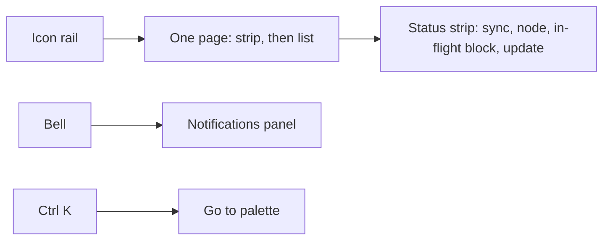
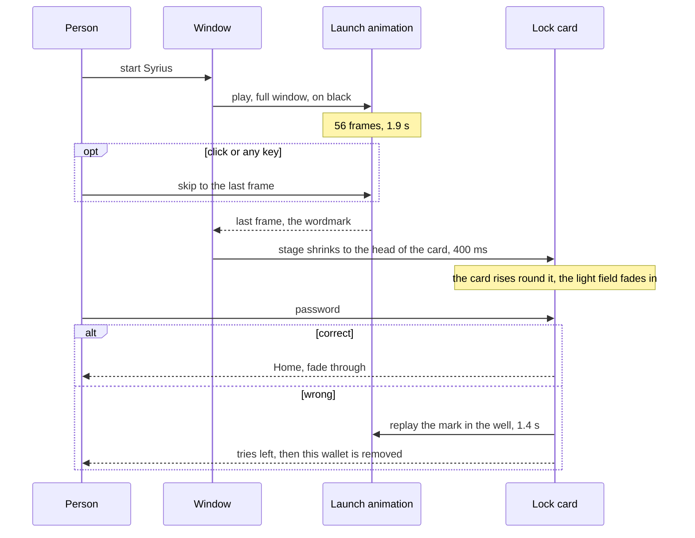

# Syrius desktop redesign: every screen

Mockups of the whole wallet on mockup B (the one the owner chose for Home),
drawn 2026-10-13 for review. The original HTML and reference images are
preserved; Flutter implementation and acceptance are recorded separately in
`PROMPT-redesign-build.md`. The owner's words that shape the references are
in `HANDOFF.md` (Task 7, 8, 9,
30, 31, 38, 39): redesign every page, keep Home, cut clutter, consolidate
where it makes sense, hide what is rarely used behind a button, plan the
motion, shaders, QoL and extension ports alongside, show dollar values as the
extension does, and keep the original Lottie animations as an homage to the
old Syrius, the launch animation most of all.

## How to look

- `index.html`: one page, 47 screens, a list on the left, dark and light
  toggle at the top. Each screen has notes under it: what is at rest, what is
  one click away, what moves, what was ported, what was dropped. Fonts are
  inlined from the home mockup; nothing is fetched.
- `shots/`: every screen at 1280 by 780, dark and light, `NN-<screen>-<theme>.png`,
  rendered by headless Chrome from the same page.
- The animations in the page are the wallet's own files, playing. Open a
  screen and they run; hover one to play it again. `art/` holds them
  (`python art.py` rebuilds it from `assets/lottie/`), `vendor/` holds the
  player, lottie-web 5.12.2 with its MIT licence.
- `src/`: the page in parts; `python build.py shots` rebuilds and re-renders.

The figures are examples, the dollar prices included. Balances show no
trailing zeros, as the owner asked.

## Settled by the owner, 2026-10-13

The seven questions of the first round, and the answers.

| # | Question | Answer | In the mockups |
|---|---|---|---|
| 1 | Pillars and Sentinels as one Nodes page with tabs | "keep one page" | Nodes, two tabs |
| 2 | Zap as Transfer's third tab, opened by Home's Zap button | "keep it this way" | As drawn |
| 3 | Connected sites inside Settings as Apps | "Okay" | Settings > Apps |
| 4 | Home's third action is Zap; Swap as a fourth pill or not | "No swap" | Send, Receive, Zap. Swap keeps its rail entry and Ctrl 7 |
| 5 | Staking and delegation stay apart | "okay" | Two pages |
| 6 | The wrong-password limit off by default | "wrong-password limit is on by default" | On, at 3. Settings > Security shows 3 selected; the lock screen counts the tries left |
| 7 | Dollar values | "Add dollar vallues like syrius extension" | See "Dollar values" below |

### Later brand-colour decision

For the Flutter implementation, the owner selected the brand colours in
`docs/design/RULES.md`: green `#00D557` and blue `#0061EB`. The original HTML
and reference PNGs retain their green `#4FD166` and blue `#006AFF` fills.
Preserve those references. The shared green also supplies the dark-theme ZNN
ink; the separately defined blue inks and light-theme green ink retain their
reference values for readability. Treat these selected colour changes as an
approved comparison exception. All other colours, layout, type, spacing,
icons and motion still require comparison in the running wallet. A
source-token check establishes no visual match.

## The shell

- **Rail**: 56 px of icons, labels as tooltips with their shortcut, a chevron
  that opens it to 200 px. The state is kept across restarts (declutter rule
  7). Settings > Display can make labels the default.
- **Status strip**: sync height, node, chain, peers; a block in flight
  ("Sending 12.5 ZNN, waiting for a momentum"); plasma generation with the
  original bolt, elapsed and typical time; the update line. It is the one
  place for background state.
- **Bell**: a dot for unseen items; the panel slides in over the page. What
  needs the user (a web app's connect request) is first; runs of the same event
  fold ("Block published × 6"). Toasts dismiss themselves with a draining bar,
  as the extension's do.
- **Go to** (Ctrl K): pages, actions, addresses and contacts. Ctrl 1 to 8 open
  the pages, Ctrl L locks, Ctrl R refreshes, Ctrl H hides balances, Ctrl ,
  opens Settings, Esc closes anything. This is what lets the rail stay small.

## Consolidation

Thirteen rail entries become eight pages plus the bell, Settings and Lock.

| Before | After | Why |
|---|---|---|
| Home | Home | Kept as chosen. Side cards are one line when empty; Pending shows only with a block in flight; Zap is the third action |
| Transfer (Send, Receive, Activity, To receive) | Transfer: one 640 px card, Send / Receive / Zap as a segment; To receive only with rows | Activity lives on Home (owner, 31). The QR is behind Show QR |
| Pillars | Nodes, Pillars tab | The strip is delegation; "Your pillar" appears in Pillar mode |
| Sentinels | Nodes, Sentinels tab | For anyone without a sentinel the page was a list with no action, so it does not earn a rail entry. "Your sentinel" leads the strip in Sentinel mode |
| Staking | Staking | Strip and list. New stake opens under the Stake button |
| Plasma | Plasma | Glow, strip, fused list. Fuse form and other addresses open on demand |
| Tokens | Tokens | One list with your balance as a column, so the Balances card goes. Owner actions open inside the row |
| P2P Swap | Swap | Strip and list; Start and Join are dialogs in the transfer shape |
| Accelerator | Accelerator | List with the vote bar in the row; a project opens by container transform |
| Connected sites | Settings > Apps | Three empty cards became one list and one switch. Approvals arrive in the bell |
| Notifications | The bell's panel | Owner, 31 |
| Settings | Settings | Seven sections, groups closed, every Confirm button gone |
| Splash, then Lock | Launch settles into the lock card | The launch animation's stage becomes the head of the card; see below |

## Page by page

| Screen | At rest | One click away | Dropped |
|---|---|---|---|
| Home | Hero with dollar values, Activity, To collect (one line, Collect all), Tokens closed, Pending while in flight | Address switcher, hide balances, token list, Message on a zap row | Refresh icons |
| Transfer | Send form with recent recipients; To receive with rows | Receive tab, QR, request an amount, Zap tab, address book | Activity, the always-open Receive card |
| Staking | Staked, to collect, week, Stake; stakes with unlock countdown | New stake form, reward chart | Empty Rewards card |
| Nodes | Delegation strip; Pillars list, five columns; Sentinels tab | Row details, sort, search, your pillar or sentinel panel, Spawn, reward chart | Rewards card, "Your pillar" for addresses without one |
| Plasma | Glow with level and fused QSR; available and fused strip; fused list with checkboxes | Fuse form, other addresses, batch cancel | Fuse form at rest, full beneficiary address |
| Tokens | Held / Favorites / All, search, one list | Row details, Mint, Burn, Transfer ownership, Flags; Create token stepper | Balances card |
| Swap | Active, completed, to reclaim; one list | Row details with deposit ID; Start and Join dialogs | |
| Accelerator | Fund, how many need your vote; Voting / Active / Mine / All | Project page with phases and the vote column; Donate; Create project | |
| Settings | Section menu; the open section's groups, closed | Each group | The second rail, Confirm buttons |
| Lock | The well with the wordmark, wallet, password, Unlock; update line | The wallet list, What changed | |
| Entry | Welcome with the globe and three rows; Import with any file; seed quiz of three words; Wallet ready over the map | | Six words placed by hand |

## The original animations

Nine Lottie files ship with the wallet. Eight came with Syrius 0.0.5 in April
2022 and one with 0.2.0 (`git log --diff-filter=A -- assets/lottie`). Two of
them, the globe and the bolt, are bundled and drawn nowhere today. The
redesign keeps all nine, as they are, and gives each one moment where it is
the largest thing on screen. None is redrawn, and none is shrunk into an icon
where it would turn to noise, which is what the owner disliked about the coin
at 64 px.

| Original | Since | Today | In the redesign | Screens |
|---|---|---|---|---|
| Launch: blue wireframe, green mark, chrome wordmark, 1.9 s | 0.0.5 | Full window at start, then a cut | Full window at every cold start, then its stage becomes the head of the lock card. The well replays the mark on a manual lock and on a wrong password. Replay button in the Originals card | `launch`, `launch-settle`, `lock-screen`, `lock-wrong`, `set-originals` |
| Globe, 30 s a turn | 0.0.5 | Bundled, unused | The left half of Welcome, turning slowly | `welcome` |
| Map with nodes lighting up, 6.4 s | 0.0.5 | "Wallet ready" | The same place, full window behind a glass card | `wallet-ready` |
| Pillar assembling, 2.8 s | 0.0.5 | Success step, pillar card | Full size on "Pillar registered"; once at 132 px when Your pillar opens; held at 48 px in the strip | `pillar-done`, `pillar-mine` |
| Sentinel, 2.3 s | 0.0.5 | Success step, sentinel card | Full size on "Sentinel registered"; at 48 px leading the strip | `sentinels` |
| ZTS coin closing from shards, 1.5 s | 0.0.5 | Tokens, success step, Accelerator | Leads the Tokens strip from the file built for that size; full size on "Token created" | `tokens`, `token-mine` |
| Eye | 0.0.5 | A card whose content is hidden | The control for hidden balances: it blinks while they are hidden, and its closing frames play as they come back | `home-hidden` |
| No-data mark | 0.0.5 | The QR card | Every empty list at 44 px with "None yet"; one-line empty cards at 16 px | `staking-empty` |
| Bolt tracing its outline, then filling, 2.7 s | 0.2.0 | Bundled, unused | The "generating plasma" mark in the status strip, for as long as the work runs | `plasma` |

### The Originals card, an easter egg

The owner, 2026-10-13: "Keep the Originals card as a secret easter egg deep
that can only be activated when the user accesses the license tab, scrolls to
the bottom, and enters 321 in a nondescript text box".

- Settings > About > Licences is a closed group like its neighbours. Open,
  it is the long list from Flutter's licence registry, every package and
  font the wallet ships.
- Under the last licence is one small field: no label, no placeholder, no
  tooltip, no button. It is not in Go to and no string names it.
- On the third digit of 321 the field empties and the Originals card rises
  under it: the six large animations as tiles that play on hover, where each
  lives now, the three small ones on one line, and a button that replays the
  launch full window. Anything else typed there does nothing at all.
- The card stays until Settings is left. Nothing is stored, so no file gives
  it away and it has to be found again each time. That last point is my
  choice; the owner did not say.

Screens `set-about`, `set-licences`, `set-originals`.

### Launch into lock

- The stage is black in both themes: the frames are drawn on black. In the
  light theme the well is a small black display on a light card, the way the
  plasma glow already sits in a dark round well in light.
- The transition is one container transform on the stage's rectangle,
  emphasized decelerate. The wordmark never leaves the screen, so the launch
  reads as the lock card arriving, not as a film before it.
- A manual lock (Ctrl L) does not play the full animation. The well replays
  frames 14 to 56, the mark and the wordmark.
- **Weight.** On disk the launch is one 10 MB file: 56 JPEG frames of 2560
  by 1440 wrapped in Lottie JSON, each shown for a thirtieth of a second. It
  is a slide show, not a vector animation. The Lottie player decodes every
  frame to raw pixels before it draws the first and holds them all until the
  last: 56 × 2560 × 1440 × 4 bytes is 826 MB of memory for about two seconds,
  then given back (`AppLottie` releases it). None of that is on disk; it is
  the wallet's memory at start.

  Measured 2026-10-13 from the shipped file with Pillow, not yet in the wallet:

  | Form | On disk | Held while it plays |
  |---|---|---|
  | Today: Lottie, every frame decoded up front | 10 MB | 826 MB |
  | Lottie with 1280 by 720 frames | 1.4 MB | 206 MB |
  | Animated WebP, 2560 by 1440, decoded a frame at a time | 1.1 MB | about 30 MB |
  | Animated WebP, 1920 by 1080 | 0.7 MB | about 17 MB |
  | Animated WebP, 1280 by 720 | 0.4 MB | about 7 MB |
  | Animated WebP, 640 by 360, for the well | 0.2 MB | about 2 MB |

  **Recommended: ship the launch as an animated WebP.** Flutter's own image
  codec plays one frame by frame (`ui.Codec.getNextFrame`), so the player
  holds the frame on screen and the one before it, never all 56, and the
  first frame draws at once instead of after the whole set is decoded. No
  package is needed. They are the same 56 pictures: the worst frame measures
  40 dB against its JPEG. Decoding a frame took 30 ms at 2560, 17 ms at 1920
  and 8 ms at 1280 in Pillow on this machine, against the 33 ms a frame is
  shown, so 1920 by 1080 for the window and 640 by 360 for the well. This
  changes the container of the launch only; the other eight stay Lottie
  files. The original JSON is kept as the master in `tool/lottie_masters/`
  (it is not there today: the shipped file is the only copy, in git since
  0.0.5), and `tool/lottie_reencode.py` writes the WebP from it.

  To prove in the wallet before it ships: the memory while it plays, frame
  times with `harness/h stalls`, and the dark gradients by eye for banding.
- In Flutter: `AppLottie(AppLottieAsset.splash, controller: …)` inside a
  `ClipRRect` and an `OverflowBox`, the stage's rect driven by one
  `AnimationController`; `PageTransitionSwitcher` is not needed because the
  lock card is under the stage from the first frame.

### Rules for the rest

- An object animation plays once when its surface appears and holds its last
  frame. It plays again on hover. It never loops beside money.
- The three loops are the globe, the map and the bolt, and each is on a
  screen with no amounts (Welcome, Wallet ready) or is the indicator itself.
- Below about 40 px an object is not drawn at all; the strip uses 48 px, from
  the `_small` file with mipmaps.
- The plasma page's large mark stays the heatmap glow the owner asked for
  (Task 13, 28). The original bolt is the small generating mark, so the two
  do not compete.

## Dollar values

As the Syrius browser extension does it:

| | |
|---|---|
| Source | CoinGecko's public price endpoint, ids `zenon-2` and `quasar`, one request for both |
| When | Once a minute, only while a screen that shows a value is open. A failed request keeps the last answer |
| Which chain | Mainnet's price on every chain, as the extension's dashboard does now |
| Format | `$746.79`; four decimals under a dollar, `$0.5704`; `≈` in front of a sum or an estimate |
| Look | Dim, mono, 13 px, after the coin amount. The coin is the headline, never the dollars |
| Hidden balances | Dots, with everything else |
| Other tokens | No price, so no value |

Where they show: each balance in the Home hero with the two together under
them; To collect on Home; the line under the amount on Send; the Zap form;
staked and to collect on Staking; to collect on Nodes; under each amount in
Start swap. Not in tables: a column of estimates beside a column of amounts
is the clutter the owner asked to remove.

One addition to the extension: a switch, Settings > Display > Dollar values,
on by default. The extension has none. A desktop wallet making a request to a
third party should be able to stop making it.

## Motion

From `docs/flutter-dev-practices.md` section 5 and the stack decisions in
`docs/research/modern-flutter-stack.md`. Every animation runs, always.

| Effect | Where | Timing | How |
|---|---|---|---|
| Launch settles into the lock card | Cold start | 400 ms, emphasized decelerate | One controller on the stage's rect; see above |
| Page change: fade through, rise 6 px | Rail pages | 320 ms, spring `(.2,.8,.2,1)` | `RiseSwitcher` (exists), `FadeThroughTransition` from `animations` |
| Rail open and close | Shell | 200 ms spring on width, labels fade 150 ms after | `AnimatedContainer` plus `AnimatedOpacity` |
| Segment thumb slides | Send / Receive / Zap, Held / Favorites / All, every segment | 360 ms, `(.65,0,.35,1)` | One thumb widget, `AnimatedPositioned` |
| Disclosure opens | New stake, Fuse form, row details, Settings groups, Other addresses | 240 ms slide down 8 px, chevron turns 220 ms | `Expansible` (SDK), `AnimatedRotation` |
| A value changes | Balance, plasma level, to collect, a row that arrives | One flash, 1.2 s | `ValueFlash` (exists); new row rises 6 px over 320 ms |
| List entrance | Welcome rows, first paint of a list | 40 ms stagger, once | `flutter_animate` `.fadeIn().slideY()` with `interval` |
| Primary pill sheen | Send, Collect, Stake, Fuse, Zap: on hover and once when the action lands | 600 ms pass | Gradient transform on the button's own paint (effect 2); no shader mask |
| Stepper steps | Spawn pillar, Create token, onboarding | Shared axis, 300 ms | `SharedAxisTransition` from `animations` |
| Row opens into a page | Accelerator project | Container transform, 300 ms | `OpenContainer` from `animations` |
| Panel and dialogs | Bell panel, Go to, confirms | Panel slides in 24 px over 240 ms; dialog rises 6 px | `AnimatedSlide`; frosted backdrop (effect 4) |
| Toast | Any event | Rises 300 ms; bar drains over 5 s; hover pauses | The banner's controller (K14, built) |
| Zap arrived | Home | 28 sparks, 900 ms, once per hash | `flutter_animate` custom effect on a `CustomPaint`; seen hashes in a Hive box |
| Object assembles | Your pillar, your sentinel, Tokens, the three success steps | Its own length, once; again on hover | `AppLottie(repeat: false)`; starts when the block is confirmed |
| The eye | Hide and show balances | Its closing and opening frames, 0.5 s | `AppLottie` with a controller, segments 0 to 30 and 200 to 232 |
| The bolt | Status strip while plasma is generated | Loops, 2.7 s | `AppLottie`, kept loaded: it is 4 KB |
| Wrong password | Lock card | Field shakes 4 px twice, 200 ms; the well replays | `flutter_animate` `.shake()` |
| Sync dot | Strip | 2.4 s pulse, continuous | `AnimatedContainer` in a `RepaintBoundary` |
| Skeleton sweep | Every loading list | 1.4 s, in step across the page | `dart:ui` gradient on `Skeleton` (effect 3) |

Not animated: amounts never roll or count; tables never shuffle; nothing on
money moves except the one flash that reports a change.

## Shaders

Four, all through `flutter_shaders` 0.1.5 or the SDK, written for OpenGL ES
and tried on Windows first.

| # | Where | What | State |
|---|---|---|---|
| 1 | Home hero, lock screen, Welcome | A slow field of green, blue and pink light under the card colour, drifting; low contrast so the balance does not move | Built as the hero field (handoff 5h); the entry screens reuse it |
| 2 | Plasma page | The heatmap glow on plasma pink and QSR blue, breathing while idle, brighter while generating | Built (5d); colours per Task 28 (5g) |
| 3 | Plasma meter, hero meter | Scrolling noise in QSR blue while plasma is generated, still when idle | Built (the meter's flow) |
| 4 | Bell panel, Go to, dialogs, menus, the lock and ready cards | Frosted backdrop: `BackdropFilter` blur in a `ClipRect`, one `BackdropGroup` when several share a backdrop | Not started (the "frost") |

The light sheen on pills is a gradient, not a shader. Glass is the SDK's blur.
Each shader sits in a `RepaintBoundary`, runs on one ticker and stops when its
page is hidden or the window loses focus.

## QoL and extension ports, placed

Numbers refer to `docs/research/extension-parity.md` (P) and
`docs/research/qol-ideas.md` (Q).

| Feature | Where in the mockups | Source |
|---|---|---|
| Zap: send, receive, celebrate once, row label, Message button | Transfer's Zap tab, Home's third action, "A zap arrived", the bell | P10, `zap.md` |
| Dollar values | Home, Send, Zap, Staking, Nodes, Start swap; Settings > Display | P22, owner's answer 7 |
| Update notice from GitHub releases, tells never installs | Status strip, lock screen, Settings > About, Settings > Node (embedded node card, built) | P1, `update-detection.md` |
| Address book and recent recipients | Send's book icon and Recent chips; Settings > Addresses > Contacts; Go to | P2, Q9 |
| Settings apply when chosen | Every segment and switch in Settings | P3, Q3 |
| Notifications and rows say what moved | "Incoming 250 ZNN from z1…", "Sent 12.5 ZNN to Alice, confirmed in momentum…", rows named Delegated, Fused, Reward, Zap | P4, P5, Q5, Q11 |
| Explorer links follow the chain; explorer is a setting | The link icon on every row; Settings > Display | P6, Q8 |
| Hide balances | The eye in the hero, Ctrl H; Settings > Display | P7, Q13 |
| A block followed to its momentum, no 31 s timer | Pending card on Home, the strip's in-flight chip, the confirm dialog's note | P8, Q10 |
| Operator modes with Auto / On / Off | Nodes strip (Pillar, Sentinel), Settings > Node > Sporks, Settings > Wallet > Modes | P9, `wallet-selection-and-modes.md` |
| Wallet picker at unlock, Add a wallet | Lock screen; Settings > Wallet > Wallets on this computer | P11, item 6 |
| Plasma generation: elapsed and typical time | Status strip on Plasma, with the bolt | P12, Q14 |
| Password rule stated | Onboarding (not drawn as a screen; the rule is one line under the field) | P13 |
| Stalled chain named | Strip dot amber, "Node is 42 momentums behind" above Send | P14, Q7, Q12 |
| Delegate: sort by weight, APR, production; APR per pillar | Nodes list sort chip and APR column | P15, Q17 |
| Batch cancel of fuses | Plasma checkboxes, "Cancel 2 fuses" | P16 |
| Seed quiz: three words, four choices | Entry | P17 |
| Loading says so after 3 s, skeleton sweep | Every list | P18, Q15 |
| Pillar revoke asks twice | Disassemble in the pillar panel | P19 |
| Sporks page, read first | Settings > Node > Sporks group (closed) | P21 |
| Wrong-password limit, on by default, counted down | Settings > Security at 3; the lock screen says the tries left and what follows | Owner's answer 6; it sets aside Q1's "off by default" |
| Delete cache keeps labels, contacts, favourites | Settings > Wallet | Q2 |
| Look-alike and first-time recipient warning | Send | Q4 |
| Keyboard shortcuts and Go to | Shell | Q6 |
| Windows Hello / Touch ID | Settings > Security row, marked later | Q19 |
| Receive button blocked while a receive runs | To receive on Transfer | Task 37 |
| Any file accepted on import | Entry | item 11, done |

Not placed: the transaction journal (P23), vanity token ids (P24), export of
history (Q18).

## Open

1. Hidden balances hide the Activity amounts too. The extension hides the
   balances and their dollar values only. I chose the wider reading because
   the stated use is sharing a screen.
2. On a wrong password the lock screen says "then this wallet is removed from
   this computer", and the limit is counted per wallet. Both follow from the
   wallet picker; today the count is global.
3. The launch plays on every cold start and can be skipped. A setting to play
   it once a day, or never, is not drawn.
4. The launch as an animated WebP instead of a Lottie file (see Weight). It
   is the same pictures in another container; the owner asked that the
   original Lottie animations be preserved, so this one is theirs to decide.
5. Whether the Originals card, once found, stays found.

## Not drawn

Update pillar, Spawn sentinel, Create phase, Donate and Create project steppers
(same shape as Spawn pillar); "Sentinel registered" and "Token created" (same
shape as "Pillar registered"); Join swap (Start swap with a deposit ID field);
the Add node row; Sign, Verify, Change password, Seed Vault export opened; the
Sporks group opened; the Ledger flow; the reward charts; the WalletConnect
pairing dialog; the 1200 by 600 window; Arabic layout. Each follows a pattern
that is drawn.
